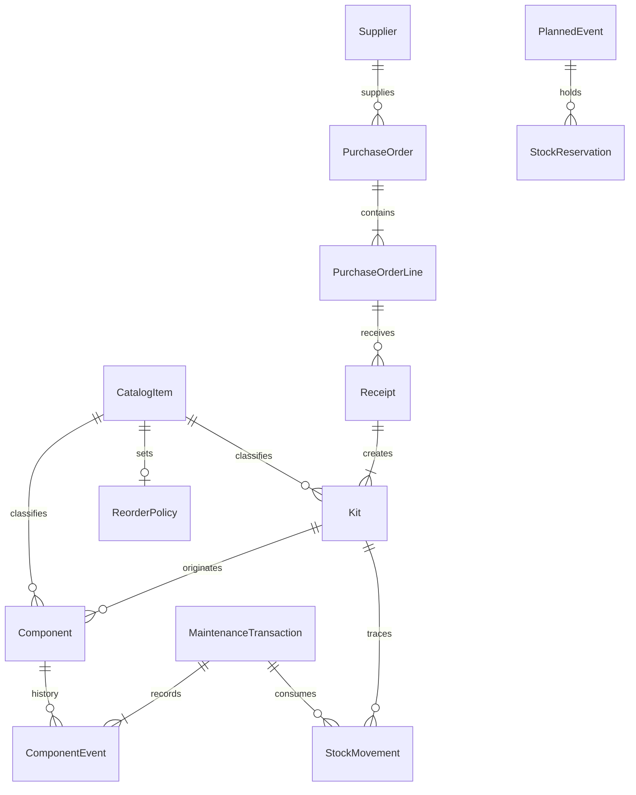
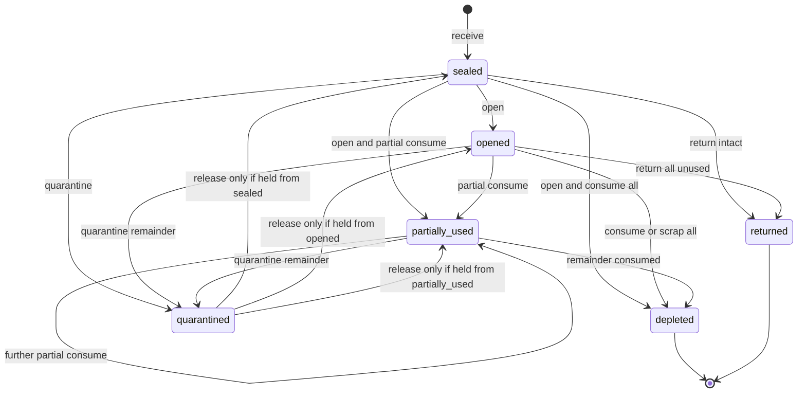
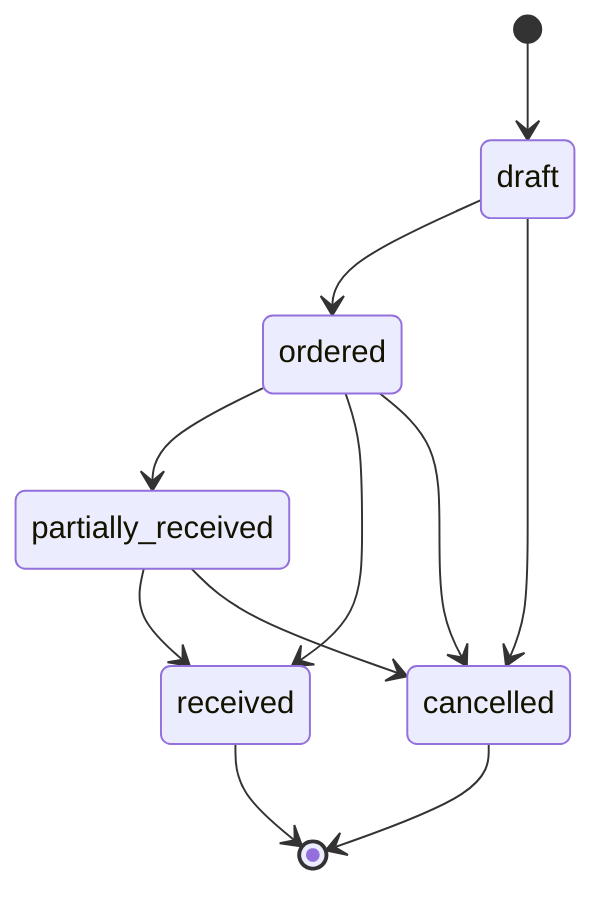
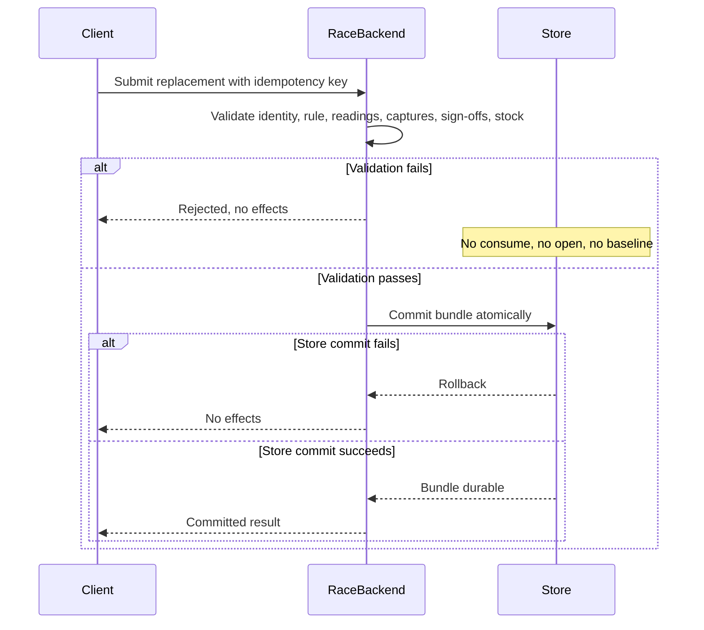

# Inventory specification

Status: documentation only. This is the stack-agnostic contract for inventory, purchasing, and the stock side of a completed maintenance transaction.

Vehicle and use: one-car team, 2004 Nissan 350Z, NASA and SCCA road-course events. Failure prevention is the priority. Snapped wheel studs are a known safety-critical failure mode. Records start empty. Historical maintenance is not invented to fill the system.

Sources: `PROJECT_HANDOFF.md` and `README.md`. Where those documents require a fact this file does not have, the value is **UNKNOWN**. UNKNOWN means the team must supply it from verified specifications, team engineering policy, applicable racing rules, or a documented failure investigation. It does not mean zero, and it does not mean healthy.

This file does not choose a language, database, host, or migration tool. Phase 1 maps the logical types below onto whatever stack it selects. Race Backend is the server-side component that validates and commits maintenance and inventory writes. It must implement the contract in [Atomic replacement](#11-atomic-replacement). This document does not implement that contract.

## 1. Scope

In scope:

- Identity separation for catalog part, physical component, sealed kit or stock unit, and installation or removal history.
- Sealed wheel-stud sets of five, including state, partial use, and traceability.
- An append-only stock-movement ledger and on-hand quantities derived from it.
- Reorder policy, early reorder warnings, and stock reserved for events.
- The all-or-nothing commit that consumes stock together with the maintenance record and the service baseline.
- Suppliers, purchase notes, purchase orders, lead times, and receiving into new kit identities.
- Inputs an event-readiness forecast needs, and the rule that a forecast is an estimate.

Out of scope:

- Application code, schema migrations, and stack selection.
- Approved replacement intervals, torque, inspection limits, and measurement limits.
- A full service-rule catalog. Rules are referenced only where a commit must read them.
- The offline sync protocol. Stable ids and idempotency are specified so a future queue can replay a commit. Sync itself is not claimed.
- User-account storage. Actors are `user_id` values owned by the authentication system.
- Certifying that the car is safe to race. Software status is a record, not a certification.

## 2. How to read this document

Normative words:

- **MUST** and **MUST NOT** are requirements on Race Backend and on any schema Phase 1 aligns to this contract.
- **MAY** is an allowed behavior.

Logical types, mapped by Phase 1:

| Type | Meaning |
| --- | --- |
| `id` | Stable opaque identifier. Unique inside its entity. Immutable. Generation method is an implementation choice. An `id` is never a catalog part number. |
| `ref(X)` | Reference to `X`'s id. The target must exist when the referencing row commits, unless the field is optional and empty. |
| `string` | Short text. |
| `text` | Long text. |
| `integer` | Whole number. |
| `decimal` | Exact decimal quantity. Scale is UNKNOWN unless a constraint below fixes it. |
| `boolean` | True or false. |
| `timestamp` | Instant with a timezone. |
| `date` | Civil date, with no time of day. |
| `enum(...)` | One of the named values. |

Requirement column:

| Mark | Meaning |
| --- | --- |
| R | Required on every persisted row. |
| O | Optional. Empty means unknown or not applicable, never a fabricated default. |
| C | Required only when the condition in Constraints holds. |
| D | Derived. Not an editable source of truth. A cache is allowed only if a disagreement with the derivation is treated as a defect. |

Column defaults that invent a quantity are forbidden. In particular, minimum stock, desired stock, lead time, order quantity, and on-hand quantity have no numeric default. Empty policy is `null`, and `null` is not `0`. A stored `0` is allowed only when a person explicitly records zero.

No field in this specification is pre-filled with a part number, supplier name, lead time, reorder point, interval, torque, or stock quantity.

## 3. Prototype boundary

`index.html` is a throwaway local prototype. It is not a schema to extend.

What it gets wrong for inventory:

- One stock row can stand for several sealed sets. A single kit/stock id carries an editable `qty`. The illustrative seed does this with a quantity greater than one. A sealed set of five needs its own kit id. Quantity of sets is how many kit rows exist, not a number on one row.
- The part description and the kit id share one form. Catalog identity and stock identity are different concepts.
- There is no component id and no installation or removal record.
- Adding stock overwrites a quantity and appends a local activity string. There is no append-only ledger, no receive movement, and no link from consumption to a validated maintenance transaction.
- Reorder is one number on the stock row. The form also ships with a numeric reorder default. That default is not team policy and must not become a column default.
- Browser local storage, including the demo seed, is not production stock. Production starts with no stock rows and no historical installs.

The prototype's unit label for a five-stud set matches the documented packaging. Its data shape does not. Do not design the schema around that shape.

## 4. Identity model

These four identities stay distinct. No table, column, or screen may use one of them as a substitute for another.

| Concept | Entity | What it identifies |
| --- | --- | --- |
| Catalog / part number | `CatalogItem` | The approved kind of part. Many physical parts share one catalog item. |
| Component ID | `Component` | One physical component or assembly. |
| Kit / stock ID | `Kit` | One sealed kit or other stock unit. For wheel studs, one sealed set of five. |
| Installation / removal record | `ComponentEvent` | What happened to one physical component on the car: installed or removed. |

A part number does not identify which set a stud came from. A kit id does not identify which wheel a stud is in. An installation record does not become a new catalog item. Replacing a component creates new events; it does not reuse the removed component's id for the new part.

Traceability that must be reconstructable for an installed wheel stud:

`ComponentEvent` → `Component` → origin `Kit` → `receive` movement → `Receipt` → `PurchaseOrderLine` / supplier.

The catalog part number is snapshotted on the event so a later catalog edit does not rewrite history.

## 5. Wheel-stud product facts

The only packaging quantity this specification fixes is the documented one: wheel studs are stocked in **sealed sets of five**.

That number is packaging. It is not a replacement interval, not a torque, not a reorder point, not a count of wheels, and not the number of studs a work order must install. How many studs a given replacement consumes is UNKNOWN until an approved rule or the validated transaction states it. Set size must not be copied onto unrelated catalog items as a default.

`CatalogItem.profile = wheel_stud_set` applies all of the following:

- `tracking_class = sealed_kit`
- `nominal_set_size = 5`
- `individual_tracking = on_open`
- `safety_critical = true`
- Silent mixing is forbidden. See [Mixing](#84-mixing).

Any other profile uses only the values the team stores on that catalog row. `nominal_set_size` for a non-stud item is UNKNOWN until supplied. It must not default to 5.

## 6. Shared enumerations

### 6.1 `tracking_class`

| Value | Meaning |
| --- | --- |
| `sealed_kit` | On-hand complete stock is counted in whole kits. Each kit has its own id. |
| `serialized` | Each physical item is a `Component`. A kit is optional. Behavior beyond identity is UNKNOWN until a later spec. |
| `bulk` | Ledger quantity without a sealed-set identity. Piece-level kit rules do not apply. |

Wheel studs use `sealed_kit`. This document fully specifies sealed-kit behavior for `profile = wheel_stud_set`. `serialized` and `bulk` exist so the catalog can record other parts without pretending they are five-stud sets. Their movement details beyond the shared ledger fields are UNKNOWN.

### 6.2 Kit `state`

| Value | Meaning |
| --- | --- |
| `sealed` | Seal intact. Counted as one complete sealed set. Pieces are not individually issued. |
| `opened` | Seal broken by an `open` movement. No piece from this kit has been consumed. Counted as loose remainder, not as a complete sealed set. |
| `partially_used` | At least one piece has been consumed, and at least one piece remains available to install. |
| `depleted` | No available unissued piece remains, and the remainder is not sitting in kit-level quarantine. The row is kept. |
| `quarantined` | The whole kit, or the entire remainder, is held and unavailable. |
| `returned` | The set or its unused remainder left team control back to the supplier. Terminal. |

`opened` means "no consume yet," not "five pieces are necessarily still available." A piece-level quarantine or loss adjustment can lower the available remainder while the kit stays `opened`. The ledger records the cause. The state name alone must not be read as a consumption.

### 6.3 Allowed kit transitions

A transition persists only inside a committed movement transaction. A failed or abandoned attempt leaves the previous state.

| From | To | When |
| --- | --- | --- |
| (none) | `sealed` | `receive` of a new kit id |
| `sealed` | `opened` | `open`, and no piece is consumed in that commit |
| `sealed` | `partially_used` | `open` and a partial `consume` in the same commit |
| `sealed` | `depleted` | `open` and a `consume` of every piece in the same commit |
| `sealed` | `quarantined` | kit-level `quarantine` |
| `sealed` | `returned` | `return` of the intact set to the supplier |
| `opened` | `partially_used` | first `consume` of one or more, but not all, remaining available pieces |
| `opened` | `depleted` | `consume` or scrapping adjustment that leaves nothing available and nothing held |
| `opened` | `quarantined` | kit-level quarantine, or piece-level holds that cover every remaining piece |
| `opened` | `returned` | every piece is returned to the supplier and none was consumed |
| `partially_used` | `partially_used` | further partial `consume` or piece-level hold, with available remainder still above zero |
| `partially_used` | `depleted` | last available pieces consumed or scrapped, none left in quarantine |
| `partially_used` | `quarantined` | remaining pieces quarantined as a kit |
| `quarantined` | the stored `quarantine_from_state` | `release_quarantine` |
| `depleted` | (none) | terminal |
| `returned` | (none) | terminal |

Forbidden:

- Any path back to `sealed`. A broken seal cannot be restored in the record.
- `release_quarantine` to a state other than `quarantine_from_state`.
- `depleted` or `returned` back into available stock.
- Replacing the kit id, splitting one sealed set across two kit ids, or merging leftovers into a new kit id.

### 6.4 Component `status`

Projection of component events plus piece-level stock movements. Required values: `contained`, `installed`, `removed`, `held`, `quarantined`, `scrapped`, `returned`.

`held` means the component is in team possession and is not installable. A removed stud uses `held` until a verified reuse policy exists. That policy is UNKNOWN. Until it exists, no disposition may move a removed stud back to `contained`.

### 6.5 Movement `type`

| Value | Effect on quantity | Service baseline |
| --- | --- | --- |
| `receive` | Creates one new kit in `sealed`. | Unchanged. |
| `open` | Reclassifies that kit from complete sealed set to loose remainder. Piece count is conserved. | Unchanged. |
| `consume` | Removes pieces from a kit to put them in service. | Updated only inside the replacement bundle in [section 11](#11-atomic-replacement). |
| `adjust` | Correction, loss, or found-damage quantity change, with a reason. | Unchanged. |
| `return` | Sends stock back to the supplier, or records a return-to-hold that stays non-installable. | Unchanged. |
| `quarantine` | Removes stock from available counts. Does not destroy history and is not consumption. | Unchanged. |
| `release_quarantine` | Inverse of a kit-level quarantine. Returns the kit to `quarantine_from_state`. | Unchanged. |

`open` is justified because sealed-set counts and loose remainder must move together under an audited actor. Without it, opening a box would look like a loss or would leave the set falsely complete.

`quarantine` is justified because a held set must disappear from available stock without looking like a consumed replacement and without resetting an interval.

Reservations are not movement types. They change availability, not physical on-hand. See `StockReservation`.

### 6.6 Other enumerations

- Catalog `status`: `draft`, `approved`, `retired`.
- Purchase note `status`: `open`, `promoted`, `closed`.
- Purchase order `status`: `draft`, `ordered`, `partially_received`, `received`, `cancelled`.
- Reservation `status`: `active`, `released`, `consumed`, `cancelled`.
- Exception `status`: `authorized`, `consumed`, `revoked`.
- Maintenance transaction `kind`: `replacement`, `inspection`, `removal_without_install`.
- Maintenance transaction `status`: `draft`, `committed`, `rejected`.
- Planned event `status`: `planned`, `cancelled`, `completed`.
- Location `kind`: `shop`, `transport`, `event`, `quarantine_hold`, `other`.
- Evidence `kind`: `photograph`, `measurement`, `written_observation`, `other`.
- Removal `reason_code`: `failure`, `other`.
- Disposition `code`: `scrapped`, `quarantined`, `retained_for_investigation`, `returned_to_supplier`, `returned_to_stock`, `other`.
- Idempotency `scope`: `maintenance_transaction`, `stock_movement`, `receipt`.
- Idempotency `status`: `in_flight`, `committed`, `rejected`.

`failure` exists because studs have snapped and that reason must be representable. A finer failure taxonomy is UNKNOWN. Details go in text, not in invented cause codes.

`returned_to_stock` records intent only. It does not make the component installable while reuse policy is UNKNOWN.

## 7. Entities and fields

Actor ids point at the authentication system. This specification does not define the user table. Server-side authorization decides whether that actor may perform the write. A client-supplied on-hand quantity is ignored.

### 7.1 `Vehicle`

The team has one car. The row exists so history names the car explicitly. Documented identity is a 2004 Nissan 350Z. VIN, competition number, and class identifiers are UNKNOWN. Do not invent them.

| Field | Type | Req | Constraints | Meaning |
| --- | --- | --- | --- | --- |
| `vehicle_id` | id | R | Immutable, unique. | Internal identity. |
| `model_year` | integer | R | Documented value 2004. | Model year. |
| `make` | string | R | Documented value Nissan. | Make. |
| `model` | string | R | Documented value 350Z. | Model. |
| `vin` | string | O | Empty until the team records the real VIN. | Chassis identifier. |
| `competition_number` | string | O | Empty until recorded. | Event number. |
| `notes` | text | O | | Team notes. |

### 7.2 `CatalogItem`

The type of part. Installation stores `catalog_item_id` as a snapshot reference; later edits do not change past events.

| Field | Type | Req | Constraints | Meaning |
| --- | --- | --- | --- | --- |
| `catalog_item_id` | id | R | Immutable, unique. | Internal identity. Not the part number. |
| `part_number` | string | R | Non-empty. Unique together with `revision` among rows that are not `retired`. The wheel-stud value is UNKNOWN. | Approved catalog / part number. |
| `revision` | string | R | Non-empty. The source revision label. UNKNOWN until the approving document is recorded. | Revision of this catalog row. |
| `description` | string | R | Non-empty. | Human description. |
| `profile` | enum | R | `wheel_stud_set` or `none`. | Applies the wheel-stud rules when set. |
| `tracking_class` | enum | R | See [6.1](#61-tracking_class). Must be `sealed_kit` when profile is `wheel_stud_set`. | How stock identity works. |
| `nominal_set_size` | integer | C | Required when `tracking_class` is `sealed_kit`. Immutable. Must be 5 when profile is `wheel_stud_set`. No default for other profiles. | Pieces in one sealed kit. |
| `individual_tracking` | enum | R | `none`, `on_open`, `always`. Wheel-stud profile must be `on_open`. | When component ids are allocated. |
| `safety_critical` | boolean | R | Wheel-stud profile must be true. | Safety-critical kind of part. |
| `set_unit_name` | string | C | Required for `sealed_kit`. | Name of one whole kit, such as the team's words for a sealed set. |
| `piece_unit_name` | string | C | Required for `sealed_kit` and `bulk`. | Name of one piece. For wheel studs, a stud. |
| `status` | enum | R | `draft`, `approved`, `retired`. New rows start as `draft` only by an explicit save, not by receiving them. | Approval state. |
| `approval_source` | string | C | Required when `status` is `approved`. | Document that approves this part number and revision. |
| `supersedes_catalog_item_id` | ref(CatalogItem) | O | Must not form a cycle. | Prior catalog row this one replaces. |
| `notes` | text | O | | |
| `created_at` | timestamp | R | Server time. | |
| `created_by` | ref(user) | R | | |
| `updated_at` | timestamp | R | Server time. | |
| `updated_by` | ref(user) | R | | |

Only `approved` catalog items may be received into stock or installed. Retiring a catalog item does not delete kits, components, or history.

A wheel-stud install must use the catalog item the approved rule names. Cross-item substitution is rejected. Whether two stud part numbers are interchangeable is UNKNOWN.

### 7.3 `Location`

| Field | Type | Req | Constraints | Meaning |
| --- | --- | --- | --- | --- |
| `location_id` | id | R | Immutable, unique. | |
| `name` | string | R | Non-empty. Unique among active locations. Actual names are UNKNOWN. | Storage place. |
| `kind` | enum | R | See [6.6](#66-other-enumerations). | Coarse class. |
| `active` | boolean | R | | Inactive locations cannot be newly assigned. |
| `notes` | text | O | | |

### 7.4 `Kit`

One stock identity. For a wheel-stud set, the row is one sealed set of five, never a stack of sets.

There is no editable `qty` on this entity.

| Field | Type | Req | Constraints | Meaning |
| --- | --- | --- | --- | --- |
| `kit_id` | id | R | Immutable, unique, never reused. | Kit / stock ID. |
| `catalog_item_id` | ref(CatalogItem) | R | Immutable. Target must be `approved` at receive time. | What this set is. |
| `nominal_contents_count` | integer | R | Immutable. Copied from the catalog item at receive. Must be 5 for `wheel_stud_set`. | Pieces the sealed unit contains. |
| `state` | enum | R | See [6.2](#62-kit-state). Changes only through movements. | Current kit state. |
| `quarantine_from_state` | enum | C | Required when `state` is `quarantined`. Otherwise empty. Allowed values: `sealed`, `opened`, `partially_used`. | State to restore on release. |
| `kit_label` | string | O | Unique if present. Format is UNKNOWN. Not a part number. | Human label printed or written on the set. |
| `location_id` | ref(Location) | O | | Where the kit is stored. |
| `supplier_id` | ref(Supplier) | C | Required when the kit was received from a supplier. | Source supplier. |
| `purchase_order_line_id` | ref(PurchaseOrderLine) | O | | Line this set was ordered on, if any. |
| `receipt_id` | ref(Receipt) | R | Immutable after receive. | Receipt that created the kit. |
| `received_at` | timestamp | R | Server time of the committed receipt. | |
| `seal_intact` | boolean | D | True only when `state` is `sealed`, or `state` is `quarantined` and `quarantine_from_state` is `sealed`. | Projection of seal. |
| `opened_at` | timestamp | C | Required once an `open` movement has committed. | |
| `opened_by` | ref(user) | C | Required together with `opened_at`. | |
| `open_reason` | text | C | Required together with `opened_at`. Non-empty. | Why the seal was broken. |
| `notes` | text | O | | |

Derived, not stored as authority:

| Attribute | Derivation |
| --- | --- |
| `unissued_pieces` | `nominal_contents_count` minus pieces that have left the kit on a committed `consume`, `return`, or negative `adjust`. While `sealed`, this equals `nominal_contents_count` because pieces cannot leave before `open`. |
| `available_pieces` | Unissued pieces that are not piece-quarantined and not on a kit in `quarantined`, `depleted`, or `returned`. |
| `complete_sealed_set` | 1 when `state` is `sealed`, otherwise 0. |

For a wheel-stud kit, `available_pieces` while `sealed` is not loose stock. The set counts as one sealed set. Loose stock starts at `open`.

### 7.5 `Component`

One physical part. Wheel-stud component rows are created when the kit is opened (`individual_tracking = on_open`), before any stud from that kit is installed or left as identified loose remainder. A sealed kit has no component rows yet. The kit id is the identity until the seal is broken.

Opening a wheel-stud kit creates one component row per piece in the sealed set: `nominal_contents_count` rows, which is 5. No piece has been issued yet. Each row's `origin_kit_id` is that kit.

| Field | Type | Req | Constraints | Meaning |
| --- | --- | --- | --- | --- |
| `component_id` | id | R | Immutable, unique, never reused. | Component ID. |
| `catalog_item_id` | ref(CatalogItem) | R | Immutable. Matches the origin kit's catalog item. | Part type. |
| `origin_kit_id` | ref(Kit) | C | Required for pieces from a sealed kit. Immutable. | Kit this physical part came from. |
| `identity_source` | enum | R | `team_assigned` or `manufacturer_marked`. | Whether the id is the team's or a mark found on the part. Which source wheel studs actually have is UNKNOWN. |
| `manufacturer_mark` | string | O | Empty when no mark was observed. Never invented. | Mark read from the part. |
| `status` | enum | D | See [6.4](#64-component-status). | Projection. |
| `created_at` | timestamp | R | | |
| `notes` | text | O | | |

Current vehicle position is not a field on `Component`. It is the position on the latest `installation` event that has no later `removal` for that component.

`origin_kit_id` never changes. There is no transfer onto another kit.

### 7.6 `ComponentEvent`

An installation or a removal of one component. This is the installation/removal record. It is not a catalog row, not a kit, and not the component itself.

Events are immutable. A correction is a later event or a later maintenance transaction, not an edit.

Shared facts about the job (readings, procedure, technician, sign-off) live on `MaintenanceTransaction` and are copied onto the event as a snapshot so the component history still reads correctly if the transaction representation changes.

| Field | Type | Req | Constraints | Meaning |
| --- | --- | --- | --- | --- |
| `component_event_id` | id | R | Immutable, unique. | |
| `maintenance_transaction_id` | ref(MaintenanceTransaction) | R | A committed `replacement` or `removal_without_install`. A draft must not own events. An `inspection` does not own installation or removal events. | Parent transaction. |
| `component_id` | ref(Component) | R | Immutable. | The physical part. |
| `catalog_item_id` | ref(CatalogItem) | R | Snapshot of the approved part used. | Part number identity at the time. |
| `origin_kit_id` | ref(Kit) | C | Snapshot. Required when the component has an origin kit. | Kit lineage at the time. |
| `vehicle_id` | ref(Vehicle) | R | | Car. |
| `event_kind` | enum | R | `installation` or `removal`. | |
| `vehicle_position` | string | C | Required for `wheel_stud_set`. Must match a configured position code. The code list is UNKNOWN. | Position on the car. |
| `occurred_at` | timestamp | R | Server commit time. | When the record committed. |
| `lap_reading` | integer | C | Snapshot from the transaction. Required when the parent is a `replacement` and the approved rule uses laps. Null on `removal_without_install` means not recorded, not zero. | Laps at the job. |
| `engine_hour_reading` | decimal | C | Snapshot from the transaction. Required when the parent is a `replacement` and the approved rule uses engine hours. Null on `removal_without_install` means not recorded, not zero. Scale UNKNOWN. | Engine hours at the job. |
| `removal_reason_code` | enum | C | Required when `event_kind` is `removal`. `failure` or `other`. | Why it came off. |
| `removal_reason_detail` | text | C | Required when `event_kind` is `removal`. Non-empty. | Observed reason, in the technician's words. |
| `disposition` | enum | C | Required when `event_kind` is `removal`. See [6.6](#66-other-enumerations). | What was done with the removed part. |
| `disposition_notes` | text | C | Required when `disposition` is `other`. | |
| `paired_event_id` | ref(ComponentEvent) | O | If set, the other side of a replacement: the removal pairs with the installation, or the reverse. | Links old and new component history. |
| `procedure_source` | string | C | Required on events whose parent is a `replacement`. Snapshot, non-empty in that case. Optional on `removal_without_install`; empty means no procedure was recorded. | Procedure document. |
| `procedure_revision` | string | C | Required together with `procedure_source`. | Procedure revision. |
| `measurement_capture_ids` | list of id | R | Empty when the parent is `removal_without_install` or the approved rule requires none. A `replacement` that omits captures the rule requires fails validation. Captures live on the parent transaction. | Measurements for this component. |
| `inspection_capture_ids` | list of id | R | Same emptiness rule as `measurement_capture_ids`. | Inspections for this component. |
| `technician_user_id` | ref(user) | R | Snapshot of the actor who committed the job. | Technician. |
| `notes` | text | O | | |

Measurements and inspection results are the structured captures on the parent transaction (section 7.19). The required set is UNKNOWN until the rule exists. Missing captures that the rule requires fail the commit.

Old and new component ids are the `component_id` values on the paired removal and installation events of one replacement transaction.

### 7.7 `FailureEvidence`

Captured when a removal reason is `failure`, including a snapped stud. The minimum set of photos or measurements beyond a non-empty capture is UNKNOWN.

| Field | Type | Req | Constraints | Meaning |
| --- | --- | --- | --- | --- |
| `evidence_id` | id | R | Immutable, unique. | |
| `component_event_id` | ref(ComponentEvent) | R | The removal event. | What the evidence belongs to. |
| `kind` | enum | R | See [6.6](#66-other-enumerations). | Kind of evidence. |
| `storage_reference` | string | R | Non-empty locator in whatever blob store Phase 1 uses. This spec does not choose the store. | Where the bytes live. |
| `content_hash` | string | O | | Integrity check, if the implementation computes one. |
| `description` | text | R | Non-empty. What was observed. Not a guessed metallurgical cause. | |
| `captured_at` | timestamp | R | | |
| `captured_by` | ref(user) | R | | |

A `removal` with `removal_reason_code = failure` is invalid unless it references at least one `FailureEvidence` row, committed in the same transaction as the removal. Evidence rows are retained with the event. How long binary bytes are kept is UNKNOWN; the metadata row is part of permanent history.

### 7.8 `StockMovement`

Append-only ledger. Rows are never updated and never deleted. A mistake is a new movement.

On-hand is the fold of committed movements, checked against kit and component projections in the same commit. There is no editable on-hand column.

| Field | Type | Req | Constraints | Meaning |
| --- | --- | --- | --- | --- |
| `movement_id` | id | R | Immutable, unique. | |
| `idempotency_key` | string | R | Unique among movements. See [9.4](#94-idempotency). | Replay key. |
| `movement_type` | enum | R | See [6.5](#65-movement-type). | |
| `catalog_item_id` | ref(CatalogItem) | R | | Part type affected. |
| `kit_id` | ref(Kit) | C | Required for `sealed_kit` catalog items. | The set affected. One kit per movement. |
| `component_id` | ref(Component) | C | Required when the movement issues, holds, scraps, or returns an individually tracked piece. | The physical piece. |
| `sealed_set_delta` | integer | R | Wheel-stud values are -1, 0, or +1. The full mapping is in [9.3](#93-movement-rules). Summed across committed movements, these deltas equal the number of kits currently in `sealed`. | Change in complete sealed sets that are available to open. |
| `loose_piece_delta` | integer | R | Wheel-stud `open` is +5. Other wheel-stud mappings are in [9.3](#93-movement-rules). Summed across committed movements, these deltas equal available loose pieces, before reservations. | Change in available loose remainder. |
| `actor_user_id` | ref(user) | R | Authenticated server principal. | Who. |
| `occurred_at` | timestamp | R | Server commit time. | When. |
| `client_observed_at` | timestamp | O | Present when a future offline client observed the action. Not authoritative over `occurred_at`. | Client clock, for later sync. |
| `reason_code` | string | R | Non-empty. `failure` is reserved for consistency with removals; other codes are team text until a taxonomy exists (UNKNOWN). | Why, short code. |
| `reason_text` | text | R | Non-empty. | Why, in words. |
| `maintenance_transaction_id` | ref(MaintenanceTransaction) | C | Required when `movement_type` is `consume`. Must be null for `adjust`. | Job that consumed the part. |
| `receipt_id` | ref(Receipt) | C | Required when `movement_type` is `receive`. | Receipt. |
| `reservation_id` | ref(StockReservation) | O | Set when this consume draws a reservation. | |
| `exception_id` | ref(AuthorizedStockException) | C | Required when this movement's fold would make any on-hand count negative. Otherwise null. | The recorded exception. |
| `related_movement_id` | ref(StockMovement) | O | Prior movement this one compensates or reverses. The prior row stays. | Link for corrections. |
| `location_id` | ref(Location) | O | Location after the movement, if it changed. | |
| `return_destination` | enum | C | Required when `movement_type` is `return`. `supplier` or `stock_hold`. | Where a return goes. |

Who, when, and why are `actor_user_id`, `occurred_at`, and `reason_code` plus `reason_text`. All four are required on every movement, including `open` and `quarantine`.

`consume` is the only movement type that puts a part into service. It exists only on a committed replacement transaction. `adjust` does not install a part and does not reset a baseline.

### 7.9 `IdempotencyRecord`

Observable replay contract. Phase 1 may store it in this shape or another, as long as the behavior in [9.4](#94-idempotency) holds.

| Field | Type | Req | Constraints | Meaning |
| --- | --- | --- | --- | --- |
| `idempotency_key` | string | R | Unique inside `scope`. | Client-generated stable key. |
| `scope` | enum | R | See [6.6](#66-other-enumerations). | Which operation family. |
| `request_hash` | string | R | Hash of the canonical request payload. Algorithm is an implementation choice. | Detects a reused key with a different body. |
| `status` | enum | R | `in_flight`, `committed`, `rejected`. | |
| `result_ref` | id | C | Required when `status` is `committed` or `rejected`. | Transaction, movement, or receipt returned. |
| `actor_user_id` | ref(user) | R | | |
| `created_at` | timestamp | R | | |

### 7.10 `AuthorizedStockException`

The only way any derived on-hand count may go negative. The exception is an explicit record. A missing row, a bug, or a race is not an exception.

| Field | Type | Req | Constraints | Meaning |
| --- | --- | --- | --- | --- |
| `exception_id` | id | R | Immutable, unique. | |
| `catalog_item_id` | ref(CatalogItem) | R | | Item the deficit applies to. |
| `kit_id` | ref(Kit) | O | When set, the deficit is limited to this kit. | |
| `component_id` | ref(Component) | O | When set, the deficit is limited to this component. | |
| `deficit_quantity` | integer | R | Positive. The maximum shortfall this record authorizes. The number is entered for that incident. This spec states no standing deficit. | How far below zero this one movement may go. |
| `deficit_unit` | enum | R | `sealed_set` or `piece`. Must match the count that would go negative. | |
| `reason` | text | R | Non-empty. | Why the team is allowing the shortfall. |
| `safety_critical_acknowledgment` | boolean | C | Required and must be true when the catalog item is `safety_critical`. Acknowledges the record. Does not certify the car. | |
| `authorized_by` | ref(user) | R | An admin actor. A race-day actor cannot create this row. | Who authorized it. |
| `authorized_at` | timestamp | R | | |
| `status` | enum | R | `authorized`, `consumed`, `revoked`. | |
| `consumed_by_movement_id` | ref(StockMovement) | C | Required when `status` is `consumed`. One exception authorizes one movement. | |
| `maintenance_transaction_id` | ref(MaintenanceTransaction) | O | Set when the movement is part of a replacement. | |
| `revoked_by` | ref(user) | C | Required when `status` is `revoked`. | |
| `revoked_at` | timestamp | C | Required when `status` is `revoked`. | |
| `revoke_reason` | text | C | Required when `status` is `revoked`. | |

Lifecycle: an admin writes `authorized` before or inside the same commit as the movement. The movement references it. The same commit sets `consumed`. A second movement cannot reuse it. Revoke is allowed only from `authorized`, before use. There is no default lifetime and no numeric expiry in this spec. Unused means still `authorized` until revoked.

Whether team policy will forbid this path for wheel studs is UNKNOWN. If an admin does not record an exception, the path is closed. If they record one that meets the fields above, Race Backend honors that record. Race Backend does not invent a standing negative allowance.

### 7.11 `ReorderPolicy`

One active policy per catalog item. For `sealed_kit` items, quantities are **whole sealed sets**, not loose pieces.

| Field | Type | Req | Constraints | Meaning |
| --- | --- | --- | --- | --- |
| `reorder_policy_id` | id | R | Immutable, unique. | |
| `catalog_item_id` | ref(CatalogItem) | R | Unique among policies. | |
| `min_stock_sets` | integer | O | Null until the team sets it. If set, must be >= 0. No default. For non-kit items this column is unused; see open questions. | Minimum complete sealed sets. |
| `desired_stock_sets` | integer | O | Null until set. If both are set, `desired_stock_sets` >= `min_stock_sets`. No default. | Desired complete sealed sets. |
| `notes` | text | O | | Policy source in the team's words. |
| `updated_at` | timestamp | R | | |
| `updated_by` | ref(user) | R | Admin. | |

Loose and opened remainder is reported beside the policy and is not added to `min_stock_sets` or `desired_stock_sets`. A pile of loose studs does not satisfy a minimum stated in complete sets.

Null `min_stock_sets` or null `desired_stock_sets` means the policy is incomplete. Incomplete policy is a warning state, not an all-clear.

The concrete min and desired values are UNKNOWN.

### 7.12 `StockReservation`

Stock held for a planned event. Still on hand. Not available for a different event. Not a consume, and not a baseline change.

| Field | Type | Req | Constraints | Meaning |
| --- | --- | --- | --- | --- |
| `reservation_id` | id | R | Immutable, unique. | |
| `catalog_item_id` | ref(CatalogItem) | R | | |
| `event_id` | ref(PlannedEvent) | R | | Event the stock is held for. |
| `kit_id` | ref(Kit) | O | When set, this reservation holds that specific sealed kit, and `quantity_sealed_sets` must be 1. | Specific set, optional. |
| `quantity_sealed_sets` | integer | C | Required for `sealed_kit` items. Whole sets. >= 0. No default. Mutually exclusive with a piece reservation: a row reserves sets or loose pieces, not a silent mix of both. | Complete sets held. |
| `quantity_pieces` | integer | O | Loose pieces only. >= 0. Does not count as sealed sets. | Loose remainder held. |
| `status` | enum | R | `active`, `released`, `consumed`, `cancelled`. | |
| `reserved_by` | ref(user) | R | | |
| `reserved_at` | timestamp | R | | |
| `released_at` | timestamp | O | | |
| `maintenance_transaction_id` | ref(MaintenanceTransaction) | C | Required when `status` is `consumed`. | Job that used the hold. |
| `notes` | text | O | | |

Creating a reservation that would make reserved sealed sets exceed `sealed_set_count`, or reserved pieces exceed loose available pieces, is rejected. Nothing is partially reserved.

Passing the event date does not release a reservation. Release is an explicit `released` or `cancelled` write, or `consumed` inside the replacement commit.

### 7.13 `Supplier`

| Field | Type | Req | Constraints | Meaning |
| --- | --- | --- | --- | --- |
| `supplier_id` | id | R | Immutable, unique. | |
| `name` | string | R | Non-empty. No supplier is named in this spec. | |
| `contact` | text | O | | Whatever contact detail the team stores. |
| `status` | enum | R | `active` or `inactive`. | |
| `nominal_lead_time_days` | integer | O | Null means UNKNOWN. Must not default to 0. A stored 0 would mean the team recorded a same-day lead, which this spec does not assert. | Default lead time for this supplier, in days, when the team has recorded one. |
| `notes` | text | O | | |
| `created_at` | timestamp | R | | |
| `created_by` | ref(user) | R | | |

### 7.14 `PurchaseNote`

A note is not stock and not a receipt.

| Field | Type | Req | Constraints | Meaning |
| --- | --- | --- | --- | --- |
| `note_id` | id | R | Immutable, unique. | |
| `supplier_id` | ref(Supplier) | O | May be empty if the supplier is not chosen yet. | |
| `catalog_item_id` | ref(CatalogItem) | O | | Part the note is about, if known. |
| `body` | text | R | Non-empty. | The note. |
| `status` | enum | R | `open`, `promoted`, `closed`. | |
| `promoted_purchase_order_id` | ref(PurchaseOrder) | C | Required when `status` is `promoted`. | Order created from the note. |
| `created_at` | timestamp | R | | |
| `created_by` | ref(user) | R | | |
| `closed_at` | timestamp | O | | |

Promoting a note creates a `draft` purchase order. It does not receive kits.

### 7.15 `PurchaseOrder`

| Field | Type | Req | Constraints | Meaning |
| --- | --- | --- | --- | --- |
| `purchase_order_id` | id | R | Immutable, unique. | |
| `supplier_id` | ref(Supplier) | R | Supplier must be `active` when the order moves to `ordered`. | |
| `status` | enum | R | See below. | |
| `external_reference` | string | O | | Supplier's own order number, if they have one. |
| `ordered_at` | timestamp | C | Required when status has reached `ordered`. | |
| `expected_receipt_date` | date | O | Null means unknown. Not computed from an invented lead time. | When the team expects the shipment. |
| `notes` | text | O | | |
| `created_at` | timestamp | R | | |
| `created_by` | ref(user) | R | | |

Status transitions:

| From | To |
| --- | --- |
| `draft` | `ordered`, `cancelled` |
| `ordered` | `partially_received`, `received`, `cancelled` |
| `partially_received` | `received`, `cancelled` |
| `received` | (terminal) |
| `cancelled` | (terminal) |

`cancelled` after any committed receipt does not delete kits or receipt rows. Cancellation stops further receipts. Already received kits stay in stock with their history.

### 7.16 `PurchaseOrderLine`

| Field | Type | Req | Constraints | Meaning |
| --- | --- | --- | --- | --- |
| `line_id` | id | R | Immutable, unique. | |
| `purchase_order_id` | ref(PurchaseOrder) | R | | |
| `catalog_item_id` | ref(CatalogItem) | R | Must be `approved` before the parent order is `ordered`. | |
| `quantity_ordered` | integer | R | Positive. For `sealed_kit`, this is a count of whole kits. The value is whatever the team orders. No default. | |
| `lead_time_days_override` | integer | O | Null means use the supplier nominal lead time. If both are null, lead time is UNKNOWN. Must not default to 0. | Line-specific lead time. |
| `expected_receipt_date` | date | O | Overrides the order date when set. | |
| `notes` | text | O | | |

`quantity_received` is derived: the count of kits created by committed receipts against this line. It is not edited by hand. Order status is derived from its lines:

- All lines zero received, and the order was `ordered`: stay `ordered`.
- Some but not all ordered quantity received: `partially_received`.
- Every line fully received: `received`.

A receipt that would make `quantity_received` greater than `quantity_ordered` is rejected. Over-receipt policy is UNKNOWN, so the conservative rule is to refuse the extra kits until the team records a policy. Refusal leaves the prior receipts intact.

### 7.17 `Receipt`

Receiving creates stock. It does not consume stock and does not touch a service baseline.

| Field | Type | Req | Constraints | Meaning |
| --- | --- | --- | --- | --- |
| `receipt_id` | id | R | Immutable, unique. | |
| `idempotency_key` | string | R | Unique among receipts. | |
| `purchase_order_line_id` | ref(PurchaseOrderLine) | O | When set, the parent order must be `ordered` or `partially_received`. | |
| `supplier_id` | ref(Supplier) | R | Required even for a receipt that has no purchase order. | |
| `catalog_item_id` | ref(CatalogItem) | R | `approved`. | |
| `kit_count` | integer | R | Positive. For wheel studs, the number of new kit ids to create, not a piece count. | How many sealed sets arrived. |
| `received_by` | ref(user) | R | | |
| `received_at` | timestamp | R | Server time. | |
| `notes` | text | C | Required when `purchase_order_line_id` is empty. | Why this arrived without an order line. |

Atomic receipt: either every new kit row and its `receive` movement commit, or none of them do. Replaying the receipt idempotency key returns the original kits and does not create a second set of ids.

Each new wheel-stud kit:

- gets a new `kit_id`
- `state = sealed`
- `nominal_contents_count = 5`
- has its own `receive` movement with `sealed_set_delta = +1` and `loose_piece_delta = 0`
- has no component rows yet

One receipt of several sets is several kit ids. It is not one kit id with a quantity.

### 7.18 `PlannedEvent`

Minimum event fields inventory, reservations, and forecasting read. An event-prep specification may add fields. This file does not list real events.

| Field | Type | Req | Constraints | Meaning |
| --- | --- | --- | --- | --- |
| `event_id` | id | R | Immutable, unique. | |
| `name` | string | R | Non-empty. | |
| `status` | enum | R | `planned`, `cancelled`, `completed`. | |
| `start_on` | date | O | Null means undated. Lead-time math cannot treat it as imminent or as far away. | |
| `end_on` | date | O | | |
| `expected_laps` | integer | O | Null means UNKNOWN. Must not be treated as zero laps. | Team's planning figure. |
| `expected_engine_hours` | decimal | O | Null means UNKNOWN. Must not be treated as zero. | Team's planning figure. |
| `notes` | text | O | | |

### 7.19 `MaintenanceTransaction`

Contract surface for the atomic replacement. The maintenance-rule entity itself is outside this document. `rule_id` is a stable id owned with that model. Interval magnitudes on the rule are UNKNOWN. Race Backend still has to read them when they exist, and must refuse a baseline reset when they do not.

| Field | Type | Req | Constraints | Meaning |
| --- | --- | --- | --- | --- |
| `transaction_id` | id | R | Immutable, unique. | |
| `idempotency_key` | string | R | Unique among maintenance transactions. | Key for the whole bundle. |
| `kind` | enum | R | `replacement`, `inspection`, or `removal_without_install`. | |
| `status` | enum | R | `draft`, `committed`, `rejected`. | |
| `rule_id` | ref(rule) | C | Required for `replacement`. The rule must be approved: it has a source and a revision. A draft rule cannot reset a baseline. Not required for `removal_without_install`. | Service rule being satisfied. |
| `vehicle_id` | ref(Vehicle) | R | | |
| `event_id` | ref(PlannedEvent) | O | | Event context, if any. |
| `procedure_source` | string | C | Required to commit a `replacement`. Non-empty. Optional for `inspection` and `removal_without_install`. Empty means no procedure was recorded, not a placeholder title. | |
| `procedure_revision` | string | C | Required together with `procedure_source`. | |
| `lap_reading` | integer | C | Required to commit a `replacement` when the rule uses laps. On `removal_without_install`, null means the reading was not recorded. Null is not zero. | |
| `engine_hour_reading` | decimal | C | Required to commit a `replacement` when the rule uses engine hours. On `removal_without_install`, null means not recorded, not zero. Scale UNKNOWN. | |
| `technician_user_id` | ref(user) | R | | |
| `rejection_reason` | text | C | Required when `status` is `rejected`. | Validation failure. Not a stud failure mode. |
| `committed_at` | timestamp | C | Required when `status` is `committed`. Server time. | |
| `created_at` | timestamp | R | | |

Nested captures, stored with the transaction and referenced from events. Field names are the contract; physical table layout is Phase 1's choice.

`SignOff`:

| Field | Type | Req | Constraints | Meaning |
| --- | --- | --- | --- | --- |
| `signoff_id` | id | R | | |
| `slot_id` | string | R | Matches a required slot on the approved rule. Slot names are UNKNOWN. | What was signed. |
| `user_id` | ref(user) | R | | Who signed. |
| `signed_at` | timestamp | R | | |

`MeasurementCapture`:

| Field | Type | Req | Constraints | Meaning |
| --- | --- | --- | --- | --- |
| `measurement_id` | id | R | | |
| `definition_id` | string | R | From the rule. Definitions and limits are UNKNOWN. | Which measurement. |
| `value` | string | R | Recorded observation. This spec supplies no numeric limit and no unit system. | |
| `unit` | string | O | The unit the technician recorded. | |
| `result` | string | R | The rule's result vocabulary. UNKNOWN until the rule exists. | Pass, fail, or other rule-defined result. |

`InspectionCapture`:

| Field | Type | Req | Constraints | Meaning |
| --- | --- | --- | --- | --- |
| `inspection_id` | id | R | | |
| `definition_id` | string | R | From the rule. | |
| `result` | string | R | Recorded result. | |
| `notes` | text | O | | |

A `draft` may be stored. A draft MUST NOT write `StockMovement`, `ComponentEvent`, kit state changes, or `ServiceBaseline`.

A `rejected` row MAY be stored so the failure is visible. It MUST NOT write those effects either.

An `inspection` commit MAY store inspection captures, defects, and notes. It MUST NOT write `consume` movements and MUST NOT write `ServiceBaseline`.

### 7.20 `ServiceBaseline`

The current service baseline for a rule and position is the latest committed row. Rows are append-only. Interval length is not stored here; it lives on the approved rule, and the value is UNKNOWN.

| Field | Type | Req | Constraints | Meaning |
| --- | --- | --- | --- | --- |
| `baseline_id` | id | R | Immutable, unique. | |
| `rule_id` | ref(rule) | R | | |
| `vehicle_id` | ref(Vehicle) | R | | |
| `vehicle_position` | string | C | Required when the rule is positional, including wheel studs. | |
| `maintenance_transaction_id` | ref(MaintenanceTransaction) | R | A `committed` replacement. | Job that set this baseline. |
| `lap_reading` | integer | C | Copied from that transaction when the rule uses laps. | |
| `engine_hour_reading` | decimal | C | Copied from that transaction when the rule uses hours. | |
| `completed_at` | timestamp | R | Same commit time as the transaction. | |
| `supersedes_baseline_id` | ref(ServiceBaseline) | O | The previous current row, if one existed. The previous row remains. | |

Opening a screen, failing validation, or crashing before commit does not insert a baseline row.

### 7.21 `AuditEvent`

Ledger rows and component events are already immutable history. This entity covers edits to policy and master data: catalog, reorder policy, supplier, purchase documents, reservation, exception, quarantine release, and sign-off.

| Field | Type | Req | Constraints | Meaning |
| --- | --- | --- | --- | --- |
| `audit_id` | id | R | Immutable, unique. | |
| `entity_type` | string | R | | |
| `entity_id` | id | R | | |
| `action` | string | R | | What changed. |
| `actor_user_id` | ref(user) | R | | |
| `at` | timestamp | R | | |
| `reason` | text | O | Required for exception, quarantine, and adjust paths; those also store reason on their own rows. | |
| `prior_values` | text | O | Prior field values. Encoding is an implementation choice. | |
| `new_values` | text | O | New field values. | |

Audit rows are append-only.

## 8. Sealed sets of five

### 8.1 Counting

For each wheel-stud catalog item, report these derived counts separately:

| Count | Definition |
| --- | --- |
| Complete sealed sets | Kits in `state = sealed`. |
| Loose / opened remainder | Sum of `available_pieces` on kits in `opened` or `partially_used`. |
| Quarantined sealed sets | Kits in `quarantined` whose `quarantine_from_state` is `sealed`. |
| Quarantined loose pieces | Available-at-hold pieces on later quarantines, plus piece-level quarantined components. |
| Depleted kits | Retained for history. Contribute zero to on-hand. |
| Returned kits | Not on hand. |

Complete sealed sets and loose remainder are never collapsed into one "stud count" that could be divided by five to pretend a new sealed set exists. Five loose studs from different kits are not a sealed set.

Reserved sets are still inside "complete sealed sets" physically, and are subtracted only in the available figure (section 9.2).

### 8.2 Opening

`open` is allowed from `sealed` only.

Effects in one commit:

- Kit state becomes `opened` unless the same commit also consumes pieces, in which case the end state follows the transition table.
- `seal_intact` becomes false.
- `opened_at`, `opened_by`, and `open_reason` are set.
- `sealed_set_delta = -1`, `loose_piece_delta = +5`.
- Exactly five `Component` rows are created, each `contained`, each with this `origin_kit_id`.
- No service baseline changes.

If individual marks are present, they are recorded. If they are absent, `identity_source` is `team_assigned` and `manufacturer_mark` stays empty. The system must not invent a manufacturer serial.

A standalone `open` (not inside a replacement) does not consume pieces. Who may perform a standalone open is an admin until team policy says otherwise (open question). A race-day replacement that needs the set includes the `open` inside the replacement commit, not as a prior silent side effect.

Rollback of a failed replacement restores the seal in the record: no `opened` state, no component rows, no ledger rows.

### 8.3 Partial use and remainder

A `consume` names explicit component ids. It cannot name a sealed kit without an `open` in the same commit. It cannot name a quantity of anonymous studs from a wheel-stud kit.

Let `k` be the number of component ids consumed from one kit in the commit.

- `k` is taken from the validated transaction. There is no default `k`.
- `k` must be greater than zero.
- `k` must be less than or equal to that kit's `available_pieces` unless an `AuthorizedStockException` in the same commit covers the difference. For a normal partial use, `k` is less than 5 if any remainder should stay, and may equal the current available remainder.
- Those components become `installed`.
- Every unnamed component from that kit stays on that same `origin_kit_id`.
- If the kit had not been consumed before and available remainder remains, the end state is `partially_used`.
- If no available piece remains, the end state is `depleted`.
- Loose on-hand for the catalog item drops by `k`. Sealed-set on-hand is unchanged if the kit was already open, and drops by one if this commit also opened it.
- Remainder studs are still individually identified. They are not pooled, relabeled as a new set, or given a new kit id.

A later job may consume the remainder. It must name those component ids. Their origin kit stays visible on the new installation events.

### 8.4 Mixing

Silent mixing is forbidden.

Forbidden operations:

- Clearing or rewriting `origin_kit_id`.
- Creating a kit whose pieces come from other kits' leftovers.
- A consume that reduces "loose studs" as a single bin without component ids.
- Installing a wheel-stud component whose origin kit is missing.
- Any UI or import that shows one quantity where the set identity used to be.

A single position in one commit may name only components that share one `origin_kit_id`, until team policy says otherwise. Policy on intentional multi-kit positions is UNKNOWN. While it is UNKNOWN, Race Backend rejects that commit in validation. Rejection writes no movements and no baseline. This rejection is the stand-in for missing policy, not an engineering claim that mixed positions are unsafe or safe.

If a future policy allows an explicit multi-kit position, every installation event must still carry its own `component_id` and `origin_kit_id`, and the transaction must record that the position used more than one kit. That recording has to be impossible to miss in the history. There is still no anonymous pool.

### 8.5 Removal, failure, and evidence

A removal event requires `removal_reason_code` and `removal_reason_detail`.

When the reason code is `failure`:

- At least one `FailureEvidence` row is in the same commit.
- The component status becomes the disposition's non-installable status (`scrapped`, `quarantined`, `held`, or `returned`), never `contained`.
- The origin kit of the removed stud is unchanged. The failure does not rewrite the set it came from.
- The replacement's new studs, if any, follow the consume rules. The failed part's evidence and the new part's kit lineage are both on the transaction.

`disposition = returned_to_stock` stores the intent and sets component status to `held`. It does not increment loose available stock and does not create a kit.

Inspections that do not remove or install a stud are `kind = inspection`. A removal that does not install the replacement is `kind = removal_without_install`. Neither consumes stock nor resets the baseline. See [11.6](#116-records-that-are-not-a-replacement).

## 9. Ledger and on-hand

### 9.1 Source of truth

Committed `StockMovement` rows are the source of truth for quantities. Kit `state` and component `status` are projections updated in the same commit. After every commit, the projections must match a fold of the ledger. If they do not, that is a defect; the fold wins and the write must not have been considered successful.

Readers see the state before a commit or the state after it. They never see an `open` without its paired `consume` when those were submitted as one replacement, and they never see a baseline without its movements.

### 9.2 Fold

The normative fold for a wheel-stud catalog item replays committed movements per kit, in commit order. Catalog totals are the sums of those per-kit results. Reservations are applied after the fold. They are not movements.

Two checks must hold after every commit:

- The sum of `sealed_set_delta` equals the number of kits in `state = sealed`.
- The sum of `loose_piece_delta` equals available loose pieces, before reservations.

| Figure | Meaning |
| --- | --- |
| `sealed_set_count` | Kits in `sealed`. Complete sets available to open, before reservations. |
| `loose_piece_count` | Available pieces on kits in `opened` or `partially_used`. |
| `on_hand_sealed_sets` | `sealed_set_count` plus kits quarantined from `sealed`. Physical sealed sets still in team control, including held ones. |
| `available_sealed_sets` | `sealed_set_count` minus active reservations of sealed sets. |
| `available_loose_pieces` | `loose_piece_count` minus active reservations of loose pieces. |

Negative results are forbidden unless the movement that would cause them references a consumed `AuthorizedStockException` covering that figure and that unit.

Conservation for one wheel-stud kit, after every commit:

`nominal_contents_count = pieces still inside a sealed set + available loose pieces + quarantined pieces + consumed pieces + returned pieces + scrapped pieces`

A kit still in `sealed` has five pieces inside the seal and zeros in the other terms. `open` does not change the total. It moves those five into identified loose pieces. A kit-level quarantine of a sealed set leaves `loose_piece_delta` at 0. The replay counts that kit's five pieces as quarantined until release, which puts them back inside the seal. A later movement cannot make the accounted total greater than 5. A positive `adjust` is allowed only to reverse a prior `adjust` or `return` on pieces that are not installed, and only up to that prior quantity.

### 9.3 Movement rules

Deltas below are for `wheel_stud_set`. `a` means the kit's available loose pieces just before that movement. `k` means the number of component ids the movement names. Neither `a` nor `k` has a default.

| Type | Kit precondition | `sealed_set_delta` | `loose_piece_delta` | Links |
| --- | --- | --- | --- | --- |
| `receive` | New kit id. | +1 | 0 | `receipt_id`. No maintenance transaction. End state `sealed`. |
| `open` | `sealed`. | -1 | +5 | Reason required. Creates 5 component rows. End state `opened` unless the same commit also consumes. |
| `consume` | Already open in this same commit, or already `opened` / `partially_used`. Not `quarantined`, `depleted`, or `returned`. | 0 | `-k` | `maintenance_transaction_id` required. Names `k` component ids. |
| `adjust` | Not `sealed`. Named components when a piece leaves or returns. | 0 | signed change in available loose pieces | `maintenance_transaction_id` null. Admin only. Cannot push the kit's accounted total above 5. |
| `return` | Intact `sealed` set, or named loose components. | -1 if the set is still `sealed`, otherwise 0 | 0 if still `sealed`, otherwise `-k` | `return_destination` required. |
| `quarantine` | Not `depleted` or `returned`. | -1 for a kit-level hold of a `sealed` set, otherwise 0 | 0 for a sealed hold; `-a` for a kit-level hold of the loose remainder; `-k` for named loose pieces | Reason required. Piece-level quarantine is allowed only after `open`. |
| `release_quarantine` | `quarantined`, or a piece-level hold being released. | +1 only when restoring `sealed`, otherwise 0 | restores the loose pieces that the matching quarantine removed from available, and only then | Admin only, until policy says otherwise. Restores `quarantine_from_state` for a kit-level hold. |

`consume` from a kit that this same commit opens uses two movements. The `open` carries the sealed and loose deltas above. The `consume` carries `-k` loose. Readers see only the end state.

An adjust that discards pieces records those components as `scrapped`. It is not a `consume` and must not look like an installation in reports. When every remaining piece of an `opened` kit is quarantined, the kit state becomes `quarantined` and `quarantine_from_state` is `opened` if nothing has been consumed, or `partially_used` if something has.

### 9.4 Idempotency

- Every receipt, stock movement, and maintenance transaction has an idempotency key.
- The same key and the same request hash, when the first attempt committed, return the original result and apply nothing again.
- The same key and the same request hash, when the first attempt rejected validation, return that rejection and apply nothing.
- The same key with a different request hash is a conflict. The client must use a new key. Nothing is applied.
- A crash that leaves the key `in_flight` resolves to one of two outcomes: the full bundle committed once, or no bundle effects exist. It must not commit twice and must not leave a half bundle.

The client supplies one idempotency key on the maintenance transaction. Race Backend derives each child movement key from that parent key and a stable sequence inside the bundle. Those derived keys are not a second entry point. Replaying the parent returns the same movement ids. A child key cannot commit on its own.

### 9.5 Concurrency

Two commits that touch the same kit, the same component, the same reservation, or the same baseline behave as if they ran one after the other. The second sees the first's result. If the second would drive stock negative without an exception, or would install a component the first already took, the second fails validation and persists no effects.

A stale client must not overwrite a newer kit state, reorder policy, or approved rule. Conflict handling for offline sync is out of scope beyond this invariant: the server refuses the stale write, and the refusal is visible.

### 9.6 Negative stock

Before commit, Race Backend computes the fold as if the movements were applied.

- If every affected figure stays >= 0, no exception is allowed on those movements (`exception_id` null).
- If any figure would go below 0, the commit includes one `AuthorizedStockException` in status `authorized` whose scope, unit, and `deficit_quantity` cover that shortfall, and the same commit marks it `consumed`.
- If the shortfall is not covered, the commit fails. Stock, kit state, component status, reservations, maintenance records, and baselines stay as they were.

Race-day users cannot authorize the exception. There is no implicit overdraft.

## 10. Reorder and event holds

### 10.1 Signals

Signals are computed from current derived stock, the reorder policy, active reservations, inbound orders, and planned events. They are not a stored quantity the user edits. Caching is allowed if it is recomputed from those inputs.

For a wheel-stud catalog item:

| Signal | When |
| --- | --- |
| `reorder_policy_unknown` | `min_stock_sets` is null or `desired_stock_sets` is null. This is not an all-clear. |
| `below_minimum` | Both policy numbers are set, and `available_sealed_sets` is less than `min_stock_sets`. |
| `below_desired` | Both policy numbers are set, and `available_sealed_sets` is less than `desired_stock_sets`. |
| `early_warning` | A future `planned` event exists, and the order-by situation below says the team may already be late or cannot tell. |
| `demand_unknown` | That event has no reservation and no verified expected consumption. The signal says the demand is unknown. It does not say stock is sufficient. |

Early-warning rule, with no extra threshold number:

- Need is the event's active `quantity_sealed_sets` reservation when one exists.
- When no reservation exists, need is the forecasted sealed-set consumption for that event, but only when that forecast has a verified input. Otherwise the signal is `demand_unknown`.
- Inbound quantity counts as expected in time only for kits on order lines whose `expected_receipt_date` is on or before the event `start_on`. Ordered kits with no expected date stay inbound-unknown. They are not on-hand and are not installable.
- Lead time is the line override, else the supplier `nominal_lead_time_days`, else UNKNOWN.
- If the event has no `start_on`, or lead time is UNKNOWN, the early warning says the timing cannot be checked. It does not assume the order will arrive, and it does not assume a lead time of zero days.
- If timing can be checked, `early_warning` is raised when `start_on` minus the lead time is on or before today and projected sealed sets for that event are below need. Projected sealed sets are `available_sealed_sets` plus inbound expected in time. Loose pieces are listed next to the signal and are not added into the projected sealed sets.

`below_minimum` can be true with no event on the calendar. Early warning is about an event arriving before replenishment, which is what "early" means here. Both can be true together.

These signals do not create purchase orders. An admin writes an order as its own act.

### 10.2 What a race-day user may do

A race-day user may submit a replacement that consumes stock through the atomic path, including the `open` that is part of that path. A race-day user must not change reorder policy, authorize a negative exception, post an `adjust`, or edit an approved catalog item or rule.

## 11. Atomic replacement

This section is the contract Race Backend implements. It is not an implementation.

### 11.1 What commits together

A successful `replacement` persists one bundle:

1. `MaintenanceTransaction` with `status = committed`.
2. `ComponentEvent` rows for each removal and each installation, including snapshots.
3. `FailureEvidence` rows required by failure removals.
4. `StockMovement` rows: `open` when a sealed kit is entered in this same job, and `consume` for each piece installed.
5. Kit `state` and component `status` projections matching those movements.
6. `ServiceBaseline` row for each rule and position the replacement completes.
7. Reservation update to `consumed` when the job draws a hold.
8. `AuthorizedStockException` transition to `consumed` when one was required.
9. Audit rows for the commit.

The maintenance record, the stock movements, and the service baseline are one commit. Either the whole bundle is durable, or none of its effects are.

### 11.2 Validation before any effect

Race Backend checks all of the following before any bundle write is visible. Failure at any step rejects the commit. Stock is not consumed. Intervals are not reset. Kits stay in their previous state.

1. The actor is authenticated, and server-side authorization allows this actor to complete maintenance. The actor is not changing the service rule, the reorder policy, or the catalog as part of this request.
2. The idempotency key is present. If it already committed, return the original result and stop. If it is in flight, do not start a second bundle.
3. `kind` is `replacement`. `inspection` and `removal_without_install` follow [11.6](#116-records-that-are-not-a-replacement) and stop before any consume or baseline write.
4. `rule_id` refers to an approved rule with source and revision. A missing rule, a draft rule, or a rule without source and revision fails the commit. Draft prototype rules are not approved rules.
5. Each new component's `catalog_item_id` is the part the rule approves for that position. Mismatch fails. Substitution across part numbers fails.
6. Lap reading and engine-hour reading are present when the rule uses those metrics. They are independent. Race Backend must not convert laps into hours or hours into laps unless the approved rule itself contains a conversion. No such conversion is supplied here.
7. Required measurement captures, inspection captures, and sign-off slots are present. The required set is whatever the approved rule says. When the rule does not state a required set, a safety-critical wheel-stud replacement fails closed rather than guessing which captures are optional. That failure is missing configuration, not a consumed job.
8. Each removal that the request actually contains names a component that is currently `installed` at the stated `vehicle_position`. Race Backend must not invent a removed component to pair with a first recorded installation. A position with no recorded stud can receive an installation with no removal. That absence means prior history is unknown. It does not mean the position was empty or healthy for any interval. The position code is in the configured position list. If no wheel positions are configured, a wheel-stud replacement fails closed. The position list is UNKNOWN and must be supplied before those jobs can commit.
9. Each installed component exists, is `contained`, belongs to the named origin kit, and is not quarantined, held, scrapped, returned, or already installed.
10. The kit is not reserved to a different event. If this transaction names an event, the kit is either unreserved or reserved to that event.
11. While multi-kit position policy is UNKNOWN, every position in the commit draws studs from only one origin kit.
12. `k` for each kit is the count of named components, not a default, and not an assumed 5.
13. The post-commit fold is non-negative, or a single covering `AuthorizedStockException` is part of this same request.
14. Every removal has reason code and detail. Every `failure` removal has evidence in this same request.
15. Procedure source and procedure revision are non-empty.
16. The request does not ask to reset a baseline for a position it does not actually replace.

Opening the form, clicking a button, or saving a draft fails none of these by itself and also completes none of them. Those actions are not a commit.

### 11.3 Failure and persistence

If validation fails, Race Backend may store the transaction as `rejected` with `rejection_reason`. That row is not a maintenance completion. It has no movements, no component events that install or remove parts, and no baseline.

If validation passes and the store then fails, the same absence of effects holds. Retry uses the idempotency rules.

A failed inspection discovered during the job is not half of a replacement. The team can record it as an `inspection` transaction or a defect. That record must be obviously not a completed replacement: no consume, no baseline. The defect text is only what was observed.

### 11.4 Baseline

The new `ServiceBaseline` row is written only inside a committed replacement that passed validation.

- It references that `transaction_id`.
- It copies the readings the rule uses.
- It becomes the current baseline for that rule and position.
- The prior baseline row stays in place, linked by `supersedes_baseline_id`.

If validation or persistence fails, the current baseline remains the previous one. No interval is reset.

An inspection does not append a baseline. A `removal_without_install` does not append a baseline.

A committed bundle is immutable. Undoing it is a new transaction with compensating movements and, when the team intends to change the baseline, a new baseline row. Race Backend does not delete the original consume or the original baseline. The procedure for correcting a wrong baseline is otherwise UNKNOWN; the inventory invariant is that history stays and effects are explicit.

### 11.5 What "nothing was consumed" means

After any failed replacement attempt, all of the following are true:

- No new `consume` or `open` movement is readable.
- No kit changed state.
- No component changed status.
- No reservation moved to `consumed`.
- No exception moved to `consumed`.
- No new current baseline exists.
- Sealed-set counts and loose remainder match the pre-attempt fold.

### 11.6 Records that are not a replacement

Two other committed kinds exist so a failure or a look-over is not stored as a finished replacement.

`inspection`:

- May store inspection captures, defects, and notes.
- Owns no installation or removal events.
- Writes no `StockMovement`.
- Writes no `ServiceBaseline`.

`removal_without_install`:

- Used when a stud comes off, including a snap, and this job does not install the replacement.
- Writes the removal `ComponentEvent`, the disposition, and `FailureEvidence` when the reason is `failure`.
- Updates that component's status to the non-installable disposition. `origin_kit_id` stays.
- Writes no `consume`, no `open`, and no `ServiceBaseline`.
- Does not create a fictional new component or a fictional prior install.
- Readings may be null when they were not taken. Null is stored as unknown, not as zero.
- The same atomic rule applies to the rows it does write: the removal, the evidence, and the status change commit together or not at all.

A later replacement that installs a new stud is a new `replacement` transaction. Only that later commit consumes stock and appends a baseline.

## 12. Purchasing

Suppliers, notes, orders, lines, and receipts are the purchasing model.

Receiving is the only purchasing action that creates kit ids. Notes and draft orders do not.

Lead time fields:

- `Supplier.nominal_lead_time_days`
- `PurchaseOrderLine.lead_time_days_override`
- `PurchaseOrder.expected_receipt_date` and `PurchaseOrderLine.expected_receipt_date`

All of them are empty until someone records a real value. Forecasts and early warnings treat empty as UNKNOWN. They must not substitute zero and must not substitute a number from this document, because this document contains none.

No price or currency field is required. Whether the team tracks cost is UNKNOWN.

Lot, batch, and date-code capture is UNKNOWN. No such field is required until that is decided. Kit id, receipt, supplier, and optional order line are the traceability that is required now.

## 13. Forecasting inputs

A forecast estimates event readiness for parts. It is an estimate, not a guarantee. It is not a certification that the vehicle is safe to race. It does not write movements, reservations, baselines, or purchase orders.

Race Backend may store a forecast snapshot for the team's record. A snapshot is labeled as an estimate and is not an input to on-hand.

### 13.1 Inputs the forecast must be able to read

| Input | Source | If missing |
| --- | --- | --- |
| Planned events | `PlannedEvent` rows in `planned` | No event claim. An empty calendar is empty, not "nothing to do." |
| Event dates | `start_on` | Timing versus lead time is UNKNOWN for that event. |
| Expected usage for the event | `expected_laps`, `expected_engine_hours` | Do not treat as zero. Demand from the schedule is UNKNOWN. |
| Approved rules and the catalog items they consume | Rule model, outside this spec | Do not invent a stud interval or a studs-per-event figure. The forecast lists the rule gap. |
| Current readings | Latest committed lap and engine-hour readings | Missing readings stay missing. They are not healthy and not zero. |
| On-hand sealed sets | Ledger fold | |
| Loose remainder | Ledger fold, reported separately | Not converted into sealed sets. |
| Quarantined stock | Ledger fold | Unavailable. Not counted as ready stock. |
| Reservations | Active `StockReservation` rows | |
| Inbound orders | Lines on `ordered` and `partially_received` orders, with expected dates | No date means not assumed to arrive in time. |
| Lead times | Supplier and line fields | UNKNOWN, not zero days. |
| Usage history | Committed `consume` movements joined to their replacement's readings, time, event, catalog item, kit, and whether a paired removal was `failure` | Empty history is the expected starting point. Usage rate is UNKNOWN, not zero. |
| Reorder policy | `ReorderPolicy` | Incomplete policy is reported, not treated as stock being fine. |
| Open exceptions | `AuthorizedStockException` still `authorized` | A standing exception is visible so a forecast does not hide a known shortfall. |

The forecast must not backfill historical maintenance or historical consumption to produce a smoother estimate.

### 13.2 What the estimate has to say

Each forecast result includes:

- When it was generated.
- An explicit statement that it is an estimate and not a guarantee.
- An explicit statement that it does not certify vehicle safety.
- Per planned event and catalog item: the inputs used, the projected sealed-set picture, loose remainder as a separate figure, inbound that has dates, and the gaps (unknown lead time, unknown demand, unknown interval, missing readings, incomplete reorder policy).
- Assumptions actually used. An assumption cannot be a number this specification refused to invent. If the team has not entered a planning figure, the gap is listed instead of a filled-in figure.

Failed safety checks and unresolved critical defects are outside the stock math, but a parts forecast must not be presented as an overall "ready" for the car. Readiness remains a checklist aid.

## 14. Permissions, audit, and retention

Admin, enforced on the server, is required to:

- Approve catalog items and edit reorder policy.
- Create suppliers, notes, orders, and receipts.
- Adjust stock, release quarantine, and authorize a negative-stock exception.
- Configure position codes.

Race-day, enforced on the server, may:

- Submit drafts and the atomic replacement.
- Record inspection results, defects, laps, and engine hours through their own transactions.
- Open a sealed set only as part of that validated replacement, unless a later policy grants standalone open.

Race-day must not change intervals, approved rules, reorder numbers, or catalog approval. A stale offline edit must not overwrite a newer admin rule. The sync design is future work; the refusal rule is already in force for any write the server accepts.

Permanent, non-deletable history:

- `StockMovement`
- `ComponentEvent`
- `FailureEvidence` metadata
- `ServiceBaseline`
- `AuditEvent`
- Kit and component identity rows, including depleted and returned kits

Production data starts empty. Do not import the prototype's local storage seed, demo kit, demo quantity, or demo reorder value.

## 15. Invariant index

Race Backend and the schema share these invariants.

1. Catalog item, component, kit, and installation/removal event are different identities and different rows.
2. Each sealed wheel-stud set has its own `kit_id`. A wheel-stud kit's nominal count is 5. No editable quantity of sets lives on that row.
3. Sealed-set on-hand and loose remainder are separate derived figures. Loose pieces are not repackaged into a sealed set.
4. Component `origin_kit_id` is immutable. Leftover studs stay on the kit they were opened from.
5. Silent mixing is impossible in the data model. Multi-kit positions are rejected while that policy is UNKNOWN.
6. The ledger is append-only. On-hand is the fold. Projections match the fold after every commit.
7. `consume` exists only on a committed replacement and always cites that transaction, the kit, and, for wheel studs, the component ids.
8. The replacement bundle is atomic: maintenance record, movements (including a necessary `open`), and service baseline. Failure leaves none of those effects.
9. Drafts, rejections, inspections, removals without installation, opens that stand alone, quarantines, adjustments, and receipts do not reset a service baseline.
10. Derived stock does not go negative unless the movement cites an `AuthorizedStockException` that an admin authorized and that this commit consumes.
11. Replaying an idempotency key does not apply the bundle twice.
12. Concurrent commits that touch the same kit serialize. The loser rolls back completely.
13. Reorder comparisons for sealed kits use whole sets and available sets, and they treat an unset policy as unknown rather than healthy.
14. Empty lead time, empty usage history, and empty expected laps or hours stay unknown. Forecasts label themselves as estimates and not guarantees.
15. No approved interval, torque, part number, supplier, lead time, or reorder value is shipped inside the schema or this document.

## 16. Open questions

Values the team still has to supply, or decisions this document deliberately does not pretend to settle:

1. **Wheel-stud part number, description, and approving source plus revision.** UNKNOWN. One catalog row per real approved number. No number is implied here.
2. **Whether more than one stud part number exists, and whether any two are interchangeable.** UNKNOWN. The commit rejects substitution until an approved rule allows a specific part.
3. **Nominal set size for any sealed kit that is not a wheel-stud set.** UNKNOWN. Must not default to 5.
4. **The rest of the catalog:** which parts exist, their units, and whether they are `sealed_kit`, `serialized`, or `bulk`. UNKNOWN.
5. **`min_stock_sets` and `desired_stock_sets` for each catalog item.** UNKNOWN. Stored only when the team sets them. Null is not zero and not "reorder at one."
6. **Whether loose studs should have a separate minimum.** This spec does not count loose remainder toward the sealed-set minimum. A second minimum is UNKNOWN.
7. **Supplier names, contacts, and lead times.** UNKNOWN. Null lead time must not become 0 days.
8. **Whether purchase cost is tracked.** UNKNOWN. No price field is required.
9. **Whether studs carry a manufacturer mark.** UNKNOWN. Until a mark is observed, component identity is team-assigned. Do not invent serials.
10. **Wheel position codes, and how many positions the car's records should list.** UNKNOWN. Set size five does not answer that. Until codes exist, wheel-stud replacements fail closed.
11. **How many studs a replacement installs at a position, or whether a full set of five must be used.** UNKNOWN. Packaging does not decide `k`.
12. **Lap interval, engine-hour interval, calendar interval, warning threshold, and critical threshold.** UNKNOWN. They belong on approved rules. This spec only refuses to reset a baseline without a validated commit.
13. **Torque, inspection limits, and required measurements.** UNKNOWN. Captures have a place to record observations. This spec supplies no limits.
14. **Sign-off slots and who must sign.** UNKNOWN. Missing required slots fail the commit once a rule defines them. A safety-critical stud job with no defined slots fails closed.
15. **Removal-reason taxonomy beyond `failure` and `other`.** UNKNOWN.
16. **Failure-evidence minimum beyond one attached capture** (how many photographs, which measurements). UNKNOWN.
17. **Whether a removed stud may ever be installed again.** UNKNOWN. Until a verified policy exists, `returned_to_stock` leaves the stud `held` and out of available stock.
18. **Whether one wheel position may intentionally use studs from more than one kit.** UNKNOWN. Until a policy is recorded, such a commit is rejected with no stock effect.
19. **Who may open a set outside a replacement, and whether pre-staging is allowed.** Effects of `open` are specified. Permission is admin-only until policy expands it.
20. **Quarantine release: any conditions beyond an admin `release_quarantine`.** UNKNOWN. Release can only restore `quarantine_from_state`.
21. **Whether team policy will forbid negative-stock exceptions for safety-critical studs.** The record is specified. No standing overdraft exists. A ban, if the team wants one, is not yet written.
22. **When an event reservation should release if nobody consumes it.** UNKNOWN. The date passing does not release it.
23. **Human kit-label format.** UNKNOWN. Do not adopt the prototype's sample id format as a standard.
24. **Decimal scale for engine hours, and the instrument those hours and laps come from.** UNKNOWN.
25. **VIN and competition identifiers** beyond 2004 Nissan 350Z. UNKNOWN.
26. **Storage location names.** UNKNOWN.
27. **Receipts with no purchase order.** This spec allows them when a supplier and a note are present. Confirm that the team wants that path.
28. **Whether notes and orders should stay two records.** Both are specified because the handoff asks for purchase notes and orders. A simpler single document is a product choice still open.
29. **Lot, batch, or date code.** UNKNOWN. Not required yet.
30. **Which approved rules consume wheel studs, and any expected count per event.** UNKNOWN. Forecasts must show that gap rather than fill it.
31. **Over-receipt above `quantity_ordered`.** UNKNOWN. Until decided, the extra quantity is rejected.
32. **How a wrong committed baseline is corrected,** beyond "append a new explicit transaction and never delete the old rows." The operational checklist is UNKNOWN.
33. **Adjustment reason taxonomy.** UNKNOWN. Free text plus a short code is required either way.
34. **Binary retention for failure photographs.** Metadata is permanent. Retention of the bytes is UNKNOWN.
35. **Service-rule schema details** owned by the maintenance work: anything beyond `rule_id`, approval source and revision, positional flag, which readings apply, and which captures and sign-off slots are required. Those listed hooks are the inventory coupling. The rest is UNKNOWN here.
36. **Offline queue payload layout.** Stable ids and idempotency keys are the contract. Extra sync fields are UNKNOWN and must not weaken the atomic commit.
37. **Studs already on the car when records start.** UNKNOWN how the team wants to identify them. Race Backend must not invent a past install, a past removal, a past reading, or a past kit to fill that gap. A first real replacement records only that job. It does not claim the previous stud satisfied an interval.
