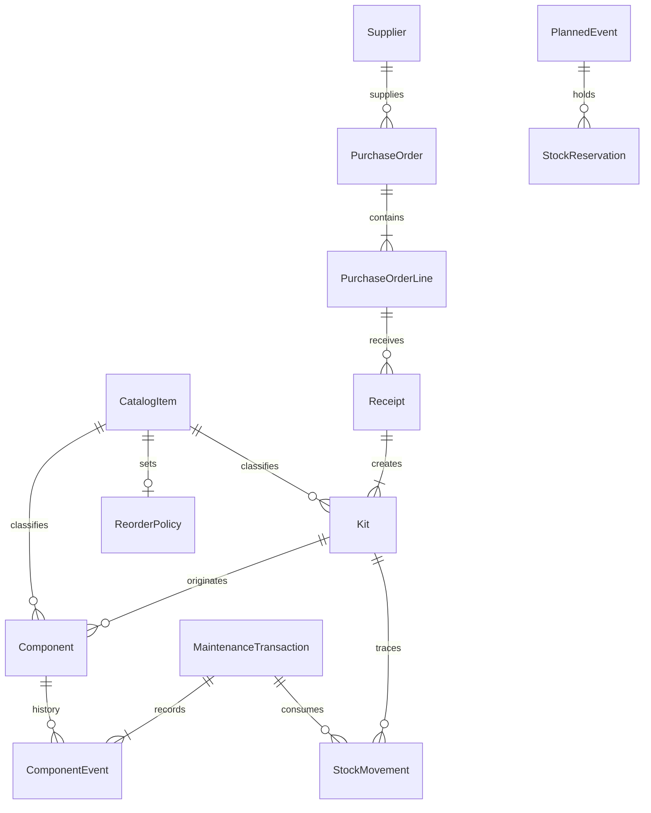
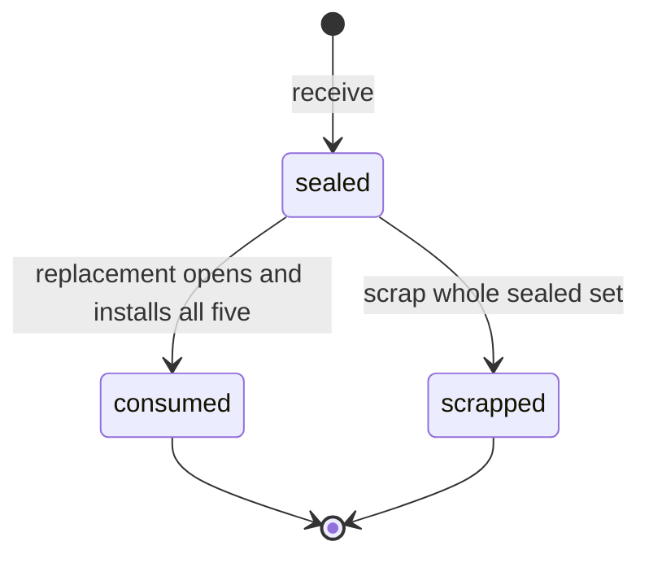
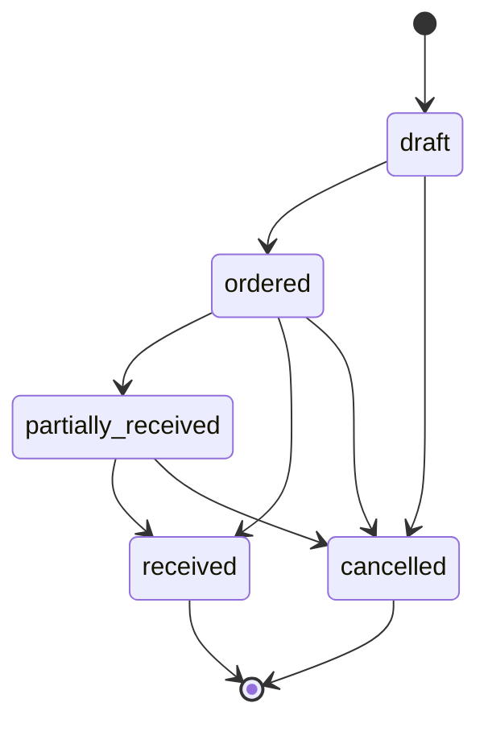
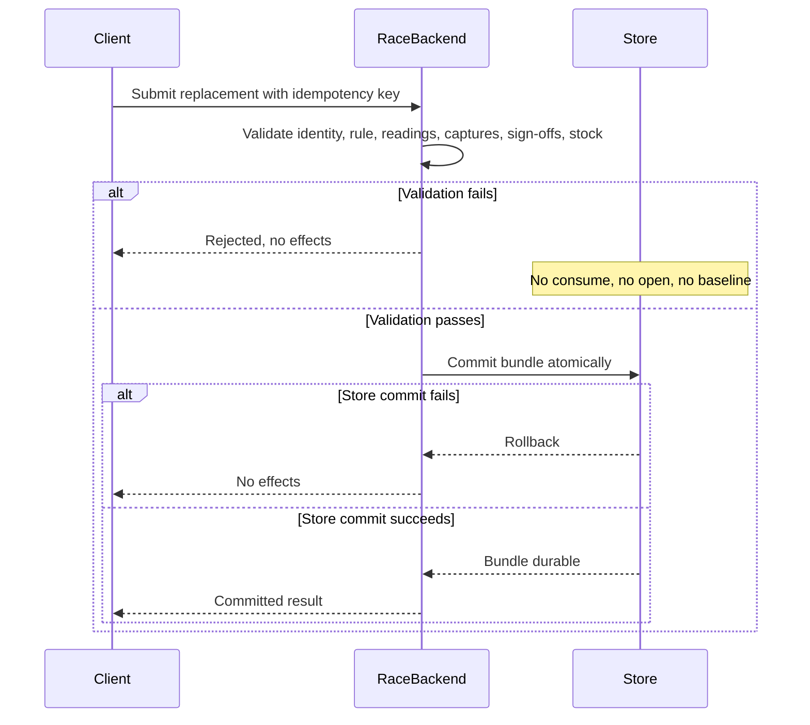

# Inventory specification

Status: documentation only. This is the stack-agnostic contract for inventory, purchasing, and the stock side of a completed maintenance transaction.

Vehicle and use: one-car team, 2004 Nissan 350Z, NASA and SCCA road-course events. Failure prevention is the priority. Snapped wheel studs are a known safety-critical failure mode. Records start empty. Historical maintenance is not invented to fill the system.

Sources: `PROJECT_HANDOFF.md` and `README.md`. Owner decisions dated 2026-10-25 are cited in the text as Owner decision, 2026-10-25. Where a fact is still missing, the value is **UNKNOWN**. UNKNOWN means the team must supply it from verified specifications, team engineering policy, applicable racing rules, or a documented failure investigation. It does not mean zero, and it does not mean healthy.

This file does not choose a language, database, host, or migration tool. Phase 1 maps the logical types below onto whatever stack it selects. Race Backend is the server-side component that validates and commits maintenance and inventory writes. It must implement the contract in [Atomic replacement](#11-atomic-replacement). This document does not implement that contract.

## 1. Scope

In scope:

- Identity separation for catalog part, physical component, sealed kit or stock unit, and installation or removal history.
- Sealed wheel-stud sets of five, including hub replacement of a whole set, state, and traceability.
- An append-only stock-movement ledger and on-hand quantities derived from it.
- Reorder policy, early reorder warnings, and stock reserved for events.
- The all-or-nothing commit that consumes stock together with the maintenance record and the service baseline.
- Suppliers, purchase notes, purchase orders, lead times, and receiving into new kit identities.
- Inputs an event-readiness forecast needs, and the rule that a forecast is an estimate.

Phase 1 implements the subset named in [Decisions for Phase 1](#17-decisions-for-phase-1). `Supplier`, purchase notes, purchase orders, receipt-from-PO, quarantine, and forecasting stay in this document and are labeled Phase 2+. `StockReservation` is not in Phase 1. Stud stock has no negative-stock exception, in Phase 1 or later.

Out of scope:

- Application code, schema migrations, and stack selection.
- Approved replacement intervals, torque, inspection limits, and measurement limits.
- A full service-rule catalog. Rules are referenced only where a commit must read them.
- The offline sync protocol. Stable ids and idempotency are specified so a future queue can replay a commit. Sync itself is not claimed.
- User-account storage. Actors are `user_id` values owned by the authentication system. Creating a user, logging in, and logging out are still recorded in `AuditEvent`. See [14](#14-permissions-audit-and-retention).
- Certifying that the car is safe to race. Software status is a record, not a certification.

## 2. How to read this document

Normative words:

- **MUST** and **MUST NOT** are requirements on Race Backend and on any schema Phase 1 aligns to this contract.
- **MAY** is an allowed behavior.

Logical types, mapped by Phase 1:

| Type | Meaning |
| --- | --- |
| `id` | Stable opaque identifier. Unique inside its entity. Immutable. Generation method is an implementation choice. An `id` is never a catalog part number. |
| `ref(X)` | Reference to `X`'s id. The target must exist when the referencing row commits, unless the field is optional and empty. |
| `string` | Short text. |
| `text` | Long text. |
| `integer` | Whole number. |
| `decimal` | Exact decimal quantity. Scale is UNKNOWN unless a constraint below fixes it. |
| `boolean` | True or false. |
| `timestamp` | Instant with a timezone. |
| `date` | Civil date, with no time of day. |
| `enum(...)` | One of the named values. |

Requirement column:

| Mark | Meaning |
| --- | --- |
| R | Required on every persisted row. |
| O | Optional. Empty means unknown or not applicable, never a fabricated default. |
| C | Required only when the condition in Constraints holds. |
| D | Derived. Not an editable source of truth. A cache is allowed only if a disagreement with the derivation is treated as a defect. |

Column defaults that invent a quantity are forbidden. Generic minimum stock, desired stock, numeric lead time, order quantity, and on-hand quantity have no numeric default. Empty policy is `null`, and `null` is not `0`. A stored `0` is allowed only when a person explicitly records zero.

The wheel-stud reorder target and inclusive warning threshold in [section 10](#10-reorder-and-event-holds) are Owner decision, 2026-10-25. They apply only to the wheel-stud catalog item. They are not defaults for other parts. The lead-time phrase in [section 12](#12-purchasing) is also that owner's words. It is text, not a number of days. Phase 1 may store it on the catalog item. The Phase 2 supplier record may store it instead.

No field in this specification is pre-filled with a part number, a supplier name, a numeric lead time, an interval, or a torque.

## 3. Prototype boundary

`index.html` is a throwaway local prototype. It is not a schema to extend.

What it gets wrong for inventory:

- One stock row can stand for several sealed sets. A single kit/stock id carries an editable `qty`. The illustrative seed does this with a quantity greater than one. A sealed set of five needs its own kit id. Quantity of sets is how many kit rows exist, not a number on one row.
- The part description and the kit id share one form. Catalog identity and stock identity are different concepts.
- There is no component id and no installation or removal record.
- Adding stock overwrites a quantity and appends a local activity string. There is no append-only ledger, no receive movement, and no link from consumption to a validated maintenance transaction.
- Reorder is one number on the stock row. The form also ships with a numeric reorder default. That default is not team policy and must not become a column default.
- Browser local storage, including the demo seed, is not production stock. Production starts with no stock rows and no historical installs.

The prototype's unit label for a five-stud set matches the documented packaging. Its data shape does not. Do not design the schema around that shape.

## 4. Identity model

These four identities stay distinct. No table, column, or screen may use one of them as a substitute for another.

| Concept | Entity | What it identifies |
| --- | --- | --- |
| Catalog / part number | `CatalogItem` | The approved kind of part. Many physical parts share one catalog item. |
| Component ID | `Component` | One physical component or assembly. |
| Kit / stock ID | `Kit` | One sealed kit or other stock unit. For wheel studs, one sealed set of five. |
| Installation / removal record | `ComponentEvent` | What happened to one physical component on the car: installed or removed. |

A part number does not identify which set a stud came from. A kit id does not identify which wheel a stud is in. An installation record does not become a new catalog item. Replacing a component creates new events; it does not reuse the removed component's id for the new part.

`Supplier`, `PurchaseOrder`, `PurchaseOrderLine`, and `Receipt` in that diagram are Phase 2+. `StockReservation` is not in Phase 1. A Phase 1 `receive` creates a `Kit` directly.

Traceability that must be reconstructable for an installed wheel stud:

Phase 1 traceability is `ComponentEvent` → `Component` → origin `Kit` → `receive` movement. A supplier reference on that receive is optional. `Receipt`, `PurchaseOrderLine`, and `Supplier` are Phase 2+ and are not required to receive a sealed kit.

The catalog part number is snapshotted on the event so a later catalog edit does not rewrite history.

## 5. Wheel-stud product facts

### 5.1 Packaging and profile

Wheel studs are stocked in **sealed sets of five**. `CatalogItem.profile = wheel_stud_set` applies all of the following:

- `tracking_class = sealed_kit`
- `nominal_set_size = 5`
- `individual_tracking = on_open`
- `safety_critical = true`
- Hub install quantity is one complete sealed set. See [5.2](#52-owner-decisions-2026-10-25).
- Removal disposition is `scrapped` only.

Set size 5 is not a service interval and not a torque. Do not copy it onto unrelated catalog items. `nominal_set_size` for a non-stud item is UNKNOWN until supplied.

### 5.2 Owner decisions, 2026-10-25

These are Colton's decisions. Each rule below is Owner decision, 2026-10-25.

**Identity.** The wheel studs are ARP extended studs. On the wheel-stud catalog item, `manufacturer` is `ARP` and `description` is `extended studs`. `part_number` stays null until an admin enters the real number. Do not invent a part number. Do not store `ARP` in `part_number`. The brand belongs in `manufacturer` or in `description` only. Race Backend rejects a wheel-stud `part_number` that is only the manufacturer name. While `part_number` or `approval_source` is missing, the item is not approved and a replacement cannot consume it. See [7.2](#72-catalogitem).

**Hub replacement.** A replacement always installs one complete sealed set of five on a hub. Sets are never mixed on one hub. Partial-set replacement on a hub is not allowed. This is a validation invariant on the replacement transaction. If it fails, the commit is rejected and there is no stock effect: no open, no consume, no baseline. Sections [8](#8-sealed-sets-of-five) and [11](#11-atomic-replacement) state the checks.

**Spares.** The pre-event target is 4 spare sealed wheel-stud sets, one per wheel. The reorder warning triggers when sealed sets on hand are 4 or fewer. For this catalog item, `desired_stock_sets` is 4 and `warning_threshold_sets` is 4, inclusive. Phase 1 counts sealed sets only. There is no loose-stud count. The threshold equals the target, so the warning stays active whenever sealed sets on hand are at or below the target, including when the count is exactly 4. That inclusive comparison is intended. Do not change it.

**Lead time.** The lead-time default is the free text `a few days`. An admin can edit that text. Phase 1 stores it on the wheel-stud `CatalogItem`. A Phase 2 `Supplier` row may store the same phrase instead. The numeric lead time in days stays null unless an admin enters a number. Forecasting must not turn `a few days` into a number. See [12](#12-purchasing).

**Scrap.** Removed studs are always scrapped. Reuse is permanently blocked. Removal moves the stud to terminal `scrapped`. No installable transition exists out of that state.

### 5.3 Strict defaults

The team also set defaults for items that were still open.

- Torque, replacement intervals, and inspection limits stay unknown until a verified source supplies them. The stud replacement interval and its lap, engine-hour, event, calendar, and service thresholds stay UNKNOWN pending `docs/research/wheel-studs.md`. This spec does not copy numbers from that file. Do not enter a placeholder. This is not a knob for guessing a value.
- Stud stock never goes negative. There is no exception path for studs. `AuthorizedStockException` is not applicable to studs and is not a Phase 1 path. A movement that would take the sealed-set count below zero is rejected.
- Reused studs are rejected. This restates the scrap decision. It is permanent, not adjustable.
- Mixed studs on a hub are rejected. This restates the hub rule. It is not adjustable.
- Studs already on the car when records start are recorded with unknown history. They are not given a made-up date, kit, reading, procedure, or interval. The record kind is `opening_identification` in [11.6](#116-records-that-are-not-a-replacement). Inventing that history is not allowed.

## 6. Shared enumerations

### 6.1 `tracking_class`

| Value | Meaning |
| --- | --- |
| `sealed_kit` | On-hand complete stock is counted in whole kits. Each kit has its own id. |
| `serialized` | Each physical item is a `Component`. A kit is optional. Behavior beyond identity is UNKNOWN until a later spec. |
| `bulk` | Ledger quantity without a sealed-set identity. Piece-level kit rules do not apply. |

Wheel studs use `sealed_kit`. This document fully specifies sealed-kit behavior for `profile = wheel_stud_set`. `serialized` and `bulk` exist so the catalog can record other parts without pretending they are five-stud sets. Their movement details beyond the shared ledger fields are UNKNOWN.

### 6.2 Kit `state`

Phase 1 states are `sealed`, `consumed`, and `scrapped`. There is no partial-set state and no loose-stud state. A set is not left `opened`. The seal is opened inside the replacement commit, and that same commit consumes all five studs.

| Value | Meaning |
| --- | --- |
| `sealed` | Seal intact. This is the only state in the on-hand count. One kit counts as one sealed set. |
| `consumed` | The replacement commit opened this set and installed all five studs on one corner. Terminal for stock. Not on hand. |
| `scrapped` | The whole sealed set was scrapped and nothing from it was installed. Terminal. Not on hand. |

Phase 2+ adds `quarantined`: a whole sealed set held out of the on-hand count until an admin releases it back to `sealed`. Phase 1 does not quarantine.

### 6.3 Allowed kit transitions

A transition persists only inside a committed movement transaction. A failed attempt leaves the previous state.

Phase 1:

| From | To | When |
| --- | --- | --- |
| (none) | `sealed` | `receive` of a new kit id |
| `sealed` | `consumed` | One replacement commit opens the set and installs all five on one corner. |
| `sealed` | `scrapped` | Admin scraps the whole sealed set. Nothing is installed. |
| `consumed` | (none) | Terminal. |
| `scrapped` | (none) | Terminal. |

Phase 2+ only: `sealed` to `quarantined`, and `quarantined` back to `sealed` on `release_quarantine`.

Forbidden:

- A resting `opened` state, a partial consume, a leftover stud, or any state that means "some of the five are still stock."
- A loose-stud ledger or a second on-hand count.
- Splitting a kit, merging kits, or putting a stud onto a different kit id.
- Returning a scrapped or consumed kit to `sealed`.
- Installing from a kit that is not `sealed` at the start of the commit.

### 6.4 Component `status`

Phase 1 values are `installed` and `scrapped`.

| Status | Meaning |
| --- | --- |
| `installed` | Installed on a wheel corner. |
| `scrapped` | Terminal. |

There is no `in_kit` status. Component rows for a new set are created inside the replacement commit, already `installed`. A sealed kit has no component rows. Removed studs do not sit in stock.

Owner decision, 2026-10-25: a removal sets the stud to `scrapped`. There is no reuse path and no reinstall path. No transition from `scrapped` to `installed` exists. The disposition value `reused` is not in the model. Do not keep `held`, `returned`, or `removed` as a status that could later become installable.

### 6.5 Movement `type`

Phase 1 types are `receive`, `consume`, and `scrap`.

| Value | Effect on the sealed-set count | Service baseline |
| --- | --- | --- |
| `receive` | Creates one new kit id in `sealed`. Count +1. Supplier is optional. No receipt and no purchase order. | Unchanged. |
| `consume` | Opens that sealed set inside the replacement commit and installs all five. Count -1. End state `consumed`. | Updated only inside the replacement bundle in [section 11](#11-atomic-replacement), and only when a verified interval exists. |
| `scrap` | Whole sealed set to `scrapped`. Count -1. Installs nothing. Creates no loose studs. | Unchanged. |

Phase 2+ types, not implemented in Phase 1: `quarantine` and `release_quarantine`.

Phase 1 has no `open` movement, no `adjust`, no piece-level `return`, and no reservation movement. Loose studs never exist: the set is opened only inside the replacement that installs all five, and a removed stud is scrapped. Stud stock has no exception path. A movement that would take the sealed-set count below zero is rejected.

### 6.6 Other enumerations

- Catalog `status`: `draft`, `approved`, `retired`.
- Purchase note `status`, Phase 2+ with `PurchaseNote`: `open`, `promoted`, `closed`.
- Purchase order `status`, Phase 2+ with `PurchaseOrder`: `draft`, `ordered`, `partially_received`, `received`, `cancelled`.
- Reservation `status`: not in Phase 1. Do not implement `StockReservation`.
- `AuthorizedStockException`: not applicable to studs. No status and no Phase 1 path.
- Maintenance transaction `kind`: `replacement`, `inspection`, `removal_without_install`, `opening_identification`.
- Maintenance transaction `status`: `draft`, `committed`, `rejected`.
- Planned event `status`: `planned`, `cancelled`, `completed`.
- Location `kind`: `shop`, `transport`, `event`, `quarantine_hold`, `other`.
- Evidence `kind`: `photograph`, `measurement`, `written_observation`, `other`.
- Removal `reason_code`: `failure`, `other`.
- Disposition `code` for a wheel stud: `scrapped` only. The value `reused` is not a disposition. Reinstall codes are not in the model.
- Idempotency `scope`: `maintenance_transaction`, `stock_movement`. A Phase 1 `receive` uses `stock_movement`. `receipt` is Phase 2+.
- Idempotency `status`: `in_flight`, `committed`, `rejected`.

`failure` exists because studs have snapped and that reason must be representable. A finer failure taxonomy is UNKNOWN. Details go in text, not in invented cause codes.

The only wheel-stud disposition is `scrapped`. Owner decision, 2026-10-25. A removal that names any other disposition, including `reused`, is rejected. There is no `returned_to_stock` outcome.

## 7. Entities and fields

Actor ids point at the authentication system. This specification does not define the user table. Server-side authorization decides whether that actor may perform the write. A client-supplied on-hand quantity is ignored.

### 7.1 `Vehicle`

The team has one car. The row exists so history names the car explicitly. Documented identity is a 2004 Nissan 350Z. VIN, competition number, and class identifiers are UNKNOWN. Do not invent them.

| Field | Type | Req | Constraints | Meaning |
| --- | --- | --- | --- | --- |
| `vehicle_id` | id | R | Immutable, unique. | Internal identity. |
| `model_year` | integer | R | Documented value 2004. | Model year. |
| `make` | string | R | Documented value Nissan. | Make. |
| `model` | string | R | Documented value 350Z. | Model. |
| `vin` | string | O | Empty until the team records the real VIN. | Chassis identifier. |
| `competition_number` | string | O | Empty until recorded. | Event number. |
| `notes` | text | O | | Team notes. |

### 7.2 `CatalogItem`

The type of part. Installation stores `catalog_item_id` as a snapshot reference; later edits do not change past events.

| Field | Type | Req | Constraints | Meaning |
| --- | --- | --- | --- | --- |
| `catalog_item_id` | id | R | Immutable, unique. | Internal identity. Not the part number. |
| `part_number` | string | O | Unique together with `revision` among non-retired rows when both are set. Null until an admin enters a real number. The wheel-stud value is null. Must not be `ARP` and must not be invented. | Approved catalog / part number. |
| `manufacturer` | string | C | Required for `wheel_stud_set`. The wheel-stud value is `ARP`. Owner decision, 2026-10-25. Not a part number. | Brand or manufacturer. |
| `revision` | string | C | Required when `part_number` is set. Otherwise null. Do not invent a revision. | Revision of this catalog row. |
| `description` | string | R | Non-empty. The wheel-stud value is `extended studs`. Owner decision, 2026-10-25. | Human description. |
| `profile` | enum | R | `wheel_stud_set` or `none`. | Applies the wheel-stud rules when set. |
| `tracking_class` | enum | R | See [6.1](#61-tracking_class). Must be `sealed_kit` when profile is `wheel_stud_set`. | How stock identity works. |
| `nominal_set_size` | integer | C | Required when `tracking_class` is `sealed_kit`. Immutable. Must be 5 when profile is `wheel_stud_set`. No default for other profiles. | Pieces in one sealed kit. |
| `individual_tracking` | enum | R | `none`, `on_open`, `always`. Wheel-stud profile must be `on_open`: the replacement commit allocates the five component ids. A sealed kit has none. There is no standalone open. | When component ids are allocated. |
| `safety_critical` | boolean | R | Wheel-stud profile must be true. | Safety-critical kind of part. |
| `set_unit_name` | string | C | Required for `sealed_kit`. | Name of one whole kit, such as the team's words for a sealed set. |
| `piece_unit_name` | string | C | Required for `sealed_kit` and `bulk`. | Name of one piece. For wheel studs, a stud. |
| `status` | enum | R | `draft`, `approved`, `retired`. The wheel-stud item stays `draft` while `part_number` or `approval_source` is null. `approved` requires both of those fields. Manufacturer and description do not approve it. | Approval state. |
| `approval_source` | string | C | Required before `status` can be `approved`. Empty while the part number is blank. Not a substitute for `part_number`. | Document that approves this part number. |
| `supersedes_catalog_item_id` | ref(CatalogItem) | O | Must not form a cycle. | Prior catalog row this one replaces. |
| `lead_time_text` | string | O | Admin-editable free text. Phase 1 may store `a few days` here for the wheel-stud item. Not a number of days. Must not be parsed. See [12](#12-purchasing). | Lead time in the team's words, when kept on the catalog item. |
| `notes` | text | O | | |
| `created_at` | timestamp | R | Server time. | |
| `created_by` | ref(user) | R | | |
| `updated_at` | timestamp | R | Server time. | |
| `updated_by` | ref(user) | R | | |

Only an `approved` catalog item may be received or consumed. The wheel-stud row may be saved early with `manufacturer` `ARP`, `description` `extended studs`, and `part_number` null. That row is not approved. A replacement that tries to consume it is rejected until an admin has entered both the real `part_number` and `approval_source`, and `status` is `approved`. Do not invent either value. Do not copy `ARP` into `part_number`. Cross-item substitution is rejected. Whether a later second stud part number is interchangeable is still UNKNOWN.

### 7.3 `Location`

| Field | Type | Req | Constraints | Meaning |
| --- | --- | --- | --- | --- |
| `location_id` | id | R | Immutable, unique. | |
| `name` | string | R | Non-empty. Unique among active locations. Actual names are UNKNOWN. | Storage place. |
| `kind` | enum | R | See [6.6](#66-other-enumerations). | Coarse class. |
| `active` | boolean | R | | Inactive locations cannot be newly assigned. |
| `notes` | text | O | | |

### 7.4 `Kit`

One stock identity. For a wheel-stud set, the row is one sealed set of five, never a stack of sets.

There is no editable `qty` on this entity.

| Field | Type | Req | Constraints | Meaning |
| --- | --- | --- | --- | --- |
| `kit_id` | id | R | Immutable, unique, never reused. | Kit / stock ID. |
| `catalog_item_id` | ref(CatalogItem) | R | Immutable. Target must be `approved` at receive time. | What this set is. |
| `nominal_contents_count` | integer | R | Immutable. Copied from the catalog item at receive. Must be 5 for `wheel_stud_set`. | Pieces the sealed unit contains. |
| `state` | enum | R | See [6.2](#62-kit-state). Changes only through movements. | Current kit state. |
| `quarantine_from_state` | enum | O | Phase 2+ only. Empty in Phase 1. When quarantine exists, the only value is `sealed`. | State to restore on release. |
| `kit_label` | string | O | Unique if present. Format is UNKNOWN. Not a part number. | Human label printed or written on the set. |
| `location_id` | ref(Location) | O | | Where the kit is stored. |
| `supplier_id` | ref(Supplier) | O | Optional in Phase 1. `Supplier` is Phase 2+. Empty is valid on a `receive`. | Source supplier, when the team names one. |
| `purchase_order_line_id` | ref(PurchaseOrderLine) | O | Phase 2+. Empty in Phase 1. | Line this set was ordered on, if any. |
| `receipt_id` | ref(Receipt) | O | Phase 2+ receipt-from-PO. Empty on a Phase 1 `receive`. | Receipt that created the kit, when that document exists. |
| `received_at` | timestamp | R | Server time of the committed `receive` movement. | |
| `seal_intact` | boolean | D | True only when `state` is `sealed`. | Projection of seal. |
| `notes` | text | O | | |

Derived, not stored as authority:

| Attribute | Derivation |
| --- | --- |
| `on_hand_set` | 1 when `state` is `sealed`, otherwise 0. This is the only quantity the kit contributes. |

Phase 1 does not store a loose-stud quantity on a kit. A kit is on hand only while `sealed`.

### 7.5 `Component`

One physical part. A sealed kit has no component rows. The kit id is the stock identity until a replacement installs the set. That commit creates five component rows together, all `installed`, each with `origin_kit_id` set to that kit. Those rows are not a loose stock count. A removal then sets the removed row to `scrapped`.

| Field | Type | Req | Constraints | Meaning |
| --- | --- | --- | --- | --- |
| `component_id` | id | R | Immutable, unique, never reused. | Component ID. |
| `catalog_item_id` | ref(CatalogItem) | R | Immutable. Matches the origin kit's catalog item. | Part type. |
| `origin_kit_id` | ref(Kit) | C | Required for pieces from a sealed kit. Immutable. Null when `history_unknown` is true. Do not invent a kit for studs already on the car. | Kit this physical part came from. |
| `history_unknown` | boolean | R | True only for studs recorded by `opening_identification`. False for studs installed from a sealed kit. | Prior life was not recorded. Not a claim that the stud is new or that an interval was met. |
| `identity_source` | enum | R | `team_assigned` or `manufacturer_marked`. | Whether the id is the team's or a mark found on the part. Which source wheel studs actually have is UNKNOWN. The brand ARP is not a serial. |
| `manufacturer_mark` | string | O | Empty when no mark was observed. Never invented. | Mark read from the part. |
| `status` | enum | D | See [6.4](#64-component-status). | Projection. |
| `created_at` | timestamp | R | | |
| `notes` | text | O | | |

Current vehicle position is not a field on `Component`. It is the position on the latest `installation` event that has no later `removal` for that component.

`origin_kit_id` never changes. There is no transfer onto another kit.

### 7.6 `ComponentEvent`

An installation or a removal of one component. This is the installation/removal record. It is not a catalog row, not a kit, and not the component itself.

Events are immutable. A correction is a later event or a later maintenance transaction, not an edit.

Shared facts about the job (readings, procedure, technician, sign-off) live on `MaintenanceTransaction` and are copied onto the event as a snapshot so the component history still reads correctly if the transaction representation changes.

| Field | Type | Req | Constraints | Meaning |
| --- | --- | --- | --- | --- |
| `component_event_id` | id | R | Immutable, unique. | |
| `maintenance_transaction_id` | ref(MaintenanceTransaction) | R | A committed `replacement` or `removal_without_install`. A draft must not own events. An `inspection` does not own installation or removal events. | Parent transaction. |
| `component_id` | ref(Component) | R | Immutable. | The physical part. |
| `catalog_item_id` | ref(CatalogItem) | R | Snapshot of the approved part used. | Part number identity at the time. |
| `origin_kit_id` | ref(Kit) | C | Snapshot. Required when the component has an origin kit. | Kit lineage at the time. |
| `vehicle_id` | ref(Vehicle) | R | | Car. |
| `event_kind` | enum | R | `installation` or `removal`. | |
| `wheel_corner` | enum | C | Required for a wheel stud. One of `LF`, `RF`, `LR`, `RR`. | Wheel corner. This is the position. |
| `stud_hole_index` | integer | O | If present, an integer from 1 through 5, unique on that corner in the commit. Omission is valid. | Hole within the corner. Not a stock quantity. |
| `occurred_at` | timestamp | R | Server commit time. | When the record committed. |
| `lap_reading` | integer | C | Snapshot from the transaction. Required when the parent is a `replacement` and the approved rule uses laps. Null on `removal_without_install` means not recorded, not zero. | Laps at the job. |
| `engine_hour_reading` | decimal | C | Snapshot from the transaction. Required when the parent is a `replacement` and the approved rule uses engine hours. Null on `removal_without_install` means not recorded, not zero. Scale UNKNOWN. | Engine hours at the job. |
| `removal_reason_code` | enum | C | Required when `event_kind` is `removal`. `failure` or `other`. | Why it came off. |
| `removal_reason_detail` | text | C | Required when `event_kind` is `removal`. Non-empty. | Observed reason, in the technician's words. |
| `disposition` | enum | C | Required when `event_kind` is `removal`. Wheel studs: `scrapped` only. Owner decision, 2026-10-25. | What was done with the removed part. |
| `disposition_notes` | text | C | Required when `disposition` is `other`. | |
| `paired_event_id` | ref(ComponentEvent) | O | If set, the other side of a replacement: the removal pairs with the installation, or the reverse. | Links old and new component history. |
| `procedure_source` | string | C | Snapshot of the parent when the parent has one. Empty when no approved procedure was recorded. Do not invent a document title. | Procedure document. |
| `procedure_revision` | string | C | Required together with `procedure_source`. | Procedure revision. |
| `measurement_capture_ids` | list of id | C | Present when `measurements_requirement` is not `none required`. Empty only together with the recorded value `none required`. A missing requirement statement is `not stated` and fails the commit. Do not invent torque or limit values. | Measurements for this component. |
| `inspection_capture_ids` | list of id | C | Empty only together with the recorded value `none required` on the parent sign-off statement. A missing statement on a replacement is `not stated` and fails the commit. | Inspections for this component. |
| `committed_by_user_id` | ref(user) | R | Snapshot of the parent `committed_by_user_id`. | User who committed. |
| `technician_user_id` | ref(user) | R | Snapshot of the parent `technician_user_id`. That field defaults to the committing user and stays its own value. | Technician. |
| `performed_at` | timestamp | C | Snapshot of the parent `performed_at` when the parent has one. Calendar intervals use this instant, not `occurred_at`. | When the work was performed. |
| `notes` | text | O | | |

Measurements and inspection results are the structured captures on the parent transaction (section 7.19). The required set is UNKNOWN until the rule exists. Missing captures that the rule requires fail the commit.

Old and new component ids are the `component_id` values on the paired removal and installation events of one replacement transaction.

### 7.7 `FailureEvidence`

Captured when a removal reason is `failure`, including a snapped stud. The minimum set of photos or measurements beyond a non-empty capture is UNKNOWN.

| Field | Type | Req | Constraints | Meaning |
| --- | --- | --- | --- | --- |
| `evidence_id` | id | R | Immutable, unique. | |
| `component_event_id` | ref(ComponentEvent) | R | The removal event. | What the evidence belongs to. |
| `kind` | enum | R | See [6.6](#66-other-enumerations). | Kind of evidence. |
| `storage_reference` | string | R | Non-empty locator in whatever blob store Phase 1 uses. This spec does not choose the store. | Where the bytes live. |
| `content_hash` | string | O | | Integrity check, if the implementation computes one. |
| `description` | text | R | Non-empty. What was observed. Not a guessed metallurgical cause. | |
| `captured_at` | timestamp | R | | |
| `captured_by` | ref(user) | R | | |

A `removal` with `removal_reason_code = failure` is invalid unless it references at least one `FailureEvidence` row, committed in the same transaction as the removal. Evidence rows are retained with the event. How long binary bytes are kept is UNKNOWN; the metadata row is part of permanent history.

### 7.8 `StockMovement`

Append-only ledger in normal operation. Rows are not updated and not deleted. A mistake is a new movement. The only exception is the disaster-recovery restore in [17](#17-decisions-for-phase-1), which replaces the store after an automatic pre-restore export and writes its own audit row.

On-hand is the fold of committed movements, checked against kit and component projections in the same commit. There is no editable on-hand column.

| Field | Type | Req | Constraints | Meaning |
| --- | --- | --- | --- | --- |
| `movement_id` | id | R | Immutable, unique. | |
| `idempotency_key` | string | R | Unique among movements. See [9.4](#94-idempotency). | Replay key. |
| `movement_type` | enum | R | See [6.5](#65-movement-type). | |
| `catalog_item_id` | ref(CatalogItem) | R | | Part type affected. |
| `kit_id` | ref(Kit) | C | Required for `sealed_kit` catalog items. | The set affected. One kit per movement. |
| `component_id` | ref(Component) | O | Empty on Phase 1 whole-set movements. Those movements name the kit. There is no piece-level return or hold. | A single piece, only if a later movement names one. |
| `sealed_set_delta` | integer | R | -1, 0, or +1. Summed across committed movements, this equals the number of kits in `sealed`. That sum is the only on-hand count. | Change in sealed sets on hand. |
| `actor_user_id` | ref(user) | R | Authenticated server principal. | Who. |
| `occurred_at` | timestamp | R | Server commit time. | When. |
| `client_observed_at` | timestamp | O | Present when a future offline client observed the action. Not authoritative over `occurred_at`. | Client clock, for later sync. |
| `reason_code` | string | R | Non-empty. `failure` is reserved for consistency with removals; other codes are team text until a taxonomy exists (UNKNOWN). | Why, short code. |
| `reason_text` | text | R | Non-empty. | Why, in words. |
| `supplier_id` | ref(Supplier) | O | Optional on `receive`. Empty is valid in Phase 1. | Supplier named on the receive, if any. |
| `maintenance_transaction_id` | ref(MaintenanceTransaction) | C | Required when `movement_type` is `consume`. Empty on `receive` and `scrap`. | Job that consumed the part. |
| `receipt_id` | ref(Receipt) | O | Empty in Phase 1. Set only by a Phase 2+ receipt-from-PO. | Receipt. |
| `related_movement_id` | ref(StockMovement) | O | Prior movement this one compensates or reverses. The prior row stays. | Link for corrections. |
| `location_id` | ref(Location) | O | Location after the movement, if it changed. | |

Phase 1 movements have no `reservation_id`, no `exception_id`, and no `return_destination`. There is no loose-stud ledger and no stock reservation.

Who, when, and why are `actor_user_id`, `occurred_at`, and `reason_code` plus `reason_text`. All four are required on every Phase 1 movement. `occurred_at` is server time. Calendar intervals use the user-entered `performed_at` on the maintenance transaction, not this field.

`consume` is the only movement type that puts a part into service. It exists only on a committed replacement transaction. Phase 1 movement types are `receive`, `consume`, and `scrap`. There is no `open`, no `adjust`, and no `return`.

### 7.9 `IdempotencyRecord`

Observable replay contract. Phase 1 may store it in this shape or another, as long as the behavior in [9.4](#94-idempotency) holds.

| Field | Type | Req | Constraints | Meaning |
| --- | --- | --- | --- | --- |
| `idempotency_key` | string | R | Unique inside `scope`. | Client-generated stable key. |
| `scope` | enum | R | See [6.6](#66-other-enumerations). | Which operation family. |
| `request_hash` | string | R | Hash of the canonical request payload. Algorithm is an implementation choice. | Detects a reused key with a different body. |
| `status` | enum | R | `in_flight`, `committed`, `rejected`. | |
| `result_ref` | id | C | Required when `status` is `committed` or `rejected`. | Transaction, movement, or receipt returned. |
| `actor_user_id` | ref(user) | R | | |
| `created_at` | timestamp | R | | |

### 7.10 `AuthorizedStockException`

Not applicable to studs. No Phase 1 path. Do not implement this entity for wheel studs, and do not add a later path that lets stud stock go below zero. A missing row, a bug, or a race is not permission to go negative. The commit is rejected.

### 7.11 `ReorderPolicy`

One active policy per catalog item. For `sealed_kit` items, quantities are **whole sealed sets**, not loose pieces.

| Field | Type | Req | Constraints | Meaning |
| --- | --- | --- | --- | --- |
| `reorder_policy_id` | id | R | Immutable, unique. | |
| `catalog_item_id` | ref(CatalogItem) | R | Unique among policies. | |
| `min_stock_sets` | integer | O | Null until the team sets it. If set, must be >= 0. No generic default. The wheel-stud item does not get a separate minimum: the owner set a target and an inclusive warning threshold instead. | Minimum complete sealed sets, when the team defines one. |
| `desired_stock_sets` | integer | O | Null until set. If both min and desired are set, desired >= min. Wheel-stud item: 4. That 4 is the pre-event target, one spare sealed set per wheel. Owner decision, 2026-10-25. Not a default for other items. | Desired complete sealed sets. |
| `warning_threshold_sets` | integer | O | Null until set. Wheel-stud item: 4. Compared inclusively: warn when sealed sets on hand are less than or equal to this threshold. | Reorder warning threshold in whole sealed sets. |
| `notes` | text | O | | Policy source in the team's words. |
| `updated_at` | timestamp | R | | |
| `updated_by` | ref(user) | R | Admin. | |

Only kits in `sealed` count toward `desired_stock_sets` and `warning_threshold_sets`. There is no loose remainder to report beside the policy. Owner decision, 2026-10-25.

For the wheel-stud item the policy is complete with `desired_stock_sets = 4` and `warning_threshold_sets = 4`. `min_stock_sets` stays null. Null on some other catalog item's desired or warning threshold means that item's policy is incomplete. Incomplete is not an all-clear.

Because the wheel-stud threshold equals the target, the warning is active at 4 sealed sets on hand and at every count below 4. It is not active only when the count is under 4. Do not "correct" that to a strict less-than. Owner decision, 2026-10-25.

Reorder numbers for catalog items other than the wheel-stud item are UNKNOWN.

### 7.12 `StockReservation`

Not in Phase 1. Do not implement event holds, and do not keep a loose-stud ledger beside them. Phase 1 on-hand is the sealed-set count only. Nothing is reserved out of that count.

### 7.13 `Supplier`

Phase 2+. Not in Phase 1. A Phase 1 `receive` does not require a supplier. The lead-time phrase may live on this row when the row exists, or on `CatalogItem.lead_time_text` in Phase 1. See [12](#12-purchasing).

| Field | Type | Req | Constraints | Meaning |
| --- | --- | --- | --- | --- |
| `supplier_id` | id | R | Immutable, unique. | |
| `name` | string | R | Non-empty. No supplier is named in this spec. | |
| `contact` | text | O | | Whatever contact detail the team stores. |
| `status` | enum | R | `active` or `inactive`. | |
| `lead_time_text` | string | R | Admin-editable when this Phase 2+ row exists. May hold `a few days`. Owner decision, 2026-10-25. Free text. Must not be parsed into a number of days. Phase 1 does not require this row; the catalog item can hold the phrase instead. | Lead time in the team's words. |
| `nominal_lead_time_days` | integer | O | Null means UNKNOWN. Must not default to 0. Must not be derived from `lead_time_text`. A stored number exists only after an admin enters one. | Numeric lead time in days, when an admin has entered one. |
| `notes` | text | O | | |
| `created_at` | timestamp | R | | |
| `created_by` | ref(user) | R | | |

### 7.14 `PurchaseNote`

Phase 2+. Not in Phase 1. A note is not stock and not a receive. Phase 1 brings a sealed kit in with a `receive` movement and does not use this record.

| Field | Type | Req | Constraints | Meaning |
| --- | --- | --- | --- | --- |
| `note_id` | id | R | Immutable, unique. | |
| `supplier_id` | ref(Supplier) | O | May be empty if the supplier is not chosen yet. | |
| `catalog_item_id` | ref(CatalogItem) | O | | Part the note is about, if known. |
| `body` | text | R | Non-empty. | The note. |
| `status` | enum | R | `open`, `promoted`, `closed`. | |
| `promoted_purchase_order_id` | ref(PurchaseOrder) | C | Required when `status` is `promoted`. | Order created from the note. |
| `created_at` | timestamp | R | | |
| `created_by` | ref(user) | R | | |
| `closed_at` | timestamp | O | | |

Promoting a note creates a `draft` purchase order. It does not receive kits.

### 7.15 `PurchaseOrder`

Phase 2+, along with `PurchaseOrderLine`. Not in Phase 1. A Phase 1 `receive` does not need a purchase order.

| Field | Type | Req | Constraints | Meaning |
| --- | --- | --- | --- | --- |
| `purchase_order_id` | id | R | Immutable, unique. | |
| `supplier_id` | ref(Supplier) | R | Supplier must be `active` when the order moves to `ordered`. | |
| `status` | enum | R | See below. | |
| `external_reference` | string | O | | Supplier's own order number, if they have one. |
| `ordered_at` | timestamp | C | Required when status has reached `ordered`. | |
| `expected_receipt_date` | date | O | Null means unknown. Not computed from an invented lead time. | When the team expects the shipment. |
| `notes` | text | O | | |
| `created_at` | timestamp | R | | |
| `created_by` | ref(user) | R | | |

Status transitions:

| From | To |
| --- | --- |
| `draft` | `ordered`, `cancelled` |
| `ordered` | `partially_received`, `received`, `cancelled` |
| `partially_received` | `received`, `cancelled` |
| `received` | (terminal) |
| `cancelled` | (terminal) |

`cancelled` after any committed receipt does not delete kits or receipt rows. Cancellation stops further receipts. Already received kits stay in stock with their history.

### 7.16 `PurchaseOrderLine`

Phase 2+ with `PurchaseOrder`. Not in Phase 1.

| Field | Type | Req | Constraints | Meaning |
| --- | --- | --- | --- | --- |
| `line_id` | id | R | Immutable, unique. | |
| `purchase_order_id` | ref(PurchaseOrder) | R | | |
| `catalog_item_id` | ref(CatalogItem) | R | Must be `approved` before the parent order is `ordered`. | |
| `quantity_ordered` | integer | R | Positive. For `sealed_kit`, this is a count of whole kits. The value is whatever the team orders. No default. | |
| `lead_time_days_override` | integer | O | Null means use the supplier's numeric lead time if an admin entered one. If that is also null, numeric lead time is UNKNOWN. Do not parse `lead_time_text`. Must not default to 0. | Line-specific lead time in days. |
| `expected_receipt_date` | date | O | Overrides the order date when set. | |
| `notes` | text | O | | |

`quantity_received` is derived: the count of kits created by committed receipts against this line. It is not edited by hand. Order status is derived from its lines:

- All lines zero received, and the order was `ordered`: stay `ordered`.
- Some but not all ordered quantity received: `partially_received`.
- Every line fully received: `received`.

A receipt that would make `quantity_received` greater than `quantity_ordered` is rejected. Over-receipt policy is UNKNOWN, so the conservative rule is to refuse the extra kits until the team records a policy. Refusal leaves the prior receipts intact.

### 7.17 `Receipt`

Phase 2+ receipt-from-PO. Not in Phase 1. Phase 1 stock entry is a `receive` movement that creates one sealed kit id. It does not write this row. A Phase 2 receipt does not consume stock and does not touch a service baseline.

| Field | Type | Req | Constraints | Meaning |
| --- | --- | --- | --- | --- |
| `receipt_id` | id | R | Immutable, unique. | |
| `idempotency_key` | string | R | Unique among receipts. | |
| `purchase_order_line_id` | ref(PurchaseOrderLine) | O | When set, the parent order must be `ordered` or `partially_received`. | |
| `supplier_id` | ref(Supplier) | R | Required even for a receipt that has no purchase order. | |
| `catalog_item_id` | ref(CatalogItem) | R | `approved`. | |
| `kit_count` | integer | R | Positive. For wheel studs, the number of new kit ids to create, not a piece count. | How many sealed sets arrived. |
| `received_by` | ref(user) | R | | |
| `received_at` | timestamp | R | Server time. | |
| `notes` | text | C | Required when `purchase_order_line_id` is empty. | Why this arrived without an order line. |

Phase 2 atomic receipt: either every new kit row and its `receive` movement commit, or none of them do. Replaying the receipt idempotency key returns the original kits and does not create a second set of ids.

Each new wheel-stud kit, whether created by a Phase 1 `receive` or by this Phase 2 receipt:

- gets its own new `kit_id`
- `state = sealed`
- `nominal_contents_count = 5`
- has its own `receive` movement with `sealed_set_delta = +1`
- has no component rows yet

One arrival of several sets is several kit ids. It is not one kit id with a quantity. Phase 1 does this with `receive` movements alone. `supplier_id` on those movements is optional.

### 7.18 `PlannedEvent`

Minimum event fields. Reservations are not in Phase 1. Forecasting that reads these fields is Phase 2+. An event-prep specification may add fields. This file does not list real events.

| Field | Type | Req | Constraints | Meaning |
| --- | --- | --- | --- | --- |
| `event_id` | id | R | Immutable, unique. | |
| `name` | string | R | Non-empty. | |
| `status` | enum | R | `planned`, `cancelled`, `completed`. | |
| `start_on` | date | O | Null means undated. Lead-time math cannot treat it as imminent or as far away. | |
| `end_on` | date | O | | |
| `expected_laps` | integer | O | Null means UNKNOWN. Must not be treated as zero laps. | Team's planning figure. |
| `expected_engine_hours` | decimal | O | Null means UNKNOWN. Must not be treated as zero. | Team's planning figure. |
| `notes` | text | O | | |

### 7.19 `MaintenanceTransaction`

Contract surface for the atomic replacement. The maintenance-rule entity itself is outside this document. `rule_id` is a stable id owned with that model. Interval magnitudes on the rule are UNKNOWN. Race Backend still has to read them when they exist, and must refuse a baseline reset when they do not.

| Field | Type | Req | Constraints | Meaning |
| --- | --- | --- | --- | --- |
| `transaction_id` | id | R | Immutable, unique. | |
| `idempotency_key` | string | R | Unique among maintenance transactions. | Key for the whole bundle. |
| `kind` | enum | R | `replacement`, `inspection`, `removal_without_install`, or `opening_identification`. | |
| `committed_by_user_id` | ref(user) | R | The authenticated user who committed. Stored even when the technician is the same person. | Committing user. |
| `technician_user_id` | ref(user) | R | Required. Defaults to `committed_by_user_id` when the request omits it. The stored value remains its own field. | Technician. |
| `performed_at` | timestamp | C | Required on a committed replacement or removal. Entered by the user. Must not be later than server commit time. Calendar intervals use this instant. | When the work was performed. |
| `backdated` | boolean | D | True when `performed_at` is earlier than server commit time. The commit also writes an `AuditEvent` with that flag. The flag does not rewrite history. | Backdated entry. |
| `status` | enum | R | `draft`, `committed`, `rejected`. | |
| `rule_id` | ref(rule) | C | Required for a `replacement` that writes a `ServiceBaseline`. The rule must be approved and its interval must come from a verified source. A draft rule cannot reset a baseline. Not required for a wheel-stud hub replacement while the interval is UNKNOWN. Not required for `removal_without_install` or `opening_identification`. | Service rule being satisfied, when a verified interval exists. |
| `vehicle_id` | ref(Vehicle) | R | | |
| `event_id` | ref(PlannedEvent) | O | | Event context, if any. |
| `procedure_source` | string | C | Required on a `replacement` only when an approved procedure exists. Optional for `inspection`, `removal_without_install`, and `opening_identification`. Empty means no procedure was recorded, not a placeholder title. | |
| `procedure_revision` | string | C | Required together with `procedure_source`. | |
| `lap_reading` | integer | C | Required to commit a `replacement` when the rule uses laps. On `removal_without_install`, null means the reading was not recorded. Null is not zero. | |
| `engine_hour_reading` | decimal | C | Required to commit a `replacement` when the rule uses engine hours. On `removal_without_install`, null means the reading was not recorded. Null is not zero. Scale UNKNOWN. | |
| `measurements_requirement` | string | C | Required on a committed `replacement`. The recorded value is `none required`, or a non-empty set of measurement captures. Null, omitted, and any other empty statement are `not stated` and fail the commit. `none required` is not a measurement value and not a torque. | Whether measurements were required. |
| `signoffs_requirement` | string | C | Required on a committed `replacement`. The recorded value is `none required`, or a non-empty set of sign-offs. Null or omitted is `not stated` and fails the commit. `none required` is not a sign-off. | Whether sign-offs were required. |
| `rejection_reason` | text | C | Required when `status` is `rejected`. | Validation failure. Not a stud failure mode. |
| `committed_at` | timestamp | C | Required when `status` is `committed`. Same server instant stored on the `AuditEvent` for this commit. Calendar intervals do not use this field. | |
| `created_at` | timestamp | R | | |

Nested captures, stored with the transaction and referenced from events. Field names are the contract; physical table layout is Phase 1's choice.

`SignOff`:

| Field | Type | Req | Constraints | Meaning |
| --- | --- | --- | --- | --- |
| `signoff_id` | id | R | | |
| `slot_id` | string | R | Matches a required slot on the approved rule. Slot names are UNKNOWN. | What was signed. |
| `user_id` | ref(user) | R | | Who signed. |
| `signed_at` | timestamp | R | | |

`MeasurementCapture`:

| Field | Type | Req | Constraints | Meaning |
| --- | --- | --- | --- | --- |
| `measurement_id` | id | R | | |
| `definition_id` | string | R | From the rule. Definitions and limits are UNKNOWN. | Which measurement. |
| `value` | string | R | Recorded observation. This spec supplies no numeric limit and no unit system. | |
| `unit` | string | O | The unit the technician recorded. | |
| `result` | string | R | The rule's result vocabulary. UNKNOWN until the rule exists. | Pass, fail, or other rule-defined result. |

`InspectionCapture`:

| Field | Type | Req | Constraints | Meaning |
| --- | --- | --- | --- | --- |
| `inspection_id` | id | R | | |
| `definition_id` | string | R | From the rule. | |
| `result` | string | R | Recorded result. | |
| `notes` | text | O | | |

A `draft` may be stored. A draft MUST NOT write `StockMovement`, `ComponentEvent`, kit state changes, or `ServiceBaseline`.

A `rejected` row MAY be stored so the failure is visible. It MUST NOT write those effects either.

An `inspection` commit MAY store inspection captures, defects, and notes. It MUST NOT write `consume` movements and MUST NOT write `ServiceBaseline`.

### 7.20 `ServiceBaseline`

The current service baseline for a rule and position is the latest committed row. Rows are append-only. Interval length is not stored here; it lives on the approved rule, and the value is UNKNOWN.

| Field | Type | Req | Constraints | Meaning |
| --- | --- | --- | --- | --- |
| `baseline_id` | id | R | Immutable, unique. | |
| `rule_id` | ref(rule) | R | | |
| `vehicle_id` | ref(Vehicle) | R | | |
| `vehicle_position` | string | C | Required when the rule is positional. For wheel studs this is the corner: `LF`, `RF`, `LR`, or `RR`. | |
| `maintenance_transaction_id` | ref(MaintenanceTransaction) | R | A `committed` replacement. | Job that set this baseline. |
| `lap_reading` | integer | C | Copied from that transaction when the rule uses laps. | |
| `engine_hour_reading` | decimal | C | Copied from that transaction when the rule uses hours. | |
| `completed_at` | timestamp | R | Server commit time, the same instant as `committed_at`. Calendar intervals use the parent `performed_at`, not this field. | |
| `supersedes_baseline_id` | ref(ServiceBaseline) | O | The previous current row, if one existed. The previous row remains. | |

Opening a screen, failing validation, or crashing before commit does not insert a baseline row.

### 7.21 `AuditEvent`

This is the main audit table. It records server time for commits, account events, and the disaster-recovery restore.

Account events recorded here, and nowhere else in this spec: user creation, login, and logout. This spec does not define the user table. It does require these three actions to land in this table, with the actor and the server time.

It also records edits to policy and master data: catalog, reorder policy, and, in Phase 2+, supplier, purchase documents, and quarantine release. A maintenance commit writes a row here. That row's `at` is the server time. The user-entered `performed_at` stays on the maintenance transaction and is not stored here as if it were the server clock. When `performed_at` is earlier than `at`, the row says the entry is backdated.

| Field | Type | Req | Constraints | Meaning |
| --- | --- | --- | --- | --- |
| `audit_id` | id | R | Immutable, unique. | |
| `entity_type` | string | R | | |
| `entity_id` | id | R | | |
| `action` | string | R | | What changed. |
| `actor_user_id` | ref(user) | R | | |
| `at` | timestamp | R | Server time. This is the server clock for the action, including a maintenance commit, a login, and a restore. | |
| `reason` | text | O | Required for a restore. Phase 2+ quarantine release also requires it. | |
| `prior_values` | text | O | Prior field values. Encoding is an implementation choice. | |
| `new_values` | text | O | New field values. | |

Audit rows are append-only, except for the disaster-recovery restore in [17](#17-decisions-for-phase-1). That restore is the single exception to permanent history.

## 8. Sealed sets of five

### 8.1 Counting

Phase 1 tracks one on-hand figure for a wheel-stud catalog item: the number of kits in `state = sealed`.

That count is the reorder warning input. It is 4 or fewer when the warning is on, including exactly 4. Consumed and scrapped kits are not in the count. There is no loose-stud count, no second remainder count, and no reserved quantity to subtract. Phase 2+ quarantined kits are not on hand either.

### 8.2 Opening and hub replacement

Owner decision, 2026-10-25. The only install path is one complete set of five on one wheel corner.

Position is `wheel_corner`, one of the four fixed corners: `LF`, `RF`, `LR`, or `RR`. It is required. `stud_hole_index` is a separate field. When sent, it is an integer from 1 through 5 and must not repeat on that corner in the commit. Leaving the index off is valid. The hole number is not part of the corner value and is not a stock quantity. The spare plan is four sealed sets, one per wheel.

The catalog item must already be `approved`, which requires a real `part_number` and `approval_source`. Otherwise the consume is rejected.

Validation invariant, checked before any effect, for every corner on the transaction:

- The corner installs exactly five studs.
- All five come from one `kit_id`.
- That kit is `sealed` at the start. This same commit opens it and installs all five. The kit does not rest in an opened state, and it does not create loose studs.
- The kit's end state is `consumed`.
- No stud from another kit is installed on that corner.
- No scrapped stud and no `history_unknown` stud is reused as one of the five.
- If any stud is already installed on that corner, every such stud is removed and scrapped in this same commit. If the corner is occupied and the commit omits any of those removals, reject it. Do not invent removals for studs that were never recorded.
- After the commit, the studs installed on that corner are exactly those five.

If any corner fails, Race Backend rejects the whole transaction. Nothing is consumed, scrapped, or baselined.

A transaction may name more than one corner. Each corner needs its own whole sealed kit. One failure rejects the bundle.

There is no standalone `open`. A set is opened only inside the replacement commit that installs all five studs from that kit. A successful consume records `sealed_set_delta = -1`. Five components are created as `installed`. There is no piece delta and no loose-stud count.

If individual marks are present, they are recorded. If they are absent, `identity_source` is `team_assigned` and `manufacturer_mark` stays empty. Do not invent a manufacturer serial. `ARP` is the brand, not a stud serial.

Rollback of a failed replacement leaves the kit as it was.

### 8.3 No partial set and no loose stock

Phase 1 supports full sealed sets of five per corner only. A set is never partial and never mixed. Loose-leftover stock is not modeled. Owner decision, 2026-10-25, forbids a partial hub replacement. Sets are opened inside the replacement commit, and removed studs are scrapped, so loose studs never exist.

Rejected with no stock effect, including the check in [11.2](#112-validation-before-any-effect) item 12:

- Installing fewer or more than five studs on a corner.
- Leaving any stud from the kit uninstalled.
- Mixing studs from more than one kit on one corner.
- A `partially_used` state, a loose-stud quantity, a loose-stud ledger, or a `loose_piece_delta`.
- Installing scrapped studs, or studs whose disposition is `reused`.
- A negative-stock exception. Studs have no such path.

A damaged sealed set is scrapped as a whole set in Phase 1. That scrap installs nothing and writes no baseline. Quarantine is Phase 2+.

### 8.4 Mixing

Sets are never mixed on one hub. Owner decision, 2026-10-25. This is not waiting on a later policy.

Forbidden, and rejected with no stock effect:

- Two or more `origin_kit_id` values on the studs installed on one hub in a commit.
- Installing any new stud on a hub that still has a recorded stud from another kit, or a `history_unknown` stud, unless that same commit removes and scraps every previously recorded stud on the hub.
- Clearing or rewriting `origin_kit_id`.
- Creating a kit whose pieces come from other kits' leftovers.
- A consume that names a loose-stud quantity instead of five component ids from one kit.
- Installing a wheel-stud component whose origin kit is missing, except the separate `opening_identification` record, which does not install from stock.
- Any screen or import that shows one quantity where distinct kit ids used to be.

There is no future switch in this spec that allows an explicit multi-kit hub.

### 8.5 Removal, failure, and evidence

A removal event requires `removal_reason_code` and `removal_reason_detail`.

Owner decision, 2026-10-25:

- Disposition is `scrapped`. `reused` is not a disposition.
- Component status becomes `scrapped`.
- That status is terminal. No install, no return to a kit, no `held` state that could later be installed.
- `origin_kit_id` is unchanged when the stud had one. A `history_unknown` stud stays without an invented kit.
- The removal does not change the sealed-set on-hand count. A removed stud is not stock.

When the reason code is `failure`, at least one `FailureEvidence` row is in the same commit. The evidence requirement beyond that one capture is still UNKNOWN. The new studs on a replacement, if the job is a replacement, still have to be one complete sealed set on that corner.

A removal that does not install the new set is `kind = removal_without_install`. It scraps the named studs and does not consume a sealed set and does not reset a baseline. It also does not authorize a later one-stud fill-in. The next replacement on that corner still has to scrap every stud still recorded there and install one new sealed set of five.

Inspections that do not remove or install a stud are `kind = inspection`. See [11.6](#116-records-that-are-not-a-replacement).

## 9. Ledger and on-hand

### 9.1 Source of truth

Committed `StockMovement` rows are the source of truth for quantities. Kit `state` and component `status` are projections updated in the same commit. After every commit, the projections must match a fold of the ledger. If they do not, that is a defect; the fold wins and the write must not have been considered successful.

Readers see the state before a commit or the state after it. They never see a baseline without its movements. They never see a partial consume.

### 9.2 Fold

On-hand is one number: the count of kits in `sealed`. It equals the sum of `sealed_set_delta` over committed movements. There is no loose-piece fold.

| Figure | Meaning |
| --- | --- |
| `sealed_set_count` | Kits in `sealed`. This is on-hand. |

Consumed and scrapped kits add zero. Phase 1 does not subtract reservations. There is no loose-piece fold.

The sealed-set count must not go below zero. That commit is rejected. There is no exception path for studs.

A sealed kit accounts for five studs inside the seal. The replacement opens and installs all five together and does not post a loose quantity. Scrapping a sealed set removes the whole set from stock and does not create loose studs. A movement must not make the kit represent more or fewer than five studs.

### 9.3 Movement rules

| Type | Kit precondition | `sealed_set_delta` | End state | Links |
| --- | --- | --- | --- | --- |
| `receive` | New kit id. Catalog item `approved`. | +1 | `sealed` | No maintenance transaction. `supplier_id` optional. No receipt and no purchase order. |
| `consume` | `sealed`. | -1 | `consumed` | `maintenance_transaction_id` required. Opens the set in this commit and installs all five on one corner. |
| `scrap` | `sealed`. | -1 | `scrapped` | Admin. Installs nothing. Creates no component stock. |

Phase 2+ only, not in this Phase 1 table: `quarantine` of a sealed set, count -1, and `release_quarantine` back to `sealed`, count +1.

A consume of any count other than five is rejected and writes nothing. A consume does not leave loose studs.

### 9.4 Idempotency

- Every `receive` movement, other stock movement, and maintenance transaction has an idempotency key.
- The same key and the same request hash, when the first attempt committed, return the original result and apply nothing again.
- The same key and the same request hash, when the first attempt rejected validation, return that rejection and apply nothing.
- The same key with a different request hash is a conflict. The client must use a new key. Nothing is applied.
- A crash that leaves the key `in_flight` resolves to one of two outcomes: the full bundle committed once, or no bundle effects exist. It must not commit twice and must not leave a half bundle.

The client supplies one idempotency key on the maintenance transaction. Race Backend derives each child movement key from that parent key and a stable sequence inside the bundle. Those derived keys are not a second entry point. Replaying the parent returns the same movement ids. A child key cannot commit on its own.

### 9.5 Concurrency

Two commits that touch the same kit, the same component, or the same baseline behave as if they ran one after the other. The second sees the first's result. If the second would drive the sealed-set count negative, or would install a component the first already took, the second fails validation and persists no effects.

A stale client must not overwrite a newer kit state, reorder policy, or approved rule. Conflict handling for offline sync is out of scope beyond this invariant: the server refuses the stale write, and the refusal is visible.

### 9.6 Negative stock

Before commit, Race Backend computes the sealed-set count as if the movements were applied. If that count would go below zero, the commit fails. Studs have no exception record and no exception path. A failed commit leaves stock, kit state, component status, maintenance records, and baselines as they were.

## 10. Reorder and event holds

Phase 1 implements `ReorderPolicy` and the sealed-set reorder warning. Event holds are not in Phase 1. Forecast timing is Phase 2+ with [section 13](#13-forecasting-inputs).

### 10.1 Signals

The Phase 1 warning is computed from the sealed-set on-hand count and `ReorderPolicy`. It is not an editable quantity.

For the wheel-stud catalog item the reorder warning is Owner decision, 2026-10-25:

| Signal | When |
| --- | --- |
| `reorder_warning` | Sealed sets on hand (`state = sealed`) are less than or equal to `warning_threshold_sets`. That threshold is 4. The warning is on at 4 and at every lower count. Consumed and scrapped kits do not add to the count. There is no loose count to add. |
| `at_or_below_target` | The same comparison. `desired_stock_sets` is also 4. Equality with the target does not clear the warning. |
| `reorder_policy_unknown` | Used for other catalog items when desired or warning threshold is null. Not the steady state of the wheel-stud item. |
| `early_warning` | Phase 2+. A future `planned` event exists, and the order-by situation below says the team may already be late or cannot tell. Phase 1 does not compute this. |
| `demand_unknown` | Phase 2+. That event has no verified expected consumption. The signal says the demand is unknown. It does not say stock is sufficient. |

The stock warning does not need a lead time. It is true or false from the sealed-set count alone.

Timing against an event uses only a numeric lead time an admin entered (`lead_time_days_override`, else `nominal_lead_time_days`). The phrase `a few days` is displayed as words. It is not a number of days, and it does not make the timing check succeed or fail by itself.

- Phase 1 does not reserve stock. `StockReservation` is not in Phase 1.
- When a Phase 2+ forecast exists, need is the forecasted sealed-set consumption for that event, but only when that forecast has a verified input. A hub replacement consumes one sealed set. How often that job comes due is UNKNOWN pending `docs/research/wheel-studs.md`. Otherwise the signal is `demand_unknown`.
- Inbound quantity counts as expected in time only for kits on order lines whose `expected_receipt_date` is on or before the event `start_on`. Ordered kits with no expected date stay inbound-unknown. They are not on-hand and are not installable.
- If the event has no `start_on`, or numeric lead time is null, the timing warning says the timing cannot be checked. It does not assume the order will arrive, and it does not assume a lead time of zero days or of "a few" days.
- If timing can be checked, `early_warning` is raised when `start_on` minus the numeric lead time is on or before today and projected sealed sets for that event are below need. Projected sealed sets are the sealed on-hand count plus inbound expected in time. This timing signal is Phase 2+ with forecasting. The Phase 1 warning does not use it.

`reorder_warning` can be true with no event on the calendar. It is on whenever sealed sets on hand are 4 or fewer, which includes the target itself.

These signals do not create movements. Phase 1 stock entry is a `receive` movement. Suppliers, purchase orders, and receipt-from-PO are Phase 2+.

### 10.2 What a race-day user may do

A race-day user may submit a corner replacement that opens and consumes one whole sealed set in that same commit. A race-day user must not change reorder policy, authorize negative stock, consume fewer than five studs, leave loose studs, or edit an approved catalog item or rule.

## 11. Atomic replacement

This section is the contract Race Backend implements. It is not an implementation.

### 11.1 What commits together

A successful `replacement` persists one bundle:

1. `MaintenanceTransaction` with `status = committed`.
2. `ComponentEvent` rows for each removal and each installation, including snapshots.
3. `FailureEvidence` rows required by failure removals.
4. One `consume` movement per kit. That movement opens the sealed set and installs all five. There is no separate `open` movement and no loose-stud movement.
5. Kit `state` `consumed` and five new components `installed`. Removed studs are `scrapped`. Disposition is `scrapped` only.
6. `ServiceBaseline` row for each rule and corner the replacement completes, and only when that rule's interval is already verified. A wheel-stud replacement with an unknown interval omits this row and does not claim a reset.
7. An `AuditEvent` for the commit. Its `at` is the server time. When the user-entered `performed_at` is earlier than that server time, the audit row says the entry is backdated.

Phase 1 does not include a reservation update. Studs have no stock-exception row in this bundle.

The maintenance record, the stock movements, and the service baseline are one commit. Either the whole bundle is durable, or none of its effects are.

### 11.2 Validation before any effect

Race Backend checks all of the following before any bundle write is visible. Failure at any step rejects the commit. Stock is not consumed. Intervals are not reset. Kits stay in their previous state.

1. The actor is authenticated, and server-side authorization allows this actor to complete maintenance. The actor is not changing the service rule, the reorder policy, or the catalog as part of this request.
2. The idempotency key is present. If it already committed, return the original result and stop. If it is in flight, do not start a second bundle.
3. `kind` is `replacement`. `inspection`, `removal_without_install`, and `opening_identification` follow [11.6](#116-records-that-are-not-a-replacement) and stop before any consume or baseline write.
4. For each wheel corner, [8.2](#82-opening-and-hub-replacement) passes: exactly five studs, one whole kit, end state `consumed`. The catalog item is approved.
5. If that corner already has installed studs, every one of them is removed and scrapped in this commit. Otherwise the commit is rejected. Studs that were never recorded are not invented.
6. The wheel-stud `CatalogItem` is `approved`: `part_number` and `approval_source` are both set. A blank part number means the item is not approved, and the replacement cannot consume it. `ARP` in `part_number` is rejected.
7. `measurements_requirement` and `signoffs_requirement` are each an explicit recorded value. The value `none required` means the team recorded that none are required. It is different from `not stated`. Null, omission, or any other unstated value is `not stated` and fails closed: the commit is rejected and nothing is consumed. `none required` does not invent a torque, a limit, or a passing inspection. When the value is not `none required`, the named captures or sign-offs must be present. A miss fails closed the same way.
8. Position is `wheel_corner`: `LF`, `RF`, `LR`, or `RR`. `stud_hole_index` is a separate field. If present, it is from 1 through 5 without duplicates on that corner. Omitting the index is valid. The hole number is not encoded inside the corner.
9. The sealed-set count would not go below zero. Studs have no negative-stock exception.
10. Every wheel-stud removal has reason code, detail, and disposition `scrapped`. Every `failure` removal has evidence in this same request. A `reused` disposition is rejected. There is no such disposition to store.
11. Lap and engine-hour readings are stored when the team took them. They are independent. Race Backend must not convert laps into hours. Null means not recorded, not zero. The interval is still UNKNOWN. See `docs/research/wheel-studs.md`. Do not copy an interval out of that file.
12. A partial set, a mixed set, or a loose-leftover quantity is rejected with no stock effect. Phase 1 has no partial-set state, no mixed hub, and no loose-stud count. See [8.3](#83-no-partial-set-and-no-loose-stock).
13. `performed_at` is entered by the user, is present, and is not in the future relative to server time. Calendar intervals use `performed_at`. Server time is stored on the `AuditEvent` as `at`, and on the transaction as `committed_at`. If `performed_at` is earlier than that server time, the audit row records that the entry is backdated. `committed_by_user_id` is the authenticated actor. `technician_user_id` is required and defaults to that actor when omitted. Both are stored.
14. A `ServiceBaseline` is written in this same commit only when the transaction cites an approved rule whose interval came from a verified source. While that interval is UNKNOWN, the commit has no baseline row. That is not an interval reset. The maintenance record and the stock movements still commit together or not at all.

Opening the form, clicking a button, or saving a draft fails none of these by itself and also completes none of them. Those actions are not a commit.

### 11.3 Failure and persistence

If validation fails, Race Backend may store the transaction as `rejected` with `rejection_reason`. That row is not a maintenance completion. It has no movements, no component events that install or remove parts, and no baseline.

If validation passes and the store then fails, the same absence of effects holds. Retry uses the idempotency rules.

A failed inspection discovered during the job is not half of a replacement. The team can record it as an `inspection` transaction or a defect. That record must be obviously not a completed replacement: no consume, no baseline. The defect text is only what was observed.

### 11.4 Baseline

The new `ServiceBaseline` row is written only inside a committed replacement that passed validation and cites an approved rule with a verified interval.

- It references that `transaction_id`.
- It copies the readings the rule uses.
- It becomes the current baseline for that rule and position.
- The prior baseline row stays in place, linked by `supersedes_baseline_id`.

The wheel-stud interval is not verified yet. It stays UNKNOWN pending `docs/research/wheel-studs.md`. Until a verified interval is adopted, a hub replacement does not append a baseline and does not claim the interval was reset. Stock is still consumed only when the hub invariant passes, and only together with the maintenance record.

If validation or persistence fails, the current baseline remains the previous one. No interval is reset. No set is opened.

An inspection does not append a baseline. A `removal_without_install` does not append a baseline. An `opening_identification` does not append a baseline.

A committed bundle is immutable in normal operation. Undoing one job is a new transaction with compensating movements and, when the team intends to change the baseline, a new baseline row. Race Backend does not delete the original consume or the original baseline to correct that job. The procedure for correcting a wrong baseline is otherwise UNKNOWN. Disaster-recovery restore, in [17](#17-decisions-for-phase-1), is the single exception to permanent history. It is not the way to fix one baseline.

### 11.5 What "nothing was consumed" means

After any failed replacement attempt, all of the following are true:

- No new `consume` movement is readable.
- No kit changed state.
- No component changed status.
- No new current baseline exists.
- The sealed-set count matches the pre-attempt fold. There is no loose remainder and no reservation to compare.

### 11.6 Records that are not a replacement

Two other committed kinds exist so a failure or a look-over is not stored as a finished replacement.

`inspection`:

- May store inspection captures, defects, and notes.
- Owns no installation or removal events.
- Writes no `StockMovement`.
- Writes no `ServiceBaseline`.

`removal_without_install`:

- Used when a stud comes off, including a snap, and this job does not install the replacement set.
- Writes the removal `ComponentEvent`, disposition `scrapped`, and `FailureEvidence` when the reason is `failure`.
- Sets that component's status to terminal `scrapped`. `origin_kit_id` stays as it was. It is not rewritten and not cleared to hide the kit.
- Writes no `consume` and no `ServiceBaseline`.
- Does not create a fictional new component or a fictional prior install.
- Readings may be null when they were not taken. Null is stored as unknown, not as zero.
- The removal, the evidence, and the status change commit together or not at all.
- This job is not permission to install fewer than five studs later.

`opening_identification`:

- Records studs already on the car when the system starts. Team default, 2026-10-25. Not a made-up history.
- Creates one `Component` per stud the team actually identifies. `history_unknown` is true. `origin_kit_id` is null. Status is `installed`. Position is `wheel_corner`, required, one of `LF`, `RF`, `LR`, or `RR`. `stud_hole_index` is a separate optional field. Omitting the corner fails closed. The record still must not invent a corner or a history.
- `occurred_at` is the time of the observation, not a backdated install.
- Lap reading, engine-hour reading, procedure, kit id, part-number snapshot beyond the wheel-stud catalog item, and service baseline are null or absent. Null is unknown, not zero, and not "interval met."
- Does not consume a sealed set and does not open one.
- Does not pad a hub out to five studs. If the team can see five, they record five observations. They do not invent studs they did not identify.
- A later corner replacement scraps every one of these recorded studs on that corner and installs one new sealed set.

A later replacement that installs studs is a new `replacement` transaction. Only that commit consumes a sealed set. It appends a baseline only after a verified interval exists.

## 12. Purchasing

Phase 1 stock entry is a plain `receive` movement. It brings one new sealed kit into stock with its own kit id. It does not require a supplier, a purchase note, a purchase order, or a receipt.

Phase 2+, still specified below and not implemented in Phase 1: `Supplier`, `PurchaseNote`, `PurchaseOrder`, `PurchaseOrderLine`, receipt-from-PO (`Receipt`), and quarantine. Forecasting is Phase 2+ in [section 13](#13-forecasting-inputs).

Lead-time text, Owner decision, 2026-10-25:

- The words are `a few days`. An admin can edit them. They are not a number of days.
- Choice: Phase 1 stores that phrase on `CatalogItem.lead_time_text`. When a Phase 2 `Supplier` row exists, the same phrase may live on `Supplier.lead_time_text` instead. Either place is the team's words. Neither place is parsed into a day count. Phase 1 does not need the supplier row in order to keep the phrase.
- `Supplier.nominal_lead_time_days` and `PurchaseOrderLine.lead_time_days_override` stay null unless an admin types a number. They are Phase 2+ fields. A missing number is UNKNOWN. It must not become 0, and it must not be derived from `a few days`.

Forecasts and timing warnings may show `a few days` as the owner's words. They must not convert that phrase into a day count, including any specific integer someone might guess from it.

No price or currency field is required. Whether the team tracks cost is UNKNOWN.

Lot, batch, and date-code capture is UNKNOWN. No such field is required until that is decided. Phase 1 traceability for a received set is the kit id and the `receive` movement. Supplier and order line are optional Phase 2+ links.

## 13. Forecasting inputs

Phase 2+. Not in Phase 1. Do not implement a forecast in Phase 1. The rules below still bind any later forecast: it is an estimate, not a guarantee, and it must not turn the lead-time phrase `a few days` into a number.

A forecast estimates event readiness for parts. It is an estimate, not a guarantee. It is not a certification that the vehicle is safe to race. It does not write movements, reservations, baselines, or purchase orders.

Race Backend may store a forecast snapshot for the team's record. A snapshot is labeled as an estimate and is not an input to on-hand.

### 13.1 Inputs the forecast must be able to read

| Input | Source | If missing |
| --- | --- | --- |
| Planned events | `PlannedEvent` rows in `planned` | No event claim. An empty calendar is empty, not "nothing to do." |
| Event dates | `start_on` | Timing versus lead time is UNKNOWN for that event. |
| Expected usage for the event | `expected_laps`, `expected_engine_hours` | Do not treat as zero. Demand from the schedule is UNKNOWN. |
| Approved rules and the catalog items they consume | Rule model, outside this spec. Wheel-stud interval research is `docs/research/wheel-studs.md` and is not an approved interval until a verified source says so. | Do not invent a stud interval or a studs-per-event figure. A hub replacement consumes one sealed set when it happens. How often it happens is UNKNOWN. The forecast lists that gap. |
| Current readings | Latest committed lap and engine-hour readings | Missing readings stay missing. They are not healthy and not zero. |
| On-hand sealed sets | Ledger fold of kits in `sealed` | |
| Loose remainder | None. Loose studs never exist. | Do not invent a loose count. Do not treat its absence as zero or as sealed sets. |
| Quarantined stock | Phase 2+ kits in `quarantined` | Unavailable. Not counted as ready stock. Phase 1 has no quarantine. |
| Reservations | Not in Phase 1 | Do not invent a hold. Do not subtract one from sealed sets. |
| Inbound orders | Lines on `ordered` and `partially_received` orders, with expected dates | No date means not assumed to arrive in time. |
| Lead times | `lead_time_text` for display. Numeric day fields only when an admin entered them. | The words `a few days` stay words. A missing number is UNKNOWN, not zero, and not a parsed day count. |
| Usage history | Committed `consume` movements joined to their replacement's readings, time, event, catalog item, kit, and whether a paired removal was `failure` | Empty history is the expected starting point. Usage rate is UNKNOWN, not zero. |
| Reorder policy | `ReorderPolicy` | Incomplete policy is reported, not treated as stock being fine. |
| Stud stock exceptions | None. Not applicable to studs. | A forecast must not show a stud shortfall as authorized. Below zero is rejected, not waived. |

The forecast must not backfill historical maintenance or historical consumption to produce a smoother estimate.

### 13.2 What the estimate has to say

Each forecast result includes:

- When it was generated.
- An explicit statement that it is an estimate and not a guarantee.
- An explicit statement that it does not certify vehicle safety.
- Per planned event and catalog item: the inputs used, the projected sealed-set picture, inbound that has dates, and the gaps (unknown lead time, unknown demand, unknown interval, missing readings, incomplete reorder policy). Phase 1 has no loose remainder, so the estimate must not add one.
- Assumptions actually used. An assumption cannot be a number this specification refused to invent. If the team has not entered a planning figure, the gap is listed instead of a filled-in figure.

Failed safety checks and unresolved critical defects are outside the stock math, but a parts forecast must not be presented as an overall "ready" for the car. Readiness remains a checklist aid.

## 14. Permissions, audit, and retention

Admin, enforced on the server, is required to:

- Approve a catalog item only after entering its part number and approval source, and edit reorder policy.
- Post a Phase 1 `receive` movement for one new sealed kit id, and scrap a whole sealed set.
- Edit `CatalogItem.lead_time_text`. Numeric lead-time fields are Phase 2+ and stay null until an admin enters a number.
- Enter the wheel-stud `part_number` and `approval_source` when they have them, without copying `ARP` into the part-number field.
- Close a critical defect. **default, adjustable by team policy.** A race-day user cannot close one until a later policy says otherwise.

Phase 2+ admin work, not Phase 1: create suppliers, purchase notes, purchase orders, and receipts-from-PO, and release quarantine. Phase 1 does not authorize negative stud stock. There is no exception path.

Race-day, enforced on the server, may:

- Submit drafts and the atomic corner replacement, which consumes one whole set of five on one of `LF`, `RF`, `LR`, or `RR`.
- Record inspection results, defects, laps, and engine hours through their own transactions.
- Record `opening_identification` and `removal_without_install` as specified. They must not invent history, and they must not install a partial set.

Race-day must not change intervals, approved rules, reorder numbers, or catalog approval. A stale offline edit must not overwrite a newer admin rule. The sync design is future work; the refusal rule is already in force for any write the server accepts.

Permanent history, except for the one restore below:

- `StockMovement`
- `ComponentEvent`
- `FailureEvidence` metadata
- `ServiceBaseline`
- `AuditEvent`
- Kit and component identity rows, including consumed and scrapped kits

Normal commits do not delete or rewrite those rows. Disaster-recovery restore is the single explicit exception. It is specified in [17](#17-decisions-for-phase-1). An automatic pre-restore export always runs first, and the restore itself is audited.

Accounts. User creation, login, and logout are recorded in `AuditEvent`, the main audit table. Each row stores the actor and the server time. This spec does not define passwords or the user table.

Production data starts empty. Do not import the prototype's local storage seed, demo kit, demo quantity, or demo reorder value.

## 15. Invariant index

Race Backend and the schema share these invariants.

1. Catalog item, component, kit, and installation/removal event are different identities and different rows. `ARP` is the manufacturer, not the part number. Until an admin enters the part number and the approval source, the wheel-stud item is not approved and cannot be consumed.
2. Each sealed wheel-stud set has its own `kit_id`. Nominal count is 5. No editable quantity of sets lives on that row.
3. On-hand is the count of kits in `sealed`. There is no loose-stud count. The warning is on when that count is 4 or fewer, including 4.
4. A corner replacement installs exactly five studs from one whole kit, and that kit ends `consumed`. Partial replacement and mixed kits are rejected with no stock effect. An occupied corner requires those current studs to be removed in the same commit.
5. A removed wheel stud is `scrapped`. That state has no installable transition. Reuse is permanently blocked.
6. The ledger is append-only in normal operation. On-hand is the fold. Projections match the fold after every commit. Disaster-recovery restore is the single exception, and only after an automatic pre-restore export, with the restore audited.
7. Wheel-stud `consume` exists only on a committed hub replacement. It opens that sealed kit in the same commit and installs five component ids. An admin whole-set `scrap` removes a sealed kit and installs nothing.
8. The hub replacement's maintenance record and stock movements commit together. A verified-interval baseline joins that commit only when a verified interval exists. Failure of validation or persistence leaves no consume and no baseline.
9. Drafts, rejections, inspections, removals without installation, and opening identifications do not reset a service baseline. A `receive` does not reset one either.
10. The sealed-set count does not go negative. Studs have no exception that waives that.
11. Replaying an idempotency key does not apply the bundle twice.
12. Concurrent commits that touch the same kit serialize. The loser rolls back completely.
13. Studs already on the car are `opening_identification` rows with unknown history. They are not backfilled with a kit, a date, or an interval.
14. Numeric lead time stays null until an admin enters it. `a few days` is text on the catalog item in Phase 1, or on the Phase 2 supplier record. It is not converted into a number. Forecasts are estimates, not guarantees.
15. No service interval, torque, inspection limit, or part number is shipped as a verified value. The wheel-stud spare target of 4 and the inclusive warning threshold of 4 are owner decisions, not service intervals.

## 16. Open questions

Resolved and removed from this list, or settled in [Decisions for Phase 1](#17-decisions-for-phase-1): ARP extended studs with a blank part number that is not approved until an admin enters the number and the approval source; one sealed set of five per corner, never partial or mixed; no loose-stud count; corners `LF`, `RF`, `LR`, and `RR` with the hole number as its own field; the spare target of 4 and the inclusive warning at 4; the lead-time phrase `a few days` on the catalog item or the Phase 2 supplier; scrapped studs with no `reused` disposition; stud stock never negative and no exception path; startup studs recorded with unknown history; `Supplier`, purchase documents, receipt-from-PO, quarantine, and forecasting labeled Phase 2+; Phase 1 `receive` of one sealed kit id.

Still open:

1. **Whether more than one stud part number will exist, and whether any second number is interchangeable.** UNKNOWN. The commit rejects substitution. Do not invent the number. The item stays unapproved until an admin enters one, plus the approval source.
2. **Nominal set size for any sealed kit that is not a wheel-stud set.** UNKNOWN. Must not default to 5. Phase 1 does not model partial sets.
3. **The rest of the catalog:** which parts exist, their units, and tracking class. UNKNOWN.
4. **Reorder numbers for catalog items other than the wheel-stud item.** UNKNOWN. The wheel-stud desired stock and inclusive warning threshold are 4. `min_stock_sets` on that item stays null.
5. **Supplier names and contacts.** UNKNOWN. `Supplier` is Phase 2+. Numeric lead time stays null until an admin enters one. The text `a few days` must not be parsed.
6. **Whether purchase cost is tracked.** UNKNOWN. No price field is required.
7. **Whether individual studs carry a manufacturer mark or serial.** UNKNOWN. `ARP` is the brand, not a serial.
8. **Stud replacement interval and service thresholds** (laps, engine hours, events, calendar, warning, critical). UNKNOWN pending `docs/research/wheel-studs.md`. Do not copy values from that file. No baseline is written from a guessed interval. When a verified calendar interval exists, it uses `performed_at`.
9. **Torque, inspection limits, and the numeric content of measurements.** UNKNOWN until a verified source. The commit still requires the explicit statement `none required` or real captures.
10. **Which sign-off slots apply when sign-offs are required.** UNKNOWN. The commit still requires `none required` or the actual sign-offs.
11. **Removal-reason taxonomy beyond `failure` and `other`.** UNKNOWN. Disposition is `scrapped`.
12. **Failure-evidence minimum beyond one attached capture.** UNKNOWN.
13. **Quarantine release conditions beyond an admin release back to `sealed`.** UNKNOWN. Quarantine itself is Phase 2+.
14. **Human kit-label format.** UNKNOWN.
15. **Decimal scale for engine hours, and the instrument those hours and laps come from.** UNKNOWN.
16. **VIN and competition identifiers** beyond 2004 Nissan 350Z. UNKNOWN.
17. **Storage location names.** UNKNOWN.
18. **Lot, batch, or date code.** UNKNOWN. Not required yet.
19. **How often a corner consumes a sealed set.** Each job consumes one set. The schedule is UNKNOWN pending `docs/research/wheel-studs.md`.
20. **How a wrong committed baseline is corrected** once a verified interval exists, beyond appending a new transaction and never deleting the old rows. UNKNOWN. Restore is not that correction.
21. **Binary retention for failure photographs.** Metadata is permanent. Retention of the bytes is UNKNOWN.
22. **Service-rule fields** beyond the hooks this commit needs. UNKNOWN here.
23. **Offline queue payload layout.** Stable ids and idempotency keys are the contract. Extra fields must not weaken the whole-set rule or the atomic commit.

## 17. Decisions for Phase 1

These answers are normative for Phase 1. Where they differ from an earlier note in this file, these answers win. They sit on top of the owner decisions in [5.2](#52-owner-decisions-2026-10-25). They do not invent part numbers, intervals, torques, supplier names, or numeric lead times.

1. **Occupied corner.** Installing at a wheel corner that already has installed studs requires a removal of every current stud on that corner in the same commit. Those removed studs are scrapped. If any current stud is left off the removal list, the commit is rejected and nothing is consumed. Studs that were never recorded are not invented to fill the corner.

2. **Position.** A position is one of the four fixed corners: `LF`, `RF`, `LR`, or `RR`. That value is `wheel_corner` and it is required. The stud hole number is a separate field, `stud_hole_index`. When present it is an integer from 1 through 5 and it does not repeat on that corner in the commit. Omitting it is valid. It is not part of the corner value and it is not a stock quantity.

3. **Critical defects.** Only an Admin can close a critical defect. **default, adjustable by team policy.** Until a later policy changes it, a race-day user cannot close one.

4. **Technician.** `technician_user_id` is a required field, separate from the user who commits. If the request omits it, it defaults to the committing user. The commit stores both `technician_user_id` and `committed_by_user_id`, including when they are the same person.

5. **Calendar time.** `performed_at` is entered by the user. It can never be in the future relative to server time. Calendar intervals use `performed_at`. Server time is stored in the audit record, `AuditEvent.at`. The transaction also stores that same server instant as `committed_at`. When `performed_at` is earlier than the server time, the audit row records that the entry is backdated. The flag does not rewrite history.

6. **Measurements and sign-offs.** `none required` is an explicit recorded value. It is different from `not stated`. Null, omission, or any other unstated value is `not stated` and fails closed. The commit is rejected and nothing is consumed. `none required` is not a torque, a limit, or a passing inspection.

7. **Sets.** Full sealed sets of five only. Never partial and never mixed. The set is opened inside the replacement commit. Removed studs are always scrapped. Loose studs never exist. There is no loose-stud ledger. `StockReservation` is not in Phase 1. The only disposition is `scrapped`. `reused` is not a disposition.

8. **Stud stock and negative quantity.** The sealed-set count can never go below zero. There is no exception path. `AuthorizedStockException` is not applicable to studs and has no Phase 1 path.

9. **Restore.** Restore is a full disaster-recovery replace of the live store. It is the single explicit exception to permanent history. An automatic pre-restore export always runs first. That export is not optional and is not a step the operator can skip. The restore then replaces the live ledger, audit history, and the other stored rows with the recovery snapshot. After the replace, Race Backend writes an `AuditEvent` for the restore itself, with server time, the actor, and a reason. That audit row is not part of the history the replace discarded. The pre-restore export keeps the previous history. No other operation may delete or rewrite ledger or audit rows.

10. **Accounts.** User creation, login, and logout are recorded in `AuditEvent`.

11. **Phase 1 and Phase 2+.**
    - Phase 1 required: `CatalogItem` (the wheel-stud row stays unapproved until an admin enters the part number and the approval source), `Kit` in `sealed`, `consumed`, or `scrapped`, `Component` and `ComponentEvent`, `FailureEvidence`, the `StockMovement` ledger with idempotency, a plain `receive` movement that creates one new sealed kit id, the all-or-nothing replacement, `ReorderPolicy` and the reorder warning, and `lead_time_text` on the catalog item.
    - A supplier reference on `receive` is optional.
    - Phase 2+, kept in this spec and not built in Phase 1: `Supplier`, `PurchaseNote`, `PurchaseOrder`, `PurchaseOrderLine`, receipt-from-PO, quarantine, and forecasting. The phrase `a few days` may live on the catalog item now or on the Phase 2 supplier record later. Do not parse it.
    - Not in Phase 1: `StockReservation`, a loose-stud ledger, and `AuthorizedStockException`.

On-hand stock in Phase 1 is the count of `sealed` kits only.
