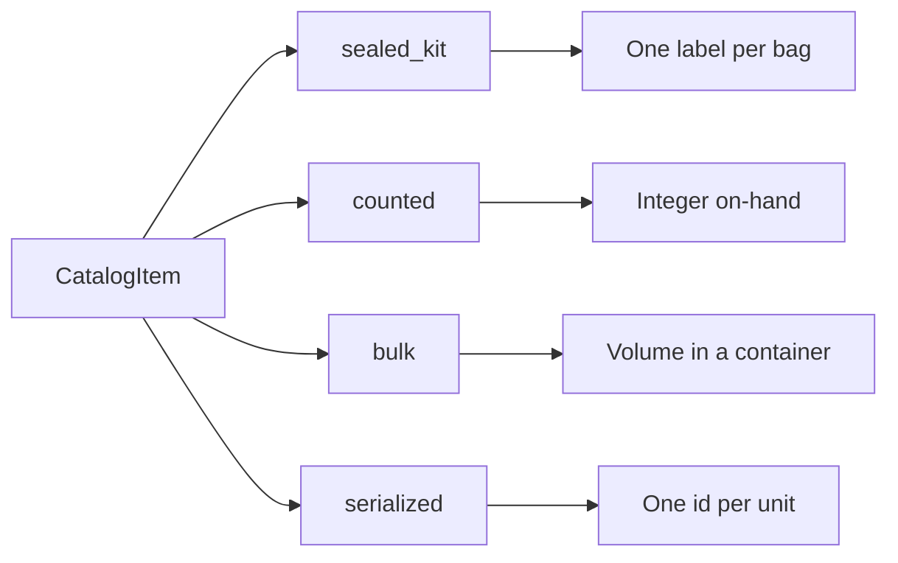
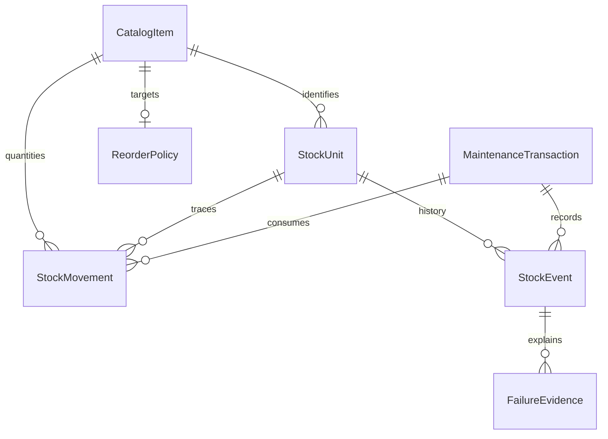

# Inventory specification

Status: documentation only. This is the stack-agnostic contract for race-team inventory and for the stock a completed maintenance transaction consumes.

Vehicle and use: one-car team, 2004 Nissan 350Z, NASA and SCCA road-course events. The inventory covers consumables and spares. Wheel studs are one catalog item in that inventory, not the whole model. Snapped wheel studs remain a known safety-critical failure mode. Records start empty. Historical maintenance is not invented to fill the system.

Sources: `PROJECT_HANDOFF.md` and `README.md`. Owner decisions dated 2026-10-25 are cited as Owner decision, 2026-10-25. Where a fact is still missing, the value is **UNKNOWN** or **admin-set**. UNKNOWN means the team must supply it from a verified source. It does not mean zero, and it does not mean healthy. Admin-set means the stored value exists only after an admin enters it. This spec does not ship a placeholder.

This file does not choose a language, database, host, or migration tool. Phase 1 maps the logical types below onto whatever stack it selects. Race Backend validates and commits maintenance and inventory writes. It must implement [Consumption](#9-consumption). This document does not implement that contract.

## 1. Scope

In scope for the whole document:

- Catalog items for race consumables and spares, and the stock units those items need.
- An append-only ledger. On-hand is derived from it.
- Reorder policy and the reorder warning.
- The all-or-nothing commit that consumes stock only with a completed maintenance transaction.
- Suppliers, purchase notes, purchase orders, quarantine, and forecasting, labeled Phase 2+ below.

Phase 1 is the general catalog, the ledger (`receive`, `consume`, `adjust`, `return`), consumption, and the reorder warning. `Supplier`, `PurchaseNote`, `PurchaseOrder`, `PurchaseOrderLine`, receipt-from-PO, quarantine, and forecasting are Phase 2+. They stay in this document so a later phase does not invent them. `StockReservation` is not in Phase 1. No stock in Phase 1 may go negative. There is no exception path.

Out of scope:

- Application code, schema migrations, and stack selection.
- Approved replacement intervals, torque, inspection limits, lifetimes, and heat-cycle limits.
- A full service-rule catalog. Rules are referenced only where a commit must read them.
- The offline sync protocol. Stable ids and idempotency are specified so a future queue can replay a commit.
- User-account storage. Actors are `user_id` values. Creating a user, logging in, and logging out are still recorded in `AuditEvent`.
- Certifying that the car is safe to race. Software status is a record, not a certification.

## 2. How to read this document

- **MUST** and **MUST NOT** are requirements on Race Backend and on any schema Phase 1 aligns to this contract.
- **MAY** is an allowed behavior.

| Type | Meaning |
| --- | --- |
| `id` | Stable identifier. Unique inside its entity. Immutable. Generation is an implementation choice, except where a wheel-stud bag id is the bag's one label. An `id` is never a catalog part number. |
| `ref(X)` | Reference to `X`'s id. The target must exist when the row commits, unless the field is optional and empty. |
| `string` | Short text. |
| `text` | Long text. |
| `integer` | Whole number. |
| `decimal` | Exact decimal quantity. Scale is admin-set per unit, not a default. |
| `boolean` | True or false. |
| `timestamp` | Instant with a timezone. |
| `date` | Civil date, with no time of day. |
| `enum(...)` | One of the named values. |

| Mark | Meaning |
| --- | --- |
| R | Required on every persisted row of that entity. |
| O | Optional. Empty means unknown or not applicable, never a fabricated default. |
| C | Required only when the constraint says so. |
| D | Derived. Not an editable source of truth. |

Column defaults that invent a quantity are forbidden. Minimum stock, desired stock, numeric lead time, order quantity, container capacity, pack size, and on-hand have no numeric default. Empty policy is `null`, and `null` is not `0`. A stored `0` is allowed only when a person records zero, when a consume brings a measured container to empty, or when a wheel-stud `scrap` of an already-installed bag records `quantity_delta` 0. That last 0 is not an on-hand default.

No field in this specification is pre-filled with a part number, a brand, a supplier name, a reorder number, a capacity, a lifetime, a heat-cycle limit, a numeric lead time, an interval, or a torque. The only numeric stock targets in this file are the wheel-stud spare target and inclusive warning in [Reorder](#10-reorder). They apply only to that catalog item.

## 3. Prototype boundary

`index.html` is a throwaway local prototype. It is not a schema to extend.

- One editable `qty` on one row is not the ledger. Sealed bags are one row per bag. Counted items and bulk fluids take their on-hand from the ledger fold.
- Catalog identity and stock identity are different.
- Adding stock overwrites a quantity in the prototype. Production appends a movement.
- The form's numeric reorder default is not team policy and must not become a column default.
- Browser local storage, including the demo seed, is not production stock. Production starts empty.

## 4. Categories

These categories are the inventory this spec covers. Each row an admin creates uses one `tracking_class`. The class is not a license to invent how the part is sold.

| Category | `tracking_class` | What is tracked |
| --- | --- | --- |
| `wheel_stud` | `sealed_kit` | One labeled bag. The instance rules are [Wheel studs](#11-wheel-studs). |
| `brake_pad` | `counted` | Discrete units. Whether the unit is one pad or a set is admin-set. |
| `brake_rotor` | `counted` | Discrete rotors. |
| `filter` | `counted` | Discrete filters. |
| `spare` | `counted` | Other discrete spares the team stocks. The part itself is admin-set. |
| `brake_fluid` | `bulk` | Volume in a container. |
| `engine_oil` | `bulk` | Volume in a container. |
| `other_fluid` | `bulk` | Coolant, gear oil, differential oil, and other fluids. Which fluid is the catalog description, admin-set. |
| `tire` | `serialized` | One tire, or a set of tires when the team records a group id. |
| `other` | admin-set | Any class in [Tracking classes](#5-tracking-classes). The choice is stored on the row. |

No category in this table has a part number, brand, size, compound, viscosity, pad compound, rotor diameter, tire size, filter number, or change interval. Those stay blank until an admin enters a real value, or UNKNOWN until a verified source exists.

## 5. Tracking classes

### 5.1 `sealed_kit`

One physical bag or kit. The unit id is its single label. There is no second label and no per-piece id inside the bag.

| Fact | Rule |
| --- | --- |
| Identity | `StockUnit.stock_unit_id` is the label. Receive requires it. A missing label rejects the receive. Do not mint a second id. |
| Pack size | `nominal_set_size` is admin-set. It is packaging, not a second on-hand count, and it does not create one row per piece. It must not default to 5. Wheel studs are the exception: 5, in [Wheel studs](#11-wheel-studs). |
| On-hand | Count of units in `sealed`. |
| Consume | One whole unit, only inside a committed maintenance transaction. A partial bag is rejected. |
| States | `sealed`, `installed`, `scrapped`. Phase 2+ may add `quarantined`. |

### 5.2 `counted`

Fungible discrete items. Pads, rotors, filters, and common spares use this class. They do not each need a label.

| Fact | Rule |
| --- | --- |
| Identity | The catalog item. No per-piece row is required. |
| Quantity | Integer. The unit name (`unit_code`) is admin-set. It may mean one piece or one set. The number of pieces inside a set is admin-set and may be null. Null is not 1 and not 5. |
| On-hand | Sum of integer `quantity_delta` for that catalog item. |
| Consume | A positive integer, only inside a committed maintenance transaction. A fraction is rejected. |
| Partial | Not allowed. The team consumes whole units of whatever `unit_code` they stored. |

### 5.3 `bulk`

Fluids measured by volume. Brake fluid, engine oil, coolant, gear oil, and differential oil use this class.

| Fact | Rule |
| --- | --- |
| Identity | One container is one `StockUnit`. The container id is the label on that container when it has one. A missing label does not invent a fill volume. |
| Unit | `unit_code` is required, admin-set text such as the team's word for the volume unit. This spec stores no conversion and no preferred unit. |
| Capacity | `capacity` is optional. Null means UNKNOWN. It must not be inferred from the unit name or from a catalog description. |
| On-hand | Sum of `quantity_delta` for that catalog item and that `unit_code`. Quantities in different unit codes are not added. |
| Container state | `sealed`, `opened`, or `empty`. |
| Sealed | Remaining quantity is the quantity received. A sealed container is not partly consumed. |
| Opened | The team may consume a partial quantity. The consume records the amount taken. Remaining is the prior remaining minus that amount. |
| Empty | Remaining is 0 because a consume recorded that. Empty is not a default. |
| Unknown capacity | A receive must name the quantity received. If the team does not know it, the receive is rejected. Do not invent a fill volume. |

Opening a sealed container, with no quantity taken, is an audited state change. It sets `opened` and leaves remaining equal to the quantity received. It writes no consume and no adjust. A later consume draws from that remaining quantity.

### 5.4 `serialized`

One physical unit has its own id. Tires use this class. A set of tires is an optional group, not a substitute for the unit the team chose to track.

| Fact | Rule |
| --- | --- |
| Identity | `stock_unit_id` is required. `group_id` is optional. Per tire, per set, or both is admin-set. This spec does not choose. |
| On-hand | Count of units in `in_stock`. |
| States | `in_stock`, `installed`, `retired`. |
| Usage | `usage_count` is optional. `usage_label` is optional text for what that count means, such as heat cycles if the team uses that name. Null means not recorded, not zero. Nothing in this spec increments the tally or stores a limit, lifetime, or maximum. |
| Consume | The named unit, only inside a committed maintenance transaction. |

Retiring a serialized unit removes it from on-hand. It is not the wheel-stud scrap rule. A tire may be returned to `in_stock` by a `return` movement. A scrapped wheel-stud bag may not.

## 6. Identity

These stay distinct.

| Concept | Entity | What it identifies |
| --- | --- | --- |
| Catalog item | `CatalogItem` | The kind of part. Many physical units may share one row. |
| Stock unit | `StockUnit` | One bag, one container, or one serialized unit, when that class has an id. Counted items have no stock-unit row. |
| Movement | `StockMovement` | One append-only change to on-hand. |
| Maintenance | `MaintenanceTransaction` | The job that consumed stock, when stock was consumed. |
| Use record | `StockEvent` | Install or removal of one stock unit, when the class tracks that. |
| Reorder | `ReorderPolicy` | Admin-set targets. Blank until set, except the wheel-stud item. |

A part number is not a stock unit. A quantity is not a list of ids. An installation record does not become a catalog item.

Phase 1 traceability is the movement to its catalog item, and to its stock unit when the class has one. A consume also points at the maintenance transaction. Supplier and purchase-order links are Phase 2+ and optional.

The catalog part number is snapshotted on the consume so a later catalog edit does not rewrite history.

## 7. Entities and fields

Actor ids point at the authentication system. This specification does not define the user table. A client-supplied on-hand quantity is ignored.

### 7.1 `CatalogItem`

| Field | Type | Req | Constraints | Meaning |
| --- | --- | --- | --- | --- |
| `catalog_item_id` | id | R | Immutable, unique. | Not the part number. |
| `category` | enum | R | See [Categories](#4-categories). | Which kind of consumable. |
| `tracking_class` | enum | R | Must be the class that category uses. `other` stores the admin's choice. | How stock identity works. |
| `part_number` | string | O | Null until an admin enters the real number. Must not be only the manufacturer name. | Part number. |
| `manufacturer` | string | O | Admin-set. The wheel-stud value is `ARP`. | Brand. Not a part number. |
| `description` | string | R | Non-empty. The wheel-stud value is `extended studs`. Other descriptions are admin-set. | What the team calls it. |
| `revision` | string | C | Required when `part_number` is set. Otherwise null. Do not invent one. | Revision. |
| `profile` | enum | R | `wheel_stud_set` or `none`. Category `wheel_stud` must use `wheel_stud_set`. | Applies [Wheel studs](#11-wheel-studs) when set. |
| `nominal_set_size` | integer | C | Required for `sealed_kit`. Immutable. Must be 5 when profile is `wheel_stud_set`. Otherwise admin-set, never defaulted to 5. | Pieces in one sealed unit. Not an on-hand count. |
| `unit_code` | string | C | Required for `bulk` and `counted`. Admin-set. No conversion table. | The team's unit word. |
| `pieces_per_unit` | integer | O | Admin-set. Null means the unit is not broken into pieces here. Not 5 unless an admin enters 5 for that item. | Pieces inside one counted unit, when the team tracks that. |
| `safety_critical` | boolean | R | No default. The wheel-stud profile must be true. Other items are explicit admin choices. | Whether this kind of part is safety-critical. |
| `status` | enum | R | `draft`, `approved`, `retired`. `approved` requires `part_number` and `approval_source`. | Approval. |
| `approval_source` | string | C | Required before `approved`. Not a substitute for `part_number`. | Why this part number is approved. |
| `lead_time_text` | string | O | Admin-editable words. Null until set, except the wheel-stud item may store `a few days`. Not a number. Must not be parsed. | Lead time in words. |
| `notes` | text | O | | |
| `created_at` | timestamp | R | Server time. | |
| `created_by` | ref(user) | R | | |

Only an `approved` catalog item may be received or consumed. Do not invent part numbers, brands, or approval sources. Cross-item substitution is rejected unless a later verified source says two part numbers are interchangeable. None is recorded here.

### 7.2 `StockUnit`

Present for `sealed_kit`, `bulk`, and `serialized`. Absent for `counted`.

| Field | Type | Req | Constraints | Meaning |
| --- | --- | --- | --- | --- |
| `stock_unit_id` | id | R | Immutable, unique. For `sealed_kit`, the single label. | Unit id. |
| `catalog_item_id` | ref(CatalogItem) | R | Immutable. Approved at receive. | Part type. |
| `tracking_class` | enum | R | Copied from the catalog item. | |
| `state` | enum | R | See the class. Changes only through committed movements or events. | |
| `group_id` | id | O | Serialized only. A set of units, when the team records one. | Optional grouping. |
| `quantity_remaining` | decimal | C | Required for `bulk`. Matches `unit_code`. Never negative. | What is left in the container. |
| `capacity` | decimal | O | Bulk only. Null means UNKNOWN. | Stated capacity, if the team has one. |
| `unit_code` | string | C | Required for `bulk`. Same code as the catalog item. | |
| `usage_count` | integer | O | Serialized only. Null means not recorded. Must not default to 0. No maximum in this spec. | Optional usage tally. |
| `usage_label` | string | O | Serialized only. Admin-set name for `usage_count`. | What the tally means. |
| `location_id` | ref(Location) | O | Names are admin-set. | Where it is stored. |
| `supplier_id` | ref(Supplier) | O | Optional. `Supplier` is Phase 2+. | |
| `received_at` | timestamp | R | Server time of the receive. | |
| `notes` | text | O | | |

### 7.3 `StockMovement`

Append-only. A mistake is a new movement. Restore does not overwrite or destroy these rows. See [Restore](#132-restore).

| Field | Type | Req | Constraints | Meaning |
| --- | --- | --- | --- | --- |
| `movement_id` | id | R | Immutable, unique. | |
| `idempotency_key` | string | R | Unique among movements. | Replay key. |
| `movement_type` | enum | R | `receive`, `consume`, `adjust`, `return`. `scrap` is allowed only for a wheel-stud bag. | |
| `catalog_item_id` | ref(CatalogItem) | R | | |
| `stock_unit_id` | ref(StockUnit) | C | Required for `sealed_kit`, `bulk`, and `serialized`. Empty for `counted`. | |
| `quantity_delta` | decimal | R | Non-zero except a wheel-stud `scrap` of a bag that is already `installed`, which is 0. Integer for `counted` and `sealed_kit`. Sign is specified in [Ledger](#8-ledger). | Change in on-hand. |
| `unit_code` | string | C | Required when the catalog item has a unit code. | Unit of `quantity_delta`. |
| `actor_user_id` | ref(user) | R | Authenticated server principal. | Who. |
| `occurred_at` | timestamp | R | Server commit time. | When. |
| `reason_code` | string | R | Non-empty. | Why, short. |
| `reason_text` | text | R | Non-empty. | Why, in words. |
| `maintenance_transaction_id` | ref(MaintenanceTransaction) | C | Required for `consume`. Required for `scrap` and `return` when that movement is part of a maintenance commit. Empty for `receive` and `adjust`. Empty when an admin scraps an unused sealed bag, or posts a return outside a job. | Job, when the movement belongs to one. |
| `supplier_id` | ref(Supplier) | O | Optional on `receive`. | |
| `related_movement_id` | ref(StockMovement) | O | Prior movement this one corrects. The prior row stays. | |

`adjust` and `return` require a reason. They are not a silent edit. They do not reset a service baseline.

### 7.4 `MaintenanceTransaction`

A draft stores no movements and no stock-unit state changes. A rejected row may be stored and also stores none.

| Field | Type | Req | Constraints | Meaning |
| --- | --- | --- | --- | --- |
| `transaction_id` | id | R | Immutable, unique. | |
| `idempotency_key` | string | R | Unique among maintenance transactions. | |
| `kind` | enum | R | `consumption`, `replacement`, `inspection`, `removal_without_install`, `opening_identification`. | |
| `status` | enum | R | `draft`, `committed`, `rejected`. | |
| `committed_by_user_id` | ref(user) | R | Stored even when the technician is the same person. | Committing user. |
| `technician_user_id` | ref(user) | R | Defaults to `committed_by_user_id` when omitted. Remains its own field. | Technician. |
| `performed_at` | timestamp | C | Required on a committed consumption, replacement, or removal. Entered by the user. Not later than server commit time. Calendar intervals use this instant. | When the work was performed. |
| `backdated` | boolean | D | True when `performed_at` is earlier than server commit time. The audit row records that. | Backdated entry. |
| `vehicle_id` | ref(Vehicle) | R | | |
| `measurements_requirement` | string | C | Required when the commit consumes stock or is a wheel-stud replacement. The value `none required`, or a non-empty set of captures. Null or omitted is `not stated` and fails the commit. `none required` is not a measurement and not a torque. | Whether measurements were required. |
| `signoffs_requirement` | string | C | Same rule as measurements. `none required` is not a sign-off. | Whether sign-offs were required. |
| `committed_at` | timestamp | C | Required when committed. Same server instant as the audit row. | Server time. |
| `rejection_reason` | text | C | Required when rejected. | |
| `created_at` | timestamp | R | | |

`replacement`, `removal_without_install`, and `opening_identification` are the wheel-stud jobs in [Wheel studs](#11-wheel-studs). Other consumables use `consumption` or `inspection`. An inspection consumes nothing and writes no baseline.

### 7.5 `StockEvent`

An install or a removal of one stock unit. Counted quantities and bulk draws do not need one unless the team is recording a unit's install. Wheel-stud bags do.

| Field | Type | Req | Constraints | Meaning |
| --- | --- | --- | --- | --- |
| `stock_event_id` | id | R | Immutable, unique. | |
| `maintenance_transaction_id` | ref(MaintenanceTransaction) | R | A committed job. A draft owns none. An inspection owns none. | |
| `stock_unit_id` | ref(StockUnit) | C | Required when the unit has a label. Null only for a wheel-stud set of unknown history. | |
| `history_unknown` | boolean | R | True only when `stock_unit_id` is null. | Prior life was not recorded. |
| `catalog_item_id` | ref(CatalogItem) | C | Snapshot when known. | |
| `vehicle_id` | ref(Vehicle) | R | | |
| `event_kind` | enum | R | `installation` or `removal`. | |
| `wheel_corner` | enum | C | Required on every wheel-stud stock event, including unknown history. `LF`, `RF`, `LR`, or `RR`. Omitting it fails closed. | Corner. |
| `position_note` | string | O | Admin-set position text for other parts. Not a stud hole. | |
| `removal_reason_code` | enum | C | Required on removal. `failure` or `other`. Further codes are UNKNOWN. | |
| `removal_reason_detail` | text | C | Required on removal. Non-empty. | |
| `disposition` | enum | C | Required on removal. Wheel studs: `scrapped` only. Any other value, including `reused`, is rejected for a wheel-stud bag. Other parts use an admin-set code. Putting stock back is a `return` movement, not a `reused` disposition. | |
| `occurred_at` | timestamp | R | Server commit time. | |
| `performed_at` | timestamp | C | Snapshot from the parent when present. | |
| `committed_by_user_id` | ref(user) | R | Snapshot. | |
| `technician_user_id` | ref(user) | R | Snapshot. | |

### 7.6 `FailureEvidence`

Attached to a removal whose reason is `failure`. It is not an inventory item.

| Field | Type | Req | Constraints | Meaning |
| --- | --- | --- | --- | --- |
| `evidence_id` | id | R | Immutable, unique. | |
| `stock_event_id` | ref(StockEvent) | R | The removal. | |
| `stud_hole_index` | integer | O | Wheel-stud failures only. 1 through 5 when the team records which hole broke. Omission is valid. Not a stock id. Do not invent it. | Which position broke. |
| `kind` | enum | R | `photograph`, `measurement`, `written_observation`, `other`. | |
| `storage_reference` | string | R | Non-empty locator. The store is an implementation choice. | |
| `description` | text | R | What was observed. Not a guessed cause. | |
| `captured_at` | timestamp | R | | |
| `captured_by` | ref(user) | R | | |

A wheel-stud removal with reason `failure` requires at least one evidence row in the same commit. How much evidence other parts require is admin-set. This spec states no extra minimum.

### 7.7 `ReorderPolicy`

One policy per catalog item. Every quantity is null until an admin sets it, except the wheel-stud item in [Reorder](#10-reorder).

| Field | Type | Req | Constraints | Meaning |
| --- | --- | --- | --- | --- |
| `reorder_policy_id` | id | R | | |
| `catalog_item_id` | ref(CatalogItem) | R | Unique among policies. | |
| `min_stock` | decimal | O | Null until set. Integer when the class is not `bulk`. | Minimum, when the team defines one. |
| `desired_stock` | decimal | O | Null until set, except wheel studs. | Desired on-hand. |
| `warning_threshold` | decimal | O | Null until set, except wheel studs. | Warn at or below this on-hand. |
| `unit_code` | string | C | Required when any quantity is set. Same code as the catalog item when that item has one. For wheel studs the unit is a sealed bag. | |
| `updated_at` | timestamp | R | | |
| `updated_by` | ref(user) | R | Admin. | |

### 7.8 `Vehicle`, `Location`, `ServiceBaseline`, `AuditEvent`

`Vehicle` is one car: 2004 Nissan 350Z. VIN and competition number are UNKNOWN. Do not invent them.

`Location` has an admin-set name and a kind `shop`, `transport`, `event`, or `other`. Names are UNKNOWN until entered.

`ServiceBaseline` is append-only. It is written only inside a committed consumption or wheel-stud replacement that cites an approved rule whose interval came from a verified source. No such interval is in this spec. Calendar comparisons use the parent's `performed_at`. `completed_at` is the server commit time. While the interval is UNKNOWN, the commit writes no baseline and does not claim a reset. The stock movements still commit with the maintenance record, or not at all.

`AuditEvent` is the main audit table. `at` is server time. It records catalog and reorder edits, maintenance commits, user creation, login, logout, and restore. A maintenance commit's user-entered `performed_at` stays on the transaction. When `performed_at` is earlier than `at`, the audit row says the entry is backdated.

| Field | Type | Req | Constraints | Meaning |
| --- | --- | --- | --- | --- |
| `audit_id` | id | R | | |
| `entity_type` | string | R | | |
| `entity_id` | id | R | | |
| `action` | string | R | | |
| `actor_user_id` | ref(user) | R | | |
| `at` | timestamp | R | Server time. | |
| `reason` | text | O | Required for a restore. | |
| `archive_reference` | string | C | Required on a restore. Locator of the archived database file. The file is never deleted. Do not invent a path. | |

Audit rows are append-only. Restore does not overwrite or destroy them.

### 7.9 Phase 2+ records

Not built in Phase 1. A Phase 1 `receive` does not require them.

- `Supplier`. Optional reference from a receive. `lead_time_text` may hold `a few days` when the row exists. `nominal_lead_time_days` stays null until an admin enters a number. Do not parse the words. Do not default the number to 0.
- `PurchaseNote`, `PurchaseOrder`, `PurchaseOrderLine`, and receipt-from-PO.
- Quarantine of a stock unit, and release back to its prior state.
- Forecasting. A forecast is an estimate, not a guarantee, and not a safety certification. It must not turn `a few days` into a number of days, and it must not treat missing history as zero demand.

`AuthorizedStockException` is not a Phase 1 path. Wheel-stud stock never has an exception path. Phase 1 rejects every movement that would take any on-hand below zero.

## 8. Ledger

Committed movements are the source of truth. Stock-unit state is a projection updated in the same commit. Readers see the state before a commit or the state after it.

| Type | `quantity_delta` | Who | Effect |
| --- | --- | --- | --- |
| `receive` | Positive. One sealed bag is +1. | Admin | New stock. Several sealed bags are several stock units, not one unit with quantity greater than 1. Counted stock adds an integer. A bulk receive names the quantity and creates one container in `sealed`. A serialized receive creates one unit in `in_stock`. |
| `consume` | Negative. One sealed bag or one serialized unit is -1. | The maintenance commit | Removes the consumed amount from on-hand. |
| `adjust` | Non-zero, either sign. | Admin | A correction with a reason. Not a consume and not an install. |
| `return` | Positive. | Admin, or the maintenance commit when a unit comes back off the car | Puts stock back. |
| `scrap` | -1 if the wheel-stud bag was `sealed`, else 0. | The stud removal, or an admin scrapping an unused bag | Wheel-stud bags only. End state `scrapped`. |

On-hand by class:

| Class | On-hand |
| --- | --- |
| `sealed_kit` | Units in `sealed`. Installed and scrapped add zero. |
| `counted` | Sum of `quantity_delta`. |
| `bulk` | Sum of `quantity_delta` for one `unit_code`. |
| `serialized` | Units in `in_stock`. |

A movement that would take any of those figures below zero is rejected. Nothing is partially applied. There is no exception record.

`adjust` cannot split a sealed bag into pieces, cannot change `nominal_set_size`, and cannot create a per-stud count. `return` cannot put a `scrapped` wheel-stud bag back into `sealed` or `installed`.

Idempotency: the same key and the same request hash return the original result and apply nothing again. The same key with a different hash is a conflict. A crash leaves either the full commit or no effects.

Two commits that touch the same stock unit or the same counted catalog item behave as if they ran one after the other. The loser rolls back completely.

## 9. Consumption

A successful stock-consuming job persists one bundle, or none of it:

1. `MaintenanceTransaction` with `status = committed`.
2. The `StockMovement` rows for every consume in the job.
3. Stock-unit state changes those movements require.
4. `StockEvent` rows when a unit is installed or removed.
5. `FailureEvidence` when a wheel-stud removal reason is `failure`.
6. A `ServiceBaseline` only when a verified interval exists.
7. An `AuditEvent` whose `at` is the server time.

Validation runs before any of that is visible. If any line fails, the commit is rejected and stock is unchanged. Opening a form or saving a draft is not a commit.

Checked for every consuming commit:

1. The actor is authenticated and may complete maintenance. The request does not change reorder policy or catalog approval.
2. The idempotency key is present. A replay returns the original result.
3. Every catalog item is `approved`.
4. Quantities match the tracking class. No fraction of a counted unit. No partial sealed bag. Bulk draws do not exceed remaining quantity.
5. The result would not be negative.
6. `measurements_requirement` and `signoffs_requirement` are each `none required` or real captures. `not stated` fails closed. `none required` does not invent a torque, a limit, or a passing inspection.
7. `performed_at` is present and not in the future. `technician_user_id` is present and defaults to the committing user. Both user ids are stored.
8. Wheel-stud lines also pass [Wheel studs](#11-wheel-studs).

One transaction may consume more than one category, for example a filter and oil. One failure rejects the whole transaction. No line is consumed.

`receive` does not reset a baseline. `inspection` does not consume and does not reset a baseline.

## 10. Reorder

Phase 1 computes a warning from on-hand and `ReorderPolicy`. It does not create movements or purchase orders.

For every catalog item except the wheel-stud item, `desired_stock`, `warning_threshold`, and `min_stock` stay null until an admin sets them. A null threshold means the policy is incomplete. Incomplete is not an all-clear.

When a threshold is set, `reorder_warning` is on when on-hand is less than or equal to `warning_threshold`. The comparison is inclusive.

Wheel studs, Owner decision, 2026-10-25: `desired_stock` is 4 and `warning_threshold` is 4, in sealed bags. The warning is on at 4 and at every lower count. Installed and scrapped bags do not count. `min_stock` stays null. Do not copy 4 onto other categories. Do not change the inclusive comparison to a strict less-than.

The warning does not use lead time. The words `a few days` are not a number of days.

## 11. Wheel studs

This section is the instance. It does not add pack sizes, brands, or intervals for other parts. The safety rules below stay in force.

Owner decision, 2026-10-25, including the later clarification that the bag is labeled and the studs are not:

- The catalog row is manufacturer `ARP`, description `extended studs`. `part_number` stays null until an admin enters the real number. `ARP` is not a part number. The row is not approved, and cannot be consumed, until an admin has entered both the part number and the approval source.
- `tracking_class` is `sealed_kit`. `nominal_set_size` is 5. That 5 is packaging, not a per-stud inventory count, and not a service interval or a torque.
- One bag, one label, and the label is `stock_unit_id`. No per-stud id, label, component, manufacturer mark, or team-assigned stud id. Do not create five rows because the bag contains five studs.
- States are `sealed`, `installed`, and `scrapped`. There is no opened state and no loose-stud count. The replacement commit takes the bag from `sealed` to `installed`.
- A hub replacement installs one sealed bag on one corner, `LF`, `RF`, `LR`, or `RR`. Bags are never mixed on a hub. A partial bag is rejected. The bag ends `installed`.
- If that corner already has an installed bag, or an unknown-history set with no later removal, this same commit removes and scraps that set. If the corner is occupied and the commit omits that removal, the commit is rejected and nothing is consumed. Do not invent a removal for a corner that has no recorded set.
- A transaction may name more than one corner. Each corner needs its own whole sealed bag. One failure rejects the bundle.
- A removed bag's only disposition is `scrapped`. `reused` is not a disposition. There is no path back to `sealed` or `installed`. `return` cannot restore it. Loose studs never exist.
- Which hole broke is optional `stud_hole_index` 1 through 5 on that set's `FailureEvidence` only. A failure removal requires one evidence row in the same commit. Further evidence requirements, and further removal-reason codes, are UNKNOWN.
- `removal_without_install` scraps the recorded set, writes no consume and no baseline, creates no bag when history is unknown, and is not permission to install a partial bag later.
- Sets already on the car at startup are one `opening_identification` per corner the team actually identifies: unknown history, no stock unit id, no invented label, date, reading, procedure, or baseline, no stud rows, and no consume. A later replacement scraps that recorded set and installs one new bag.
- Sealed bags on hand warn at 4 or fewer, including 4. See [Reorder](#10-reorder).
- The replacement interval and its thresholds stay UNKNOWN pending `docs/research/wheel-studs.md`. Do not copy numbers from that file. No baseline is written from a guessed interval.

Those checks run inside [Consumption](#9-consumption). A failed check consumes nothing and writes no baseline.

## 12. Purchasing and forecasting

Phase 2+. Not in Phase 1.

Phase 1 stock entry is a `receive` movement. It does not require a supplier, a purchase note, a purchase order, or a receipt. A supplier reference on the movement is optional.

Lead time, Owner decision, 2026-10-25: the words `a few days` may be stored on the wheel-stud catalog item in Phase 1, or on a Phase 2 supplier row. Either place is text. Neither is parsed into a day count. Other catalog items leave `lead_time_text` null until an admin sets it. Numeric day fields stay null until an admin enters a number. Null is not 0.

Forecasts, if a later phase builds them, are estimates. They are not a guarantee and not a certification that the car is safe to race. They do not write movements.

## 13. Permissions, audit, and retention

Admin, enforced on the server, is required to approve a catalog item, edit reorder policy, receive stock, adjust stock, return stock, and scrap an unused wheel-stud bag. Only an Admin can close a critical defect. **default, adjustable by team policy.** A race-day user cannot close one until a later policy says otherwise.

Race-day, enforced on the server, may submit drafts and the consuming maintenance transaction, including a wheel-stud corner replacement, and may record `opening_identification` and `removal_without_install`. Those records must not invent history and must not install a partial bag. Race-day must not change intervals, reorder numbers, or catalog approval, and must not post `adjust`.

Permanent history: `StockMovement`, `StockEvent`, `FailureEvidence` metadata, `ServiceBaseline`, `AuditEvent`, and stock-unit identity rows. Those rows are not deleted or rewritten in normal operation. How long the binary files behind `storage_reference` are kept is UNKNOWN.

### 13.1 Accounts

User creation, login, and logout are recorded in `AuditEvent`. Each row stores the actor and the server time. This spec does not define passwords or the user table.

### 13.2 Restore

Restore only ever goes into an empty instance. The restore API refuses when the store is not empty and fails closed: it writes nothing and deletes nothing.

Disaster recovery is a CLI command, in this order:

1. Snapshot the current database.
2. Move the existing database aside to an archived file. That file is never deleted.
3. Restore into a fresh, empty store.
4. Write a restore `AuditEvent` on that store. `archive_reference` points at the archived file. The row records the actor, the server time, and a reason.

Ledger rows and audit history are not overwritten and not destroyed. The history that was on the previous store stays in the archive. Restore is not a way to correct one baseline or one movement.

Production data starts empty. Do not import the prototype's local storage seed, demo quantity, or demo reorder value.

## 14. Invariant index

1. Catalog item, stock unit, movement, and maintenance transaction are different rows. A wheel stud is not its own row.
2. Only an approved catalog item is received or consumed. Approval requires a part number and an approval source. `ARP` is the wheel-stud manufacturer, not the part number.
3. On-hand is the ledger fold for that tracking class. It is not an editable column.
4. `consume` exists only on a committed maintenance transaction. The transaction's movements commit together or not at all.
5. On-hand does not go negative. Phase 1 has no exception path. Wheel-stud stock never has one.
6. `adjust` and `return` append a movement. They do not rewrite history. A scrapped wheel-stud bag is not returned to stock.
7. Reorder quantities are admin-set, except the wheel-stud desired stock of 4 and inclusive warning threshold of 4, counted in sealed bags only.
8. No interval, torque, lifetime, heat-cycle limit, capacity, pack size, part number, or brand is shipped as a verified value, other than the documented wheel-stud manufacturer, description, bag of five, and spare target of 4.
9. The ledger and the audit table are append-only. Restore archives the previous database and does not destroy it.
10. Replaying an idempotency key does not apply a commit twice.

## 15. Open questions

These are admin-set or UNKNOWN. They are not per-category research lists. Do not fill them with invented values.

1. **Part numbers, brands, descriptions, and approval sources** for every catalog row except the wheel-stud manufacturer `ARP` and description `extended studs`. Admin-set. The wheel-stud part number is still blank.
2. **Reorder numbers** for every item except the wheel-stud sealed-bag target of 4 and inclusive warning of 4. Admin-set. A blank policy is incomplete, not healthy.
3. **Unit words, pieces per counted unit, and bulk capacities.** Admin-set. A blank capacity is UNKNOWN. Do not copy the stud bag of 5 onto other parts.
4. **Tire identity and usage.** Per tire, per set, or both is admin-set. The usage tally and any limit are admin-set. No heat-cycle limit is specified.
5. **Service intervals, torque, inspection limits, and lifetimes** for every category. UNKNOWN until a verified source. The stud interval file is `docs/research/wheel-studs.md`. Do not copy numbers from it. No baseline is written from a guess.
6. **What a consuming job must capture** beyond the explicit statement `none required`. Admin-set per rule. `not stated` still fails closed.
7. **Suppliers, prices, and lot codes.** UNKNOWN. Suppliers and purchase orders are Phase 2+. Numeric lead time stays null. `a few days` is not parsed.
8. **VIN, competition number, and storage location names.** UNKNOWN.

## 16. Decisions for Phase 1

These are normative. They do not invent part numbers, brands, reorder points, capacities, intervals, torques, lifetimes, or heat-cycle limits.

1. **Catalog and ledger.** Phase 1 stores `CatalogItem`, the stock units each tracking class needs, `StockMovement` (`receive`, `consume`, `adjust`, `return`, plus `scrap` for wheel-stud bags), idempotency, the all-or-nothing maintenance consume, and `ReorderPolicy` with its warning.
2. **Phase 2+.** `Supplier`, `PurchaseNote`, `PurchaseOrder`, `PurchaseOrderLine`, receipt-from-PO, quarantine, and forecasting. A receive does not need them. A supplier reference is optional.
3. **No negative stock.** Any class. No exception path in Phase 1. Wheel studs never have one.
4. **Wheel-stud bag.** The rules in [Wheel studs](#11-wheel-studs) remain. One label per bag. Full set of five on a hub, never mixed. A removed bag is scrapped and never reused. Occupied-corner removal is in the same commit. The hole number exists only on failure evidence.
5. **Reorder.** Only the wheel-stud item has numbers in this spec: desired 4, warning at 4 or fewer, sealed bags only. Every other policy stays blank until an admin sets it.
6. **Technician and time.** `technician_user_id` defaults to the committing user. Both are stored. `performed_at` is user-entered, never in the future, and drives calendar intervals. Server time is `AuditEvent.at`.
7. **Measurements and sign-offs.** `none required` is an explicit value. `not stated` fails closed.
8. **Critical defects.** Only an Admin can close one. **default, adjustable by team policy.**
9. **Restore.** Empty instance only. The API fails closed on a non-empty store. The CLI snapshots, archives without deleting, restores into a fresh store, and writes an audit row that points at the archive.
10. **Accounts.** User creation, login, and logout are recorded in `AuditEvent`.
